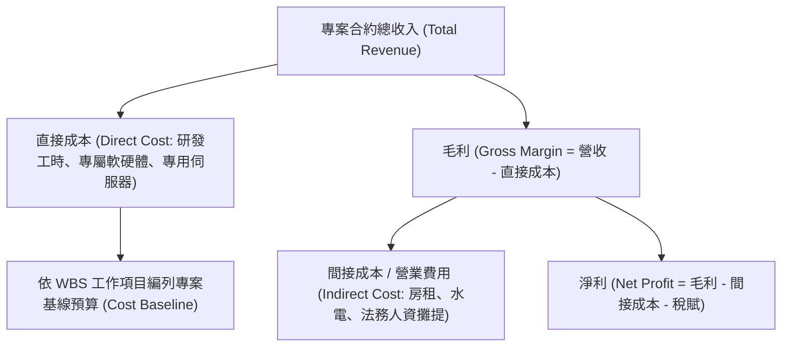

# 🎙️ 專案管理實務：專案成本管理、直接成本 vs. 間接成本與預算編列技術 (授課講師 / 學員)

> **課程主題**：專案成本管理（Cost Management）、直接成本／間接成本拆解、毛利率計算與預算編列  
> **授課教授**：授課講師（專案管理授課教授）  
> **核心模組**：Project Cost Estimation, Direct & Indirect Costs, Gross Margin, WBS Costing  
> **學習目標**：理解專案損益結構、精準拆解執行團隊直接成本與企業營運管銷費用  
> **關聯文件**：[📄 完整原話逐字稿 (2024-10-15-01-直接成本與預算編列-proofread.md)](./20241015-直接成本與預算編列.full.md)

---

## 🏛️ 核心架構與概念流轉圖

---

## 🔑 重點提要 (Key Takeaways)

1. **直接成本 vs. 間接成本**：直接成本是專案不接就不會發生的成本（如專案外包費、專案成員工時）；間接成本是公司日常維持必須分攤的管銷費用。
2. **毛利是專案存亡關鍵**：報價時若只估算直接成本而忽略間接成本分攤與風險準備金，接案愈多虧損愈大。
---

## 💰 專案財務成本結構、WBS 工時預估公式與直接/間接成本分攤表

| 成本維度與財務結構 | 定義範疇與成本科目清單 | 計算公式與分攤機制 | 專案預算編列與利潤防禦策略 |
| :--- | :--- | :--- | :--- |
| **專案直接成本（Direct Costs）** | 專為執行該單一專案所產生之專屬支出，可直接歸屬至專案 WBS 工作包 | 人事研發工時費（$\sum \text{工時} \times \text{時薪}$）、專屬測試設備購置、雲端伺服器專用租賃費及外包模組授權費 | 必須嚴格估算防止範疇蔓延（Scope Creep）導致人月工時暴增，吞噬專案合約利潤 |
| **專案間接成本（Indirect Costs / Overhead）** | 支援多個專案或維持組織日常營運之共用間接費用，無法單獨計入單一專案 | 企業辦公室租金、共用行政人資法務薪資、共用水電網路費及固定資產折舊攤提 | 依據專案直接工時或直接成本比例，按分攤率（Overhead Rate，如直接成本的 20-30%）合理加成編列 |
| **緊急預備金與毛利率控管** | 應對專案突發技術風險與驗收延宕之**應急準備金（Contingency Reserve）**（約 10-15%） | 總專案報價 = 直接成本 + 間接分攤 + 應急準備金 + 目標毛利（Target Margin） | 若未編列不可預見準備金，一旦驗收發生卡關，合約延遲罰款將直接導致專案虧損破產 |
