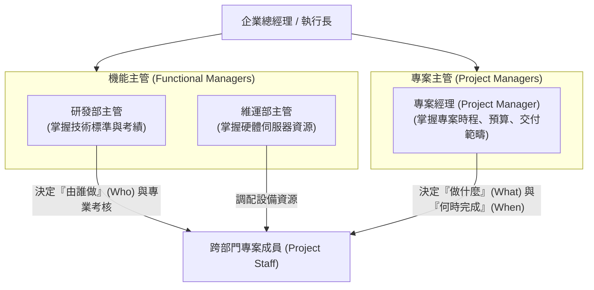

# 🎙️ 專案管理實務：專案角色授權、組織權責劃分與跨部門協調 (授課講師 / 學員)

> **課程主題**：專案治理架構（Project Governance）、角色授權、矩陣型組織權責劃分與跨部門資源協調  
> **授課教授**：授課講師（專案管理授課教授）  
> **核心模組**：Project Governance, Authority Delegation, Matrix Organization, RACI Matrix, Resource Conflict  
> **學習目標**：釐清弱矩陣、平衡矩陣與強矩陣組織中 PM 之授權邊界，建立透明之決策升級與授權層級體系  
> **關聯文件**：[📄 完整原話逐字稿 (2024-11-25-08-角色授權與權責矩陣-proofread.md)](./20241125-01-角色授權與權責矩陣.full.md)

---

## 🏛️ 矩陣型組織架構中專案經理與機能主管權責邊界

---

## 🎯 核心重點整理 (Key Takeaways)

### 1. 專案角色的雙重報告線（Dual Reporting）
- **矩陣型組織挑戰**：專案成員同時向機能主管（Functional Manager）與專案經理（PM）報告，極易產生指令衝突。
- **權限清晰劃分**：PM 主掌專案工作範疇、時程與交付物；機能主管主掌人員專業訓練、薪酬考績與長期職涯分配。

### 2. 授權與責任落實
- **授權層級設計**：專案經理在預算與時程調整上應具備明確的自主核決權限，避免枝微末節的變更皆需向上請示而喪失專案敏捷度。
---

## 📊 機能主管 vs. 專案經理權責邊界、跨部門資源協調與授權矩陣表

| 組織角色與管理維度 | 專案經理（Project Manager, PM） | 機能主管（Functional Manager, FM） | 矩陣型組織跨部門衝突化解機制 |
| :--- | :--- | :--- | :--- |
| **核心職責與考核目標** | 負責專案範疇、時程與成本交付（What & When）；對專案最終成果與客戶驗收全權負責 | 負責部門專業技術標準、人員職涯培訓與資源配置（Who & How）；對部門專業能力負責 | 建立清楚的 **RACI 權責矩陣**（Responsible, Accountable, Consulted, Informed），杜絕灰色地帶 |
| **權限劃分與資源調度** | 掌控專案工作分解（WBS）優先順序與日常任務指派，但不具備組員晉升調薪之絕對考核權 | 掌控部門組員之薪酬評核、考績評定與部門長期專案排程；決定派遣何人支援專案 | 專案啟動時簽署專案章程（Project Charter），明訂 PM 獲得高層贊助者（Sponsor）正式授權 |
| **衝突解決與雙向溝通** | 面對跨部門組員被 FM 臨時調離支援其他緊急業務時，主動以專案關鍵路徑（Critical Path）數據協商 | 理解各部門專業瓶頸，提供備援替代人力方案，共同尋求雙贏（Win-Win）之排程重構 | 避免直接向高層告狀激化對立，以事實與時程影響評估作為跨部門協調之談判籌碼 |
