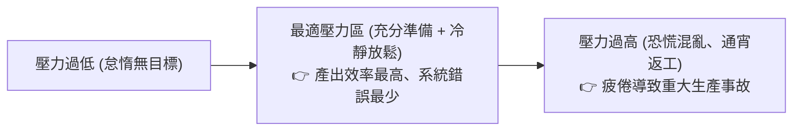

# 🎙️ 專案管理實務：專案團隊心理調適、聯考裝杯標哲學與成果驗收前瞻 (授課講師 / 學員)

> **課程主題**：專案團隊心理調適、驗收前壓力管理、個人專業適性發展與專案交付前預備度檢核  
> **授課教授**：授課講師（專案管理授課教授）  
> **核心模組**：Stress Management, Readiness Review, Career Diversity, Psychological Safety, Final Delivery  
> **學習目標**：掌握專案衝刺收尾期的團隊心理韌性建設，建立上線前的冷靜驗收心態並正確認知多元人才價值  
> **關聯文件**：[📄 完整原話逐字稿 (2024-11-25-09-團隊心理調適與成果驗收-proofread.md)](./20241125-02-團隊心理調適與成果驗收.full.md)

---

## 🏛️ 專案收尾衝刺壓力與心理調適曲線 (Yerkes-Dodson 模型)

---

## 🎯 核心重點整理 (Key Takeaways)

### 1. 充足準備後的「放鬆哲學」
- **聯考裝杯標比喻**：專案上線前最後關頭，最重要的不再是臨時盲目寫新功能，而是「放鬆心情、檢查清單、確保既有架構穩定運作」。慌亂改動往往是生產事故的元凶。
- **心理韌性**：專案經理的從容定見是穩定整個團隊軍心的核心錨點。

### 2. 人才多樣性與實務生存力
- **學業成績 vs. 商業實踐**：會讀書的人適合走純學術或研究型道路；而能在複雜商業環境中賺錢破局的，往往是具備高情商、人脈整合與業務膽識的成員。專案團隊必須包容各具所長的多元人才。
---

## 🧘 專案驗收準備度檢核清單、期末展示演練與團隊心理調適表

| 驗收與衝刺維度 | 實務檢核要點與準備作業 | 團隊抗壓與心理調節哲學 | 專案收尾與成果交付準則 |
| :--- | :--- | :--- | :--- |
| **上線前穩定度實機壓力測試** | 軟硬體整合測試：穿戴式感測手環藍牙傳輸連線、後端 API 伺服器並發負載與資料庫讀寫容錯 | 「充分準備後的從容」：將所有可能發生的展示意外在演練階段預先排查，建立備援展示影片與離線展示模式 | 徹底消除「展示時才第一次連線實機」之致命僥倖心態，確保舞台驗收萬無一失 |
| **多元人才分工與自我認同** | 一個卓越的專案團隊兼具學術理論推演者、軟體系統實作者與對外溝通簡報者 | 不以單一學術成績論英雄；多元思維與實務執行力在真實產業創業中往往更具商業爆發力 | 肯定每位組員之不可替代性，建立心理安全感（Psychological Safety），激發團隊極限潛能 |
| **期末成果展示與驗收收尾** | 準備精準 10 分鐘簡報、實機即時互動展示與評審答辯問答備忘錄（Cheat Sheet） | 面對評審嚴苛質詢時，就事論事說明現有版本實作邊界與未來演進藍圖，展現成熟工程風範 | 交付完整軟體原始碼、部署手冊、測試報告與專案結案總結，圓滿達成學期專案里程碑 |
- **抗壓心法與驗收心態總結**：專案團隊在成果驗收前夕應保持充分的自信與客觀冷靜，將各項壓力測試指標落實為數據清單；唯有在事前做好最嚴格的除錯與備援演練，方能在上線舞台上展現行雲流水之成果展示與專業風範。
