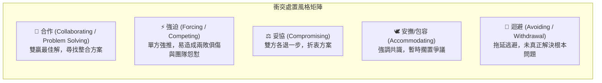

# 🎙️ 專案管理實務：專案衝突解決矩陣、強勢成員處置與實獲值 EVM 控制 (授課講師 / 學員)

> **課程主題**：專案溝通衝突解決模式（Thomas-Kilmann 模型）、破壞性強勢成員處置、事實證據導向與實獲值管理（EVM）動態策略校準  
> **授課教授**：授課講師（專案管理授課教授）  
> **核心模組**：Conflict Resolution, Toxic Experts Handling, Fact-Based Communication, EVM Dynamic Control  
> **學習目標**：精熟專案衝突之五種應對手法，掌握強勢破壞型技術專家之風險隔離備援方案，並透過 EVM 動態調整時程與預算  
> **關聯文件**：[📄 完整原話逐字稿 (2024-11-27-10-衝突解決矩陣與EVM動態控制-proofread.md)](./20241127-01-衝突解決矩陣與EVM動態控制.full.md)

---

## 🏛️ 專案衝突解決五大模式 (Thomas-Kilmann Conflict Mode)

---

## 🎯 核心重點整理 (Key Takeaways)

### 1. 事實與證據導向溝通（Fact-Based）
- **避免情緒化爭執**：專案出現爭議時，PM 應要求雙方拿出客觀數據、測試報告與系統 Log 說話，以事實證據（Evidence）為決策基準，杜絕主觀臆測。

### 2. 強勢破壞型專家的風險處置
- **兩敗俱傷的強迫風格**：部分核心成員雖具技術能力，但處處強推己見、霸凌隊友。
- **風險防禦對策**：PM 必須在不激化衝突的前提下，私下培訓備援人選（Shadowing / Backup），逐步降低專案對單一破壞型人員的依賴，最終在適當時機將其移出團隊。

### 3. EVM 動態調整循環
- **持續修正策略**：若專案呈現「時程超前但成本超支」，應評估是否投入過多加班費用；若「成本節省但進度落後」，需評估是否需適度增補外包資源以追回進度。
---

## ⚖️ 團隊衝突五大處理解決策略與實獲值管理（EVM）動態修正表

| 管理工具與衝突維度 | 衝突策略類型與模式定義 | 適用情境與潛在後遺症 | 實獲值管理（EVM）動態修正指標 |
| :--- | :--- | :--- | :--- |
| **團隊衝突五大策略（Thomas-Kilmann 模型）** | 1. 解決問題/合作（Collaborating, Win-Win）；2. 妥協（Compromising）；3. 緩解/包容（Accommodating）；4. 撤退/迴避（Avoiding）；5. 強迫（Forcing, Win-Lose） | 合作為最佳長線策略；強迫策略破壞團隊凝聚力，僅能在緊急危機時由主管採用；避免採取鴕鳥式迴避 | 專案進度超前但成本超支時，需檢視是否投入過多昂貴資源執行非關鍵路徑任務 |
| **事實導向之直球溝通（Fact-based）** | 以明確的客觀數據、日誌紀錄與工時報表進行溝通，避免主觀情緒指責與迂迴猜忌 | 遇到技術分歧時，以客觀 Benchmark 壓測數據作為架構決策依據，而非比誰音量大 | 將溝通成本降至最低，快速收斂歧見並維持團隊專業信任與凝聚力 |
| **實獲值管理（EVM）動態平衡控制** | 評估 **CV (成本偏差) = EV - AC**、**SV (時程偏差) = EV - PV**；成本績效指標 **CPI = EV / AC**、時程績效指標 **SPI = EV / PV** | 當 $CPI < 1$ 且 $SPI > 1$ 時（花錢買時程），應及時調整排程步調，縮減加班支出以挽救成本績效 | 透過動態滾動修正使專案在範疇、時間與成本之鐵三角（Triple Constraint）中維持動態平衡 |
