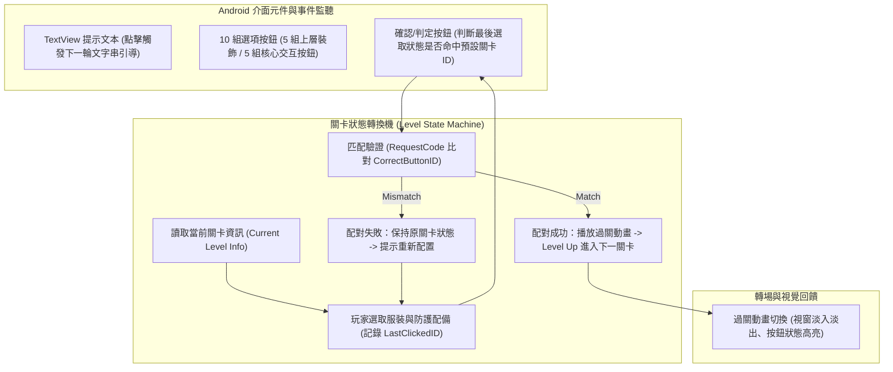

# 🎙️ 專題實作成果發表：Android 醫療互動遊戲 App 架構、關卡邏輯與UI事件控制 (專題開發者 / 專案審查委員 / 同學)

> **發表主題**：資訊管理系畢業專題成果發表、Android 醫療衛教互動遊戲 App 開發實務、UI 事件驅動與狀態機邏輯  
> **專案發表**：專題開發組員（專題學生）  
> **核心模組**：Android SDK, State Machine, UI Event Handling, Level Progression, Animation Transitions  
> **學習目標**：精熟 Android 生命週期事件處理、按鈕狀態比對防呆機制與動態遊戲關卡架構設計  
> **關聯文件**：[📄 完整原話逐字稿 (20240606-Android醫療互動遊戲App架構與關卡控制.full.md)](./20240606-Android醫療互動遊戲App架構與關卡控制.full.md)

---

## 🏛️ Android 互動 App 介面事件驅動與關卡狀態轉換架構

---

## 🎯 核心重點整理 (Key Takeaways)

### 1. Android 互動關卡狀態機（State Machine）設計
- **關卡狀態讀取與初始化**：Activity/Fragment 載入時動態讀取當前關卡參數（如關卡編號、目標服裝 ID、文字說明序列）。
- **雙態按鈕事件處理**：採用單一選擇狀態記錄器（`lastSelectedButtonId`），避免多選衝突；設計防呆機制（上層無效裝飾按鈕點擊不觸發成功判定）。
- **狀態判定與流轉**：按下確認後比對 `lastSelectedButtonId == targetLevelId`；成功時觸發回呼更新資料並調用 `startActivityForResult` / Intent 傳遞關卡晉級參數。

### 2. UI 互動體驗與動態文本推進
- **TextView 動態文字步進**：透過陣列索引追蹤劇情對話，點擊即時更新下一句對白，直到完整引導完畢才啟用（`setEnabled(true)`）核心操作按鈕。
- **視覺動畫回饋**：關卡通過時疊加動畫過渡效果，提升使用者衛教互動之趣味性與沉浸感。
---

## 📱 Android 醫療遊戲 App 系統架構、資料庫上傳驗證與關卡邏輯對照表

| 系統模組與功能架構 | 前端 Android App 技術實作細節 | 後端資料庫存取與契約驗證 | 審查驗收重點與展示除錯排查 |
| :--- | :--- | :--- | :--- |
| **使用者角色狀態與主頁導航** | 採用 Activity/Fragment 模組化設計，初始化載入病患與醫療人員雙角色設定與衛教進度 | 本地 SharedPreferences 快取輕量設定，全域 ViewModel 維護遊戲進行即時分數與剩餘生命值 | 確保橫豎屏切換時生命週期不中斷，防止記憶體洩漏與畫面卡死閃退 |
| **衛教資訊與商品資料庫上傳** | 管理端提供商品上架與健康知識題庫發布介面，包含圖片壓縮預處理與文字欄位校驗 | 透過 RESTful API 串接雲端關聯式資料庫，落實表單輸入合法性檢查（防止空值與 SQL Injection） | 現場實機展示資料上傳至伺服器之即時更新能力，確保前後端資料一致性 |
| **互動關卡控制與評審答辯驗收** | 遊戲關卡設計結合醫療知識測驗互動，答對通關計分並解鎖後續衛教小短片與徽章獎勵 | 遊戲計分引擎即時防作弊驗證，關卡完成後非同步同步個人歷史健康學習成效數據 | 現場展示組長展現成熟團隊領導力，明確指派組員負責展示切換與評審技術問答答辯 |
