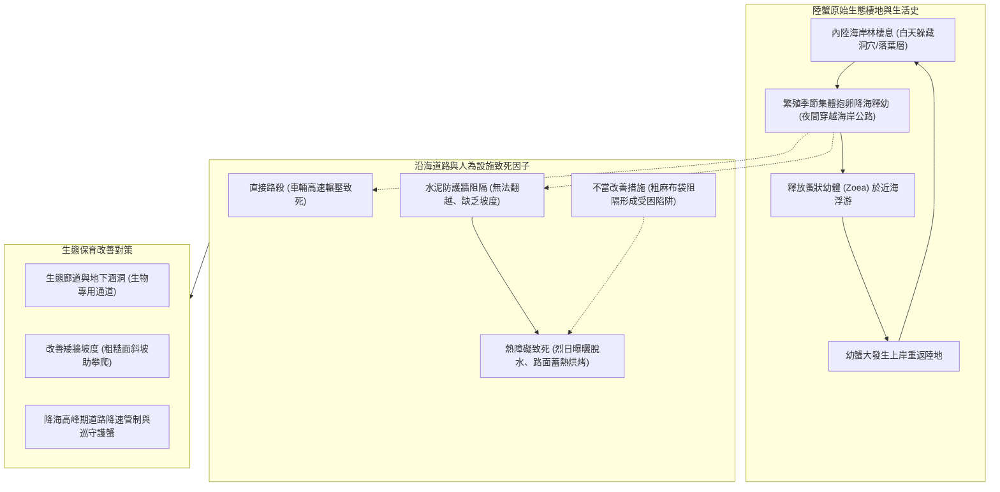

# 🎙️ 自然生態觀察社：恆春墾丁海岸陸蟹生態調查與道路阻隔熱障礙分析 (生態導師 / 社長 / 社員學員)

> **活動主題**：自然生態觀察社墾丁海岸陸蟹生態調查、道路路殺現況與水泥阻隔熱致死衝擊評估  
> **領隊主持**：生態導師 / 社團社長（自然生態觀察社）  
> **核心模組**：Land Crab Migration, Coastal Roadkill, Habitat Fragmentation, Thermal Stress, Conservation Ecology  
> **學習目標**：深入掌握台灣南部海岸陸蟹生活史、量化評估道路工程對野生動物之阻隔與熱障礙衝擊  
> **關聯文件**：[📄 完整原話逐字稿 (20240511-恆春墾丁海岸陸蟹生態調查與道路阻隔分析.full.md)](./20240511-恆春墾丁海岸陸蟹生態調查與道路阻隔分析.full.md)

---

## 🏛️ 陸蟹降海生活史與道路生態阻隔危機模型

---

## 🎯 核心重點整理 (Key Takeaways)

### 1. 陸蟹降海釋幼之生活史危機
- **繁殖降海需求**：每年農曆十五前後月圓夜間，海岸林中抱卵母蟹必須橫越沿海道路前往潮間帶與近海釋放蚤狀幼體。
- **沿海公路雙重威脅**：
  - **車輛直接路殺（Roadkill）**：高速行駛車輛致死率極高。
  - **水泥護欄與熱障礙（Thermal Barrier）**：道路兩側垂直水泥擋土牆阻斷母蟹返林路徑，黎明太陽升起後路面及麻布袋急遽升溫（可達 40°C~50°C），導致數十隻幼蟹與母蟹因嚴重脫水熱衰竭死亡。

### 2. 人為生態補償工程之檢討
- **麻布袋攀爬設施盲點**：原本旨在協助陸蟹翻越垂直牆體的麻布袋，若缺乏遮蔭與水分，常反被陸蟹誤視為陰涼庇護所而聚集躲入，日光直射後成為致命的集體烘烤陷阱。
- **改善建言**：應採用地下微型生態通道（Micro-Culverts）、改良斜坡粗糙生態矮牆，並配合降海尖峰期（夏季農曆七至九月）實施夜間道路封閉與志工護蟹巡守。
---

## 🦀 恆春半島陸蟹降海釋幼生態、台 26 線路殺熱點與生態廊道防護表

| 調查維度與生態要素 | 陸蟹生物學特性與降海繁衍行為 | 台 26 線道路阻隔衝擊（Roadkill 威脅） | 生態廊道設計與公民保育實踐 |
| :--- | :--- | :--- | :--- |
| **海岸林陸蟹棲地多樣性** | 恆春半島香蕉灣、港口溪流域孕育全球陸蟹多樣性最高熱點（包含毛足圓盤蟹、中型仿相手蟹等） | 陸蟹平時棲息於內陸海岸林腐殖土與石縫中，以落葉與有機質為食，為森林物質循環關鍵工程師 | 棲地遭公路與人為開發切割，導致個體在微氣候乾燥時面臨脫水死亡威脅 |
| **月圓潮汐與抱卵母蟹降海** | 每年農曆五至九月月圓夜間，抱卵母蟹成群由海岸林橫越公路前往海邊岩礁進行**釋幼（Larval Release）** | 抱卵母蟹攀爬速度緩慢且受車輛強光眩暈停滯，在台 26 線面臨極高機率之車輛輾壓路殺（Roadkill） | 墾管處於釋幼高峰時段實施「護蟹交管封路」，並設置帆布阻隔網導引母蟹進入微型生態廊道 |
| **野外夜間生態調查與安全守則** | 社員攜帶專業頭燈、防滑鞋並配備長袖長褲，在不干擾母蟹降海行為之前提下記錄物種與路殺數據 | 記錄體長背甲寬度、抱卵狀態與路殺座標，為國家公園提供長年路殺熱點之熱區分析依據 | 落實無痕山林（LNT）原則，不捕捉、不私藏，以實際科研調查行動推動道路生態學改善 |
