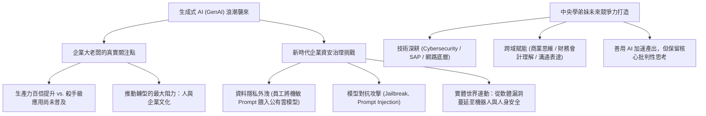

# 🎙️ 產學大師講座：生成式 AI 產業浪潮、企業資安治理與職場數位競爭力 (勤業眾信資安執行副總 / 主持教授 / 現場學員)

> **演講主題**：生成式 AI 爆發浪潮、企業數位轉型困境、新型資安風險防禦與職涯發展  
> **主講貴賓**：勤業眾信聯合會計師事務所（Deloitte）資安執行副總（中央資管系所校友）  
> **主辦單位**：國立中央大學資訊管理學系碩士班 前瞻產業專題講座  
> **核心模組**：Generative AI, Enterprise Cybersecurity Governance, IT Career Pathways  
> **學習目標**：理解企業大老闆對 AI 的真實焦慮、掌握跨域顧問職能與 AI 時代不可替代核心競爭力  
> **關聯文件**：[📄 完整原話逐字稿 (2025-12-05-勤業眾信副總-生成式AI與企業資安治理-proofread.md)](./20251205-生成式AI與企業資安治理.full.md)

---

## 🏛️ 核心架構與概念流轉圖

---

## 🔑 重點提要 (Key Takeaways)

1. **AI 轉型的最大阻力永遠是「人」**：工具推陳出新極其快速，但企業內部既有流程、組織官僚文化與員工抗拒改變的心態，是 GenAI 無法在短期內轉化為殺手級應用的主要癥結。
2. **資安諮詢的高門檻與市場需求**：勤業眾信擁有全台最大的 200 人資安顧問團隊，負責政府核心機關與跨國企業的高規格資安審查與合規建置，資安業務是全事務所成長最迅猛、營收最高的業務板塊之一。
3. **不可替代的跨域 T 型人才**：純懂寫 Code 或純懂調包的工程師極易被 AI 替代。未來的頂尖顧問必須一手掌握網路與系統資安技術底層，另一手具備財務會計、法律合規與管理溝通的綜合治理視野。
---

## 📊 企業生成式 AI 導入治理體系與資安風險防禦對照表

| 治理與應用維度 | 核心應用場景 | 關鍵資安與合規風險 | 勤業眾信（Deloitte）治理防線與控制措施 |
| :--- | :--- | :--- | :--- |
| **員工生產力賦能** | 公有雲 LLM 輔助文案撰寫、會議摘要與程式碼生成 | 企業內部機密原始碼、財務數據與客戶個資因複製貼上而外洩至外部模型訓練集 | 建立企業級 AI Gateway 與敏感資料遮罩（Data Masking），禁止未脫敏商業機密直接上傳外部公有模型 |
| **企業知識庫（RAG）** | 串接內部規章、法務合約與專案文件之檢索增強生成系統 | 檢索權限繞過（越權調閱高階主管薪酬或機密專案）、間接提示詞注入（Indirect Prompt Injection） | 實施文件級別角色存取控制（RBAC）、輸入與輸出雙向安全護欄（Guardrails）與檢索來源審計追蹤 |
| **對外客服與決策 Agent** | 自動化客服問答、金融產品推薦與跨系統 API 觸發執行 | 模型幻覺（Hallucination）導致錯誤承諾、越獄攻擊（Jailbreak）誘導執行未授權交易、深偽（Deepfake）身分冒用 | 強制高風險操作納入人工審查迴路（Human-in-the-Loop）、API 最小權限隔離與多因子生物特徵防偽驗證 |
| **組織文化與人才轉型** | 跨部門 AI 專案落地、EMBA 管理視野與資管人職涯佈局 | 部門本位主義抗拒變革、盲目追求技術卻缺乏商業投資報酬率（ROI）評估、單一技術思維受限 | 結合財務報表解讀能力、考取國際資安與稽核證照（如 CISSP、CISA、ISO 27001）並透過四大事務所實習累積實戰經驗 |
