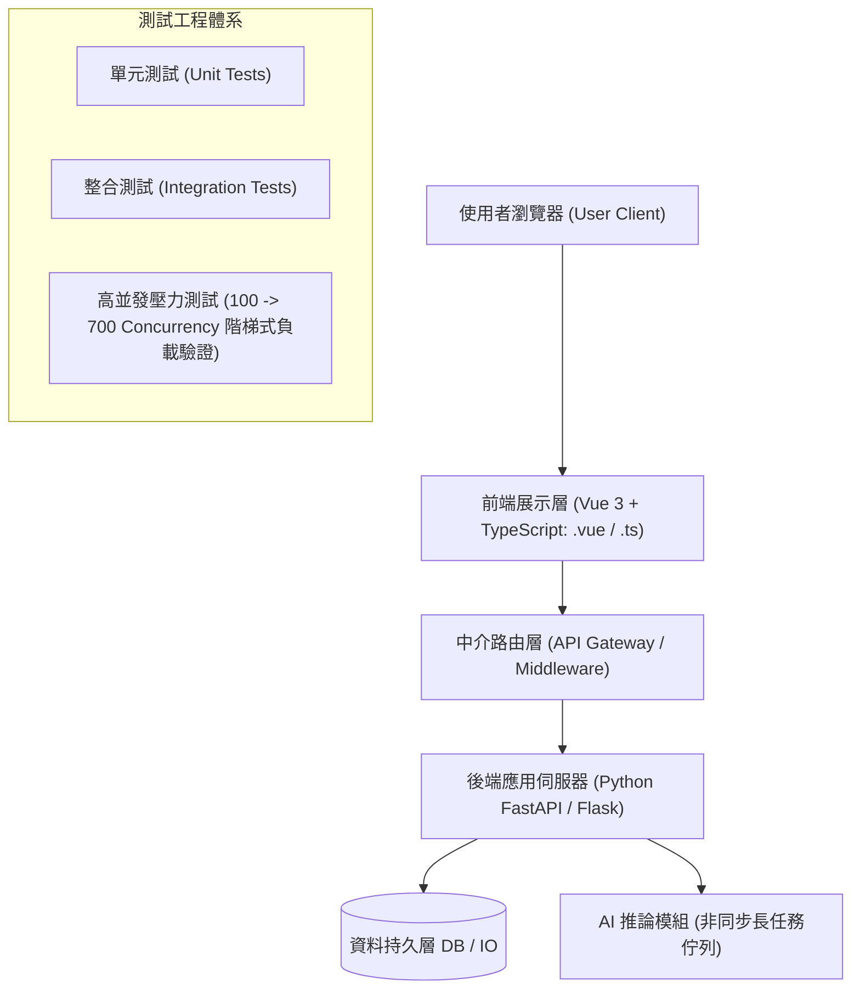

# 🎙️ 軟體工程期末專案發表與評審審查會：Vue/TS 前端、Python 後端、高並發壓力測試與 AI 模組整合 (授課講師 / 學員 (專案報告團隊))

> **課程主題**：軟體工程（Software Engineering）期末專案發表、UML 循序圖重構、高並發壓力測試與 AI 模組實作  
> **指導評審**：授課講師（軟體工程授課教授）  
> **發表團隊**：專案開發團隊學員群  
> **核心模組**：Software Architecture, UML Sequence Diagrams, Stress Testing (700 Concurrency), AI Module Integration  
> **學習目標**：實踐完整 SDLC 軟體生命週期、完成前後端架構解耦、量化負載極限並通過現場答辯  
> **關聯文件**：[📄 完整原話逐字稿 (2025-12-17-期末專題架構循序圖與高並發壓測-proofread.md)](./20251217-期末專題架構循序圖與高並發壓測.full.md)

---

## 🏛️ 核心架構與概念流轉圖

---

## 🔑 重點提要 (Key Takeaways)

1. **架構分層與循序圖重構**：團隊將原本直連後端的架構重構為包含中介層（Middleware）的多層架構，並在 UML 循序圖中完整體現 Vue 前端、TypeScript 模組與 Python 後端的交互時序。
2. **高並發壓力測試（Stress Testing）**：透過自動化腳本進行階梯式壓力測試。系統在 100 並行請求時維持 100% 成功率；當攀升至 700 Concurrency 時暴露資料庫連線池與 AI 推論延遲瓶頸，為後續效能調校提供確切數據。
3. **AI 時代的軟工素養**：授課教授在講評中強調，生成式 AI 工具極大加速了寫 code 速度，但系統設計架構力、測試驗證嚴謹度與對底層錯誤的排查能力，才是軟體工程師的核心價值所在。
---

## ⚡ 軟體系統分層架構、高並發壓測指標與 AI 模組整合對照表

| 系統工程與評測維度 | 專案實作技術棧與規格 | 壓力測試現象與瓶頸根因（100 → 700 Concurrency） | 架構調校策略與教授審查重點 |
| :--- | :--- | :--- | :--- |
| **前後端分離與循序圖契約** | 前端採用 **Vue 3 + TypeScript** 強型別組件；後端採用 **Python RESTful API** 中介層與關聯式資料庫 | 前後端狀態機未完全對齊時，高並發重複點擊易觸發非預期之狀態覆寫與交易不一致 | 嚴格繪製 UML 循序圖（Sequence Diagram）定義同步與非同步訊息邊界，前端加入防抖（Debounce）與幂等性 Token 驗證 |
| **單元測試與覆蓋率分析** | 針對核心業務邏輯、資料驗證與邊界條件（Boundary Conditions）編寫自動化單元測試與整合測試 | 僅測試正常路徑（Happy Path）會遺漏空值、超長字串、負數金額與無效權限等例外狀況 | 補齊邊界值分析與異常注入測試案例，明確區分 HTTP 4xx（客戶端參數錯誤）與 5xx（伺服器內部異常）回傳碼 |
| **高並發負載與壓力測試** | 模擬 **100、300、500 至 700 並行請求（Concurrency）**，量測吞吐量（RPS）、P95/P99 延遲與錯誤率 | 當併發數攀升至 500–700 時，資料庫連線池（Connection Pool）耗盡、I/O 阻塞導致大量請求 Timeout 與失敗率飆升 | 調優資料庫連線池上限、導入非同步 I/O（Asyncio）與快取層（Redis），並對高耗時寫入操作實施佇列緩衝削峰 |
| **AI 模組異步整合與交付** | 整合大型語言模型（LLM）推論 API 進行智慧分析與內容生成 | LLM 同步推論耗時長達數秒，若直接綁定於主請求執行緒，會迅速拖垮整體 Web Worker 並發容量 | 將 AI 推論改為背景非同步任務佇列（Task Queue）搭配前端輪詢或 WebSocket 推播，並落實 `.env` 金鑰隔離與超時降級機制 |
