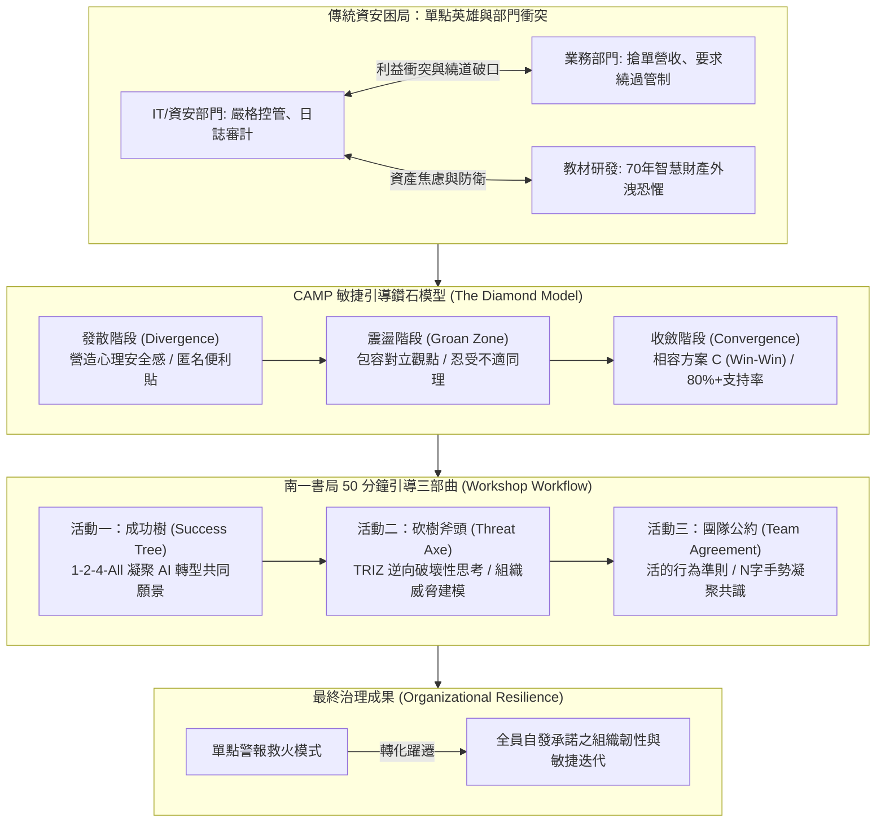

# 敏捷資安共識行動：跨部門風險引導與南一書局 AI 轉型實戰 (周龍鴻博士)

## 📌 執行摘要 (Executive Summary)

本場講座為臺灣首位國際敏捷大使、專案管理教育巨擘**周龍鴻博士（Roger 老師）**於 InfoSec Taiwan 2026 大會發表之專題演講。講座以擁有七十年歷史的臺灣出版龍頭**南一書局**導入大型語言模型（LLM）進行核心教材教育 AI 轉型為實證案例，深入剖析傳統企業資安推動之核心痛點：**最強大的防線絕非單點採購之防火牆設備，而往往崩潰於內部業務、教材與資訊部門之間的利益拉扯與意識斷層**。

周博士系統化提出導入 **CAMP（Certified Agile Facilitator）敏捷引導技術**，運用經典之**鑽石模型（Diamond Model）**、**解放結構（Liberating Structures 1-2-4-All）**與 **TRIZ 逆向破壞性思考**，透過「種植成功樹」、「尋找砍樹斧頭」及「締結團隊公約」三大實戰工坊，在 50 分鐘內將企業內部資安對立轉化為跨部門全員承諾，成功構築具備高度自適應能力的「組織韌性（Organizational Resilience）」。

---

## 🏛️ 核心架構圖 (Mermaid Architecture)

---

## 🔑 關鍵架構剖析與核心亮點

### 1. 破除「資安英雄」迷思：從單點防禦邁向組織韌性
- **單點防護的脆弱性**：企業花費重金建構先進防火牆，但業務同仁往往為了搶訂單私下尋求繞過 IT 審核；最強防線因此瓦解於內部拉扯。
- **組織治理而非單純溝通**：引導絕非單純「聊聊天、講好話」，而是讓跨部門同仁透過結構化流程，親自正視公司權限過大、數據未加密、漏洞未修補之嚴峻現實。

### 2. CAMP 鑽石模型引導法
- **發散（Divergence）**：建立封閉且保密的心理安全感，運用「如果專案成功會獲得什麼獎勵」的好提問激發全面觀點。
- **震盪（Groan Zone）**：引導師保持中立，邀請業務與資安人員互相複述對方的核心痛點，在衝突不適中孕育理解。
- **收斂（Convergence）**：拒絕 51:49 的多數決暴力，催生融合雙方底層需求的「相容方案 C」，使支持率躍升至 80% 以上。

### 3. 南一書局 AI 轉型 50 分鐘實戰三部曲
1. **種植成功樹（Success Tree）**：採用 **1-2-4-All**（1人思考 $	o$ 2人配對 $	o$ 4人收斂 $	o$ 全場分享），讓 40 位跨部門主管快速凝聚十餘張 AI 轉型共同願景便利貼。
2. **砍樹斧頭（Threat Modeling via TRIZ）**：運用逆向思維發問「如果我們要砍倒這棵樹讓公司倒閉，我們要持續做什麼？」，同仁自發暴露諸如私開權限、數據外傳公開模型、隱匿違規等「組織自我攻破大斧頭」。
3. **締結團隊公約（Living Team Working Agreement）**：跨部門主管親筆簽署防禦公約，並以「N 字手勢」確立衝突時的共識語言；公約並非死板 PDF，而是在雙月敏捷回顧會議（Retrospective）中持續迭代的活文件。

---

## 🎯 落地實踐啟示 (Actionable Takeaways)

1. **問對問題勝過千言萬語**：切勿以「我們如何做好資安」等抽象說教開場；改以「若要讓公司發出高額年終獎金，資安與業務需克服哪些關鍵障礙」等與切身利益掛鉤的提問激發動力。
2. **資安威脅建模的組織維度擴展**：除了伺服器與架構端的威脅建模（Threat Modeling）外，應定期實施「組織自毀式威脅建模」，挖掘業務流程與人性心理所滋生之防禦破口。
3. **制度必須由執行者親手起草**：由跨部門共同參與設計並簽署之團隊公約，其遵循率與內化程度遠勝總經理室發布之剛性管理手冊。
