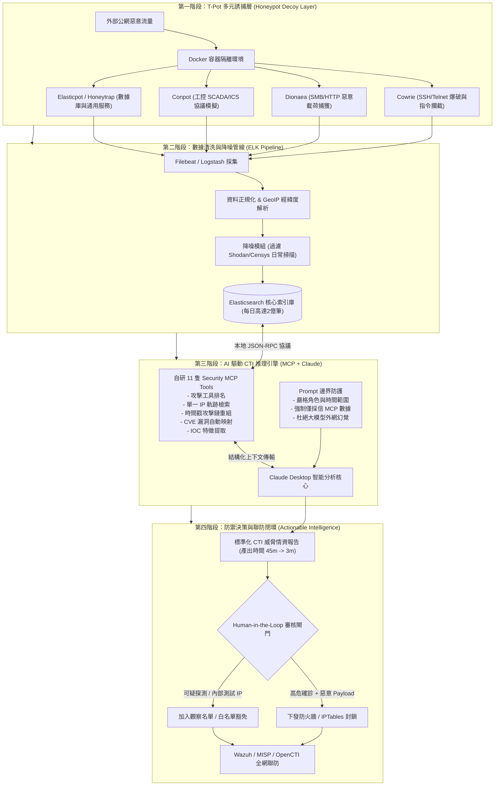

# 從 TIPa 蜜罐誘捕到 AI 驅動 CTI 威脅情資分析實戰

## 📌 執行摘要 (Executive Summary)

本場講座由資安競賽得獎新秀**蔡全宇（Leo）**與擁有全國學術網路（TANet）6,000 IP 蜜罐維運實績之**資深法人資安專家**聯合主講。前半段深入剖析開源整合蜜罐平台 **T-Pot（TIPa）** 之五層架構（誘捕層、日誌採集、Logstash 正規化、Elasticsearch 儲存、Kibana 儀表板）與多元誘捕矩陣（Cowrie、Dionaea、Conpot、Honeytrap 等）；後半段直擊企業海量日誌維運之核心痛點——**日收兩億筆日誌所引發的警報疲勞（Alert Fatigue）與無效益的人工報表作業**。

講者團隊創新性地採用 **Anthropic Model Context Protocol（MCP）** 架構，自行開發 **11 隻資安專屬 MCP 工具**串接 **Claude Desktop**，使分析師得以透過自然語言於 3～5 分鐘內完成跨工具數據抓取、時間戳攻擊鏈（Attack Chain）重組、CVE 漏洞利用標記與標準 CTI 威脅報告生成，並嚴格確立「**Human-in-the-Loop（人工審核阻斷）**」安全紅線，打造兼具自動化效能與維運安全性之主動防禦閉環。

---

## 🏛️ 核心架構圖 (Mermaid Architecture)

---

## 🔑 關鍵架構剖析與核心亮點

### 1. T-Pot（TIPa）主動防禦平台架構
- **捕蠅草哲學**：跳脫傳統被動防禦，故意模擬具已知漏洞之網路服務吸引攻擊者，全程記錄其探索路徑、攻擊工具與指令。
- **低互動 vs 高互動平衡**：T-Pot 透過 Docker 容器化隔離技術，在單一主機內整合二十餘種蜜罐，既具備低互動之安全性，又能透過 Dionaea / Cowrie 獲取高互動深度的 Payload 與終端操作日誌。
- **硬體與網路邊界要求**：蜜罐日誌量巨大（建議至少 100 GB SSD），且必須置於獨立 DMZ 網段，嚴禁與企業生產內部網路直通，避免遭突破後淪為橫向跳板。

### 2. 實務維運瓶頸：海量數據與警報疲勞
- **數據爆炸**：全國學術網路 6,000 個 IP 與 GCP 12 個節點單日產生逾 2 億筆日誌；記憶體未加限制易導致主機兩天內崩潰死當（需導入容器記憶體重排腳本）。
- **警報疲勞（Alert Fatigue）**：連續觀看炫麗之即時攻擊射線地圖後，缺乏轉化為實質防禦的機制，陷入無意義之人工作業與月報拼貼；Splunk 昂貴授權與 Elasticsearch DSL 語法門檻亦阻礙即時響應。

### 3. 自研 11 隻 MCP 工具驅動 Claude 進行自動化 CTI 研判
- **解決官方工具斷代問題**：Elasticsearch 官方 MCP 僅支援效能監控且停止維護，團隊自行研發 11 隻安全專屬 MCP 工具，直接對接底層日誌庫。
- **自然語言秒級查詢**：分析師下達自然語言指令，Claude 透過 MCP 工具鏈完成時間序列攻擊鏈重組、CVE 弱點利用匹配與 IOC 萃取，將過往 30～45 分鐘之分析流程縮減至 **3～5 分鐘**。
- **提示詞邊界約束（Prompt Guardrails）**：嚴格限定 Role、Scope，並強制 AI 僅能依據 MCP 回傳之事實數據進行推理，杜絕大模型編造 IP 與攻擊脈絡之幻覺。

### 4. 決策邊界：Human-in-the-Loop 安全紅線
- **禁止全自動聯動封鎖**：實戰中大量高頻探測往往來自內部監控、滲透測試主機或合法公有雲爬蟲；若由 AI 全自動向防火牆下發封鎖指令，極易導致生產網路瞬間中斷癱瘓。
- **四級分流處置機制**：
  1. 高危確認且含惡意攻擊載荷：人工審核後下發防火牆阻斷；
  2. 疑似自動化工具掃描：動態限速或列入觀察清單；
  3. 偶發低頻探測：僅記錄於 CTI 數據庫；
  4. 內部測試與授權 IP：納入白名單排除。

---

## 🎯 落地實踐啟示 (Actionable Takeaways)

1. **蜜罐部署首重容器資源治理**：企業自建 T-Pot 時，務必針對各容器設定明確之 Memory Limit 與自動重啟策略，防止日誌突發暴增耗盡宿主機記憶體。
2. **MCP 架構是資安大模型落地的黃金標準**：切勿將數十萬行非結構化日誌直接丟入大模型 Context；應透過自建 MCP 工具在本地端完成數據過濾、聚合與預處理，僅傳遞高價值上下文給 LLM。
3. **自動化分析與人工決策嚴格解耦**：善用 AI 進行「95% 的前置情報萃取與摘要推理」，但「最後 5% 的阻斷與封鎖決策」必須由資安分析師掌控，確保業務連續性與零誤殺。
