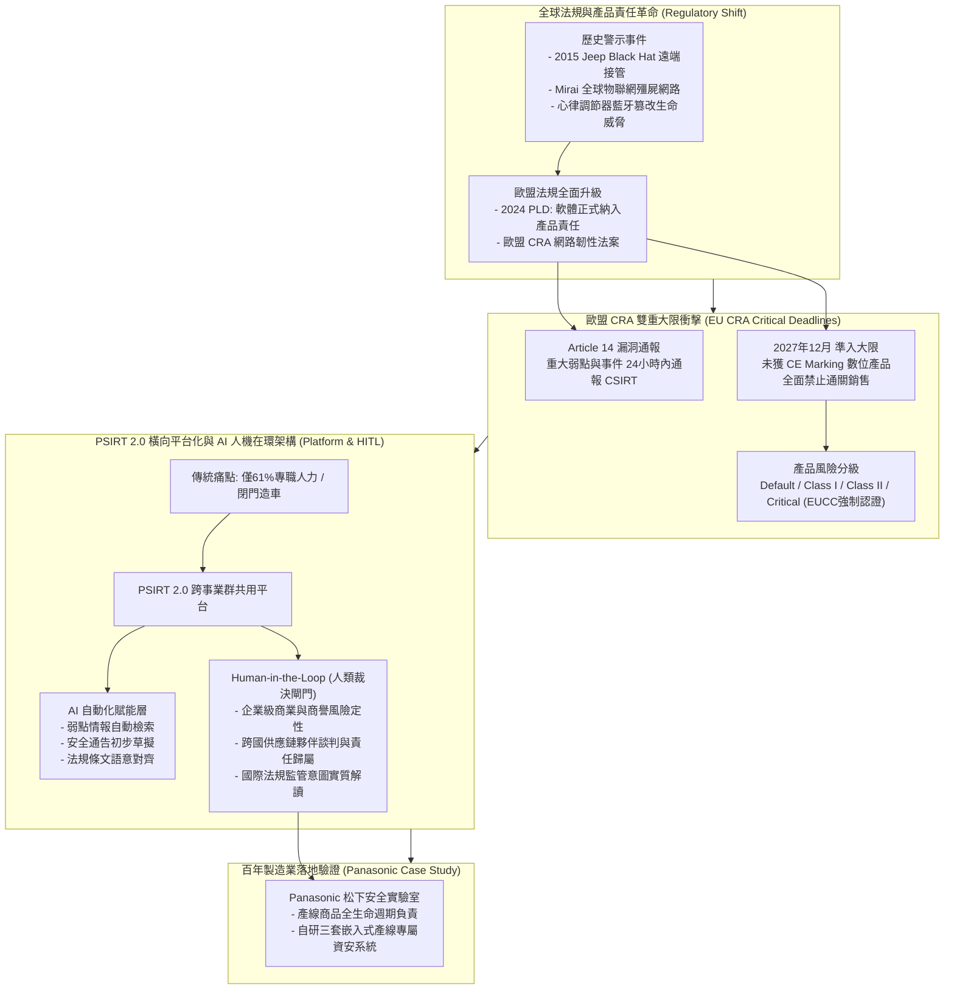

# 🎙️ 日本 IoT 物聯網安全標準與 PSIRT 2.0 實務：歐盟 CRA 規範與松下製造業落地

> **會議／場合**：InfoSec Taiwan 2026 臺灣資訊安全論壇 / 夏季高峰論壇  
> **日期**：2026-07-07  
> **講者／參與者**：大會主持人 (黃先生)、伊豆倉 憲 博士 (Dr. Ken Idokura / GMO Cybersecurity by Ierae)、Jack Lee (日本松下 Panasonic 首席資安工程師)  
> **關聯文件**：[📄 完整逐字稿 (20260707-03-日本IoT物聯網安全標準與指引實務.full.md)](./20260707-03-日本IoT物聯網安全標準與指引實務.full.md)

## 📌 執行摘要 (Executive Summary)

本場講座為 InfoSec Taiwan 2026 大會極具國際視野之製造業產品資安（Product Security）專題，由日本頂尖資安巨擘 **GMO Cybersecurity by Ierae 伊豆倉 憲 博士（Dr. Ken Idokura）** 與百年製造巨頭 **日本松下電器（Panasonic）首席工程師 Jack Lee** 聯合發表。

伊豆倉博士系統化闡述「**產品資安即產品安全品質（Product Security is Product Safety）**」的核心新範式，深度解析歐盟《產品責任指令》（PLD）將軟體正式列入法定產品責任之法律變革，並敲響**歐盟《網路韌性法案》（CRA）** 的警鐘：**Article 14 強制重大弱點於 24 小時內通報歐盟 CSIRT**，且 **2027 年 12 月起未符 CRA 標準之數位產品全面禁止進入歐盟市場**。針對目前企業 PSIRT 僅 61% 配置全職員工的資源困境，博士提出以「**橫向平台化架構**」結合「**AI 輔助 + Human-in-the-Loop（人機在環）**」的 PSIRT 2.0 治理方案；隨後由松下電器 Jack Lee 接棒揭露百年製造大廠自研產線專屬資安工具的實務落地經驗。

---

## 🏛️ 核心架構圖 (Mermaid Architecture)

---

## 🔑 關鍵架構剖析與核心亮點

### 1. 概念革命：產品資安即「產品質量與人身安全」
- **本質跳脫 IT 範疇**：過往企業視資安為 IT 防護，但在智慧聯網時代，代碼瑕疵直接導致車輛失控、醫療器材失常、工控停擺；產品資安已等同於「產品物理安全（Safety）」。
- **歐盟 PLD 指令擴展**：歐盟最新產品責任指令明確將「純軟體」納入法定產品瑕疵範圍，廠商無法再以「純屬軟體漏洞」免除賠償責任。

### 2. 歐盟 CRA 網路韌性法案倒數計時
- **Article 14 24 小時通報窗口**：針對被積極利用之重大弱點，必須在 24 小時之內向歐盟 CSIRT 正式報備，極度考驗企業 PSIRT 的監控與判定時效。
- **2027 年 12 月硬性準入紅線**：外銷含數位元素產品（PDE）若無完整合規技術文檔與 CE 標記，海關將直接拒絕通關；針對 Class II（防火牆、虛擬監控）與 Critical 類別（安全晶片、智慧電表），甚至強制第三方 EUCC 認證。

### 3. PSIRT 2.0：橫向平台化打破各事業群單打獨鬥
- **資源匱乏現狀**：調查顯示高達 39% 的企業 PSIRT 無專職編制，普遍缺乏 AI 與機器學習導入能力。
- **平台化架構**：將垂直封閉的部門自建 PSIRT，轉型為集團共用之橫向平台化運作，統一弱點對接、工具流與合規管道。

### 4. Human-in-the-Loop（人機在環）黃金法則
- **AI 賦能邊界**：AI 可勝任 80% 的日常情報檢索、初步公告起草與條文比對。
- **嚴格不可替代的人類決策**：
  1. 企業商譽與全面召回之高層次商業風險決策；
  2. 供應鏈廠商合約與法律責任協商；
  3. 監管法規跨國政治與司法背景之實質意涵解讀。

---

## 🎯 落地實踐啟示 (Actionable Takeaways)

1. **臺灣外銷製造業應立即清查產品清單**：盤點所有出口歐盟之硬體與軟體產品，確認其屬於 CRA 的哪一類別（Default / Class I / Class II），及早準備合規技術證據。
2. **建立 24 小時緊急通報 SOP**：因應 CRA Article 14 規範，企業應在產品發布前建立清晰的重大弱點識別標準與通報管道，切忌臨渴掘井。
3. **PSIRT 必須從「事後救火」走向「全生命週期介入」**：如同松下安全實驗室實踐，資安團隊必須在產品架構設計初期就進駐產線，落實 Security by Design，從源頭最小化市售召回成本。