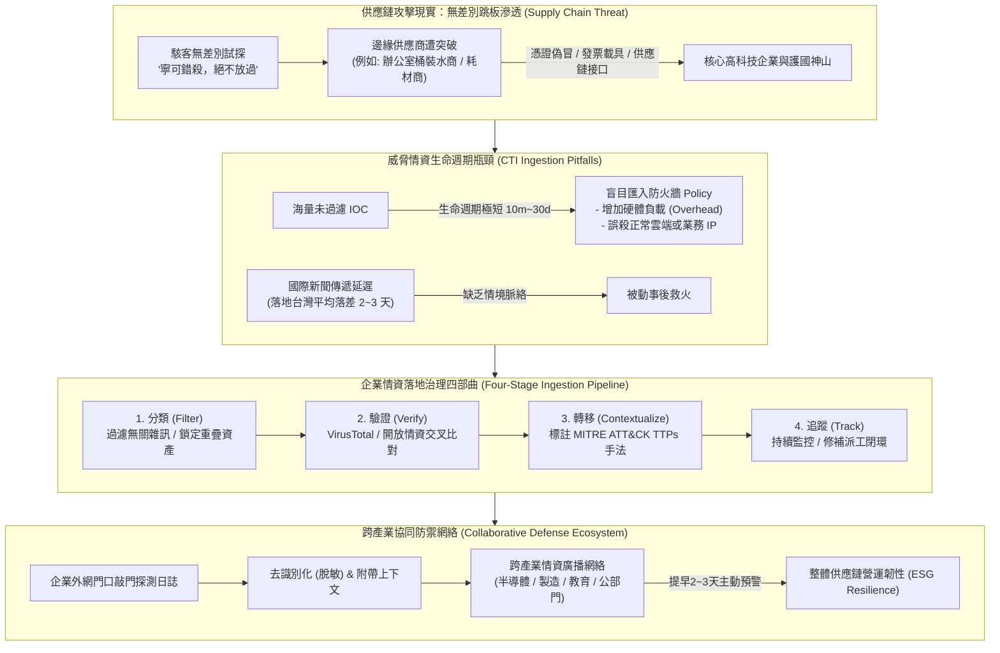

# 🎙️ 數位身分認證與供應鏈威脅情資治理實戰：從個資根因到跨企業協同防禦

> **會議／場合**：InfoSec Taiwan 2026 臺灣資訊安全論壇 / 夏季高峰論壇  
> **日期**：2026-07-07  
> **講者／參與者**：社群講者 (臺灣數位安全聯盟 / 職安資安社群召集人)、大會主持人  
> **關聯文件**：[📄 完整逐字稿 (20260707-04-數位身分認證與供應鏈情資治理.full.md)](./20260707-04-數位身分認證與供應鏈情資治理.full.md)

## 📌 執行摘要 (Executive Summary)

本場講座為 InfoSec Taiwan 2026 第一日閉幕壓軸議程，由臺灣數位安全聯盟與資安社群召集人主講。講座開篇以戶政法令中個人身分數據（姓名、手機、地址、身分證字號乃至出生年月日）的法定更正條件切入，探討數位身分認證的底層根因（Root Cause）；隨後直擊當前駭客針對供應鏈生態系之「**寧可錯殺、絕不放過**」無差別攻擊態勢——揭露實例中連辦公室桶裝水供應商皆遭勒索攻擊，意圖藉由供應鏈往來憑證迂迴入侵背後高科技核心企業。

講者深入破除企業資安維運之兩大迷思：「情資盲目複製貼上防火牆」與「短命 IOC 過期失效」，系統化提出「**情資交流不是機密交換，而是共享門外威脅行為特徵**」之核心理念。演講提出涵蓋**分類（Filter）、驗證（Verify）、轉移（Contextualize）、追蹤（Track）**的企業情資落地四部曲，並分享自 2026 年初起跨半導體、製造與公部門推動之「去識別化敲門情資協同防禦網絡」，為跨企業與供應鏈建構具備高預警速度與營運韌性之防禦閉環。

---

## 🏛️ 核心架構圖 (Mermaid Architecture)

---

## 🔑 關鍵架構剖析與核心亮點

### 1. 數位身分數據的法定不可變性與安全根因
- **個資變更的法律層級**：手機與住址可自由更換，身分證字號與出生年月日依法需特殊要件與醫療證明方可更正；正因底層身分數據具備高度靜態綁定特性，一旦外洩便構成難以逆轉的長久安全隱患。
- **身分驗證邊界**：單純仰賴靜態個資比對之驗證機制已不堪一擊，必須朝向動態行為分析與多因子（MFA）防護演進。

### 2. 供應鏈威脅現實：無差別跳板策略
- **連桶裝水廠商都被打**：攻擊者不再耗費巨資強攻核心企業厚重防線，轉而針對邊緣供應商（如桶裝水、物流、外包廠商）下手，藉由橫向供應鏈信任關係滲透核心目標。
- **攻擊手法升級**：弱密碼暴力破解式微，取而代之的是高度逼真之生成式 AI 釣魚、Deepfake 偽冒身分與自動化 API 探測。

### 3. 破除 IOC 迷思與社群情報速度優勢
- **IOC vs. TTPs**：IP 與 Hash 生命週期短暫（10 分鐘～30 天），駭客極易更換；唯有掌握攻擊者的 TTPs（戰術、技術與程序）才能建立長效防線。
- **社群傳遞速度**：重大漏洞從國外情報反映至台灣官方媒體平均有 2 至 3 天延遲；善用技術社群情資可搶在攻擊大規模擴散前完成預警。

### 4. 企業情資落地四部曲與協同防禦實踐
- **情資交流 $
eq$ 機密交換**：共享的標的僅限於外網邊界遭受之探測 IP、被探測端口與去識別化之攻擊行為特徵，企業核心內部網路數據絕不外洩。
- **四部曲管道**：
  1. **分類（Filter）**：與本業及供應鏈資產無關者直接剔除；
  2. **驗證（Verify）**：透過開放情資平台交叉檢驗；
  3. **轉移（Contextualize）**：對齊 MITRE ATT&CK 手法與內部防護情境；
  4. **追蹤（Track）**：落實完整的修補與日誌追蹤，杜絕復發。

---

## 🎯 落地實踐啟示 (Actionable Takeaways)

1. **落實情資去識別化 SOP**：對外回報或交流情資時，務必將企業內網 IP、敏感主機名稱及客戶數據徹底脫敏，並附上清晰上下文避免誤判。
2. **切忌盲目匯入防火牆清單**：所有外部情資在下發防火牆阻斷規則前，必須經過內部專職資安人員二次審核，防止因誤判導致業務中斷。
3. **推動供應鏈同盟預警**：企業應攜手上游供應商建立低門檻的情資通報機制，只要其中一家遭遇探測，即同步廣播同盟夥伴，實現全網聯防。