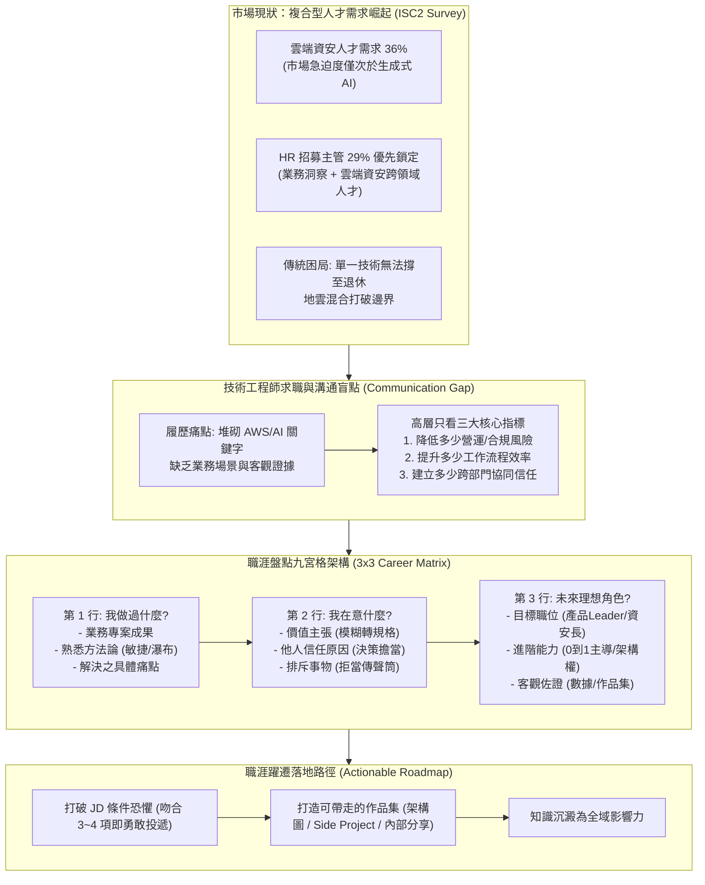

# 🎙️ 從 HR 與跨領域視角看企業 AI 安全治理與職涯轉型九宮格實踐

> **會議／場合**：InfoSec Taiwan 2026 臺灣資訊安全論壇 / 第二日社群高峰論壇  
> **日期**：2026-07-08  
> **講者／參與者**：露露 (Lulu / 臺灣數位安全聯盟、AIC2 企業 AI 治理社群召集人)、大會主持人  
> **關聯文件**：[📄 完整逐字稿 (20260708-01-HR與跨領域視角之企業AI治理平台.full.md)](./20260708-01-HR與跨領域視角之企業AI治理平台.full.md)

## 📌 執行摘要 (Executive Summary)

本場講座為 InfoSec Taiwan 2026 第二日開幕主題演講，由臺灣數位安全聯盟幹部、AIC2 企業 AI 治理社群召集人**露露（Lulu）**主講。講者以傳統財務與人資（HR）背景成功跨界考取多項國際證照並跨足企業 AI 治理之實證經驗，引用 (ISC)² 全球資安人才報告指出：**雲端資安與 AI 治理複合型人才需求高達 36%，高居市場急迫度榜首**。

演講直擊技術人員求職與跨部門溝通之核心盲點——「技術關鍵字堆砌而缺乏業務情境」，首創公開**「職涯盤點九宮格（3×3 Matrix）」**模型，引導 PM、研發與資安維運人員從「執行問題」躍遷至「定義問題」，將技術付出轉化為企業高層最關注之**風險降低、營運增效與跨部門信任**。講者鼓勵技術從業者打破 JD 職缺焦慮，透過考照、架構圖繪製與 Side Project 打造個人專屬作品集，構築無法被 AI 取代之跨領域職場影響力。

---

## 🏛️ 核心架構圖 (Mermaid Architecture)

---

## 🔑 關鍵架構剖析與核心亮點

### 1. 複合型人才市場爆發：雲端資安與 AI 雙引擎
- **技術邊界消融**：地雲混合架構普及，企業已無單純之 Infra 或純 IT 崗位；掌握雲端架構配置與 AI 安全防護已成顯學。
- **跨界乘數效應**：純技術背景常受限於溝通障礙，而本職專業（HR/財務/營運）疊加雲端資安與 AI 應用技能，能創造極高之薪資與職場議價空間。

### 2. 跨越溝通鴻溝：高層決策只認三大指標
- **拒絕無效名詞堆砌**：單寫「精通 AWS」無法體現價值；必須明確指出「在 HR 流程導入最小權限與自動化帳號生命週期，降低 80% 特權帳號外洩風險」。
- **三大指標體系**：
  1. **風險降低**：消除了哪些潛在合規裁罰與資料外洩漏洞；
  2. **流程增效**：運用 AI 工具提升了幾倍產能與準確率；
  3. **協同信任**：能否兼顧各部門需求，避免盲目承接導致專案虧損。

### 3. 職涯盤點九宮格（3×3 Matrix）實務指引
- **縱深三層次**：
  - **基礎層（Past）**：盤點專案實績、方法論與曾克服之混亂；
  - **核心層（Present）**：確立自我價值追求、他人信任根源及排斥之工作型態；
  - **躍遷層（Future）**：瞄準下階段職責，主動爭取「定義問題」與「主導 0 到 1 架構」之掌控權。
- **角色破局示範**：
  - **PM**：從被動傳聲筒晉升為產品負責人，以商業成本控制與上線成效說話；
  - **Developer**：從技術債清理者晉升為 Tech Lead，爭取架構主導權；
  - **SecOps**：從地端防護跨足多雲資安治理，以開源 Side Project 與架構圖構建證據力。

### 4. 破除 JD 恐懼與打造「可帶走的作品集」
- **JD 的真實心理學**：用人主管開出的條件常是「十萬預算規格」，而企業核定薪資可能只有五萬；吻合 3～4 項即應勇敢爭取。
- **作品集（Portfolio）思維**：證照是系統化學習的骨架，但真正的競爭力在於繪製清晰的架構圖、維護 GitHub Side Project，以及能對外演講分享的知識內化能力。

---

## 🎯 落地實踐啟示 (Actionable Takeaways)

1. **重新改寫個人履歷**：全面檢視既有履歷，將所有純技術工具名詞，改寫為「在何種業務場景下，運用該技術降低了多少風險或提升了多少效率」。
2. **立刻填寫專屬九宮格**：以 30 分鐘時間完成自我盤點，找出「自己做過但尚未被看見」的成果，並鎖定下階段需要補足的 0 到 1 主導經驗。
3. **建立視覺化架構作品集**：不再只依賴口頭或文字陳述，嘗試將複雜的雲端資安架構、AI 治理管線繪製為清晰架構圖，於面試與內部晉升時展現降維打擊的說服力。