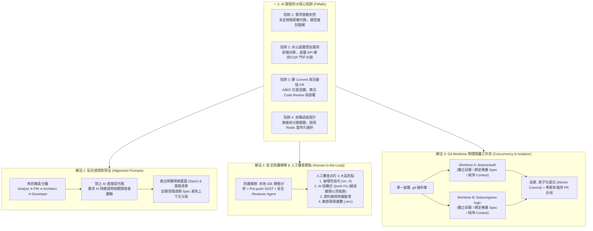

# 從 Web Coding 到 CTF 奪旗實戰：AI 輔助開發的陷阱防範與 Git Worktree 隔離工作流

## 📌 執行摘要 (Executive Summary)

本場講座為 InfoSec Taiwan 2026 第二日社群高峰論壇專題演講，由資安顧問、Baselines 安全程式碼社群發起人 **Miss Tika** 主講。講者以一人開發「CTF 戀愛解謎乙女遊戲」Side Project 之實戰跌撞經驗為切入點，深入剖析開發者過度依賴生成式 AI 寫代碼時所遭遇的四大典型陷阱：**需求發散與原型失控、冰山底層之資安漏洞（API 鑑別繞過、過寬 CSP 與 IDOR）、版本控管混亂（臃腫百變怪 PR 與髒 Commit）、以及架構過度設計（微服務濫用與 Redis 誤用）**。

針對上述痛點，演講提出一套可落地的工程實踐體系：
1. **反向提問對齊法（Alignment Prompts）**：禁止 AI 直接生成代碼，轉而引導 AI 主動提問挑戰規格盲點，產出完整系統藍圖與風險評估；
2. **多層級安全防護梯隊與關鍵節點人工審查**：IDE 外掛即時掃描、Git Push 前 SAST 檢測，並對「破壞性指令、AI 投機 Quick Fix、資料庫遷移與敏感環境變數」嚴格執行 Human-in-the-loop；
3. **Git Worktree 實體隔離工作流**：善用 Git Worktree 搭配 VS Code，針對不同 Feature Branch 建立物理目錄隔離，實現上下文純淨、原子化提交（Atomic Commit）與無衝突並行開發。

---

## 🏛️ 核心架構圖 (Mermaid Architecture)

---

## 🔑 關鍵架構剖析與核心亮點

### 1. 需求收斂：從「直接催代碼」轉向「反向辯證對齊」
- **對齊心法**：一人開發者容易在產品經理、架構師與研發角色間混亂切換。利用 Prompt 要求 AI 擔任「嚴苛架構審查員」，不斷向開發者提出澄清問題，直至開發者無法回答之處，即為潛在業務邊界風險。
- **上下文管理**：採用大 Context Window 模型（如 Gemini）完成前期調研，並嚴格遵循「過期 Spec 定期移出 Codebase」規則，防止模型檢索歷史過期規則造成代碼倒退。

### 2. 嚴守安全底線：破除「AI 代碼即安全」之迷思
- **冰山效應**：AI 傾向以最快路徑完成前端功能展示，極易在底層隱藏邏輯繞過（Logic Bypass）、水平越權（IDOR）、以及為求運行方便而開啟 `unsafe-inline` 之極端脆弱 CSP 設定。
- **警惕「快速修復（Quick Fix）」**：模型在面對執行報錯時，常採用投機取巧方式（如註解驗證代碼、全開跨域 CORS、捕獲所有 Exception 並吞掉），引入更大資安破口。

### 3. 工程化協作：Git Worktree 與原子化提交
- **物理隔離避免污染**：並行多功能開發時，避免傳統 `git checkout` 導致的本地未追蹤檔案互相干擾；Git Worktree 建立物理資料夾隔離，確保每個工作目錄只聚焦單一功能。
- **純淨原子化提交**：功能單一化使得每個 Commit 訊息清晰可考，杜絕包含數十個異質檔案的「百變怪 PR」，確保日後線上異常時 Git Blame 能精準溯源。

---

## 💡 講者實務金句與行動指引 (Actionable Advice)

> **「千萬不要一開始就要求 AI 提供解決方案！請要求 AI 持續向你提問，直到你無法回答為止——你答不出來的地方，就是專案最大的風險！」**

> **「畫面上看起來漂亮光鮮，但冰山底下往往漏洞百出；出事背鍋的永遠是人，人工審查是絕對不可省略的最後一道防線！」**

> **「用 AI 寫代碼雖然又快又爽，但唯有搭配 Git Worktree 隔離與嚴格的原子化提交，才能真正享受生產力，而不被技術債掩埋。」**
