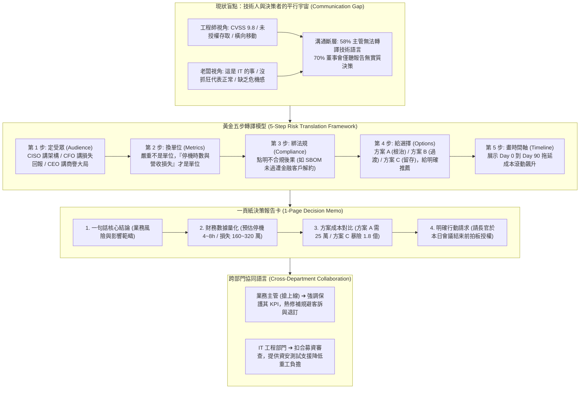

# 🎙️ 技術人與決策者的跨維度溝通：CVSS 9.8 漏洞的商業轉譯與黃金五步決策框架

> **會議／場合**：InfoSec Taiwan 2026 臺灣資訊安全論壇 / 第二日社群高峰論壇  
> **日期**：2026-07-08  
> **講者／參與者**：黃一展 (Nicky / Step Up 臺灣敏捷社群發起人、資深資安治理顧問)、大會主持人  
> **關聯文件**：[📄 完整逐字稿 (20260708-03-CVSS漏洞轉譯與CLevel決策溝通.full.md)](./20260708-03-CVSS漏洞轉譯與CLevel決策溝通.full.md)

## 📌 執行摘要 (Executive Summary)

本場講座為 InfoSec Taiwan 2026 第二日社群高峰論壇重要主題演講，由資深資安治理顧問、Step Up 臺灣敏捷社群發起人 **黃一展（Nicky）** 主講。演講直指企業資安防禦最大的非技術瓶頸——**「技術人員與高階決策者（C-Level / 董事會）之間的語言鴻溝」**。數據揭露：臺灣每日面臨高達 263 萬次網路威脅，然而 58% 的資安主管難以將技術風險轉化為商業語言，高達 70% 的董事會聽取資安簡報後無法做出實質決策，最終導致安全通報遭擱置而引爆客戶個資外洩之災難。

為徹底打破「工程師講 CVSS 9.8，老闆低頭滑手機」的平行宇宙現象，演講提出完整且模組化的解決方案：
1. **世界經濟論壇（WEF）商業情境化模型**：將網路威脅重新框定於「業務連續性、品牌商譽、法規監管與財務衝擊」四個維度；
2. **黃金五步轉譯模型（5-Step Risk Translation Framework）**：
   - **定受眾**：區隔 CISO（架構）、CFO（投報與罰款）、CEO（營運中斷與商譽）與中小企業主（生存與大客戶流失）；
   - **換單位**：將抽象之 Critical/High 換算為**「停機時數 × 每小時營收損失 + 監管裁罰」**；
   - **綁法規**：不背法條，直接點明「合規紅線」（如金融業 SBOM 軟體供應鏈要求，違者終止合約）；
   - **給選擇**：提供「A 方案（根除）、B 方案（監控防禦）、C 方案（承擔風險）」三選一，並明確給出團隊專業推薦；
   - **畫時間軸**：以 Day 0 到 Day 90 的走勢圖，具象化「拖延不決所引爆的滾動災難成本」；
3. **一頁紙決策報告卡（1-Page Decision Memo）**：以結論先行、數據量化、方案對比與明確請求（Ask），將 90 分鐘無效會議壓縮為 2 分鐘內高層拍板簽署預算。

---

## 🏛️ 核心架構圖 (Mermaid Architecture)

---

## 🔑 關鍵架構剖析與核心亮點

### 1. 語言轉譯的典範轉移：從「因果推演」到「金字塔結論先行」
- **技術思維 vs 商業思維**：工程師習慣先講「漏洞原理 ➔ 攻擊路徑 ➔ 影響模組 ➔ 建議修補」；而決策者在認知負荷過載下，需要先聽「商業影響結論 ➔ 財務暴險金額 ➔ 三方案優缺 ➔ 行動請求」。
- **換單位之量化公式**：
  - *面向對外業務系統*：$\text{風險損失} = \text{預估停機時數} \times \text{每小時在線營收} + \text{主管機關裁罰} + \text{商譽修復成本}$
  - *面向內部後勤系統（HR / ERP）*：$\text{受影響員工數} \times \text{平均時薪} \times \text{停機中斷時數} + \text{業務延誤重工成本}$

### 2. 拒絕踢皮球：提供三個方案與明確推薦
- **杜絕「建議修補」**：在報告尾端僅寫「建議修補」等於將工程評估責任推卸給不懂技術的老闆。提供「根除（A）、緩解（B）、承擔（C）」並誠實列出各自成本與隱形成本，能賦予決策者掌控感與邊界認知。
- **具象化時間軸**：利用 Day 0（修補成本 25 萬）至 Day 90（暗網曝光、全面外洩、損失破億）的走勢對比，擊破決策層「僥倖拖延」的心理慣性。

### 3. 業務與工程的跨部門潤滑劑
- **與業務部門對齊**：不以「資安大旗」強壓業務，而是從「守護業務 KPI、防範上線後退款客訴」的角度提出微調時程建議。
- **與 IT 開發對齊**：將資安補強與「公司重大融資審查、消除技術債」掛鉤，並由資安團隊主動分擔驗證工時，將對立化為協同。

---

## 💡 講者實務金句與行動指引 (Actionable Advice)

> **「嚴重不是單位，金額才是單位！在老闆辦公室裡，CVSS 9.8 只是雜訊，停機 4 小時損失 200 萬才是訊號！」**

> **「不要只丟給老闆四個字『建議修補』，那是在踢皮球；給出三個選項、列明代價、給出你的專業推薦，然後堅定地看著他的眼睛要授權！」**

> **「技術從來都不是資安唯一的解藥，語言與溝通才是推動安全防禦真正落地的引擎。」**