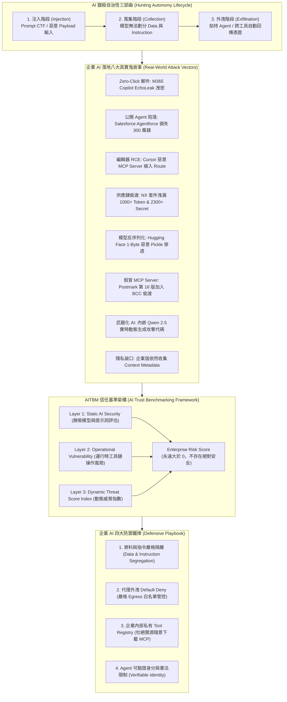

# 🎙️ 企業生成式 AI 落地「鬼故事」全揭秘：獵殺自治性、惡意 MCP 與 AI 信任基準 (AITBM)

> **會議／場合**：InfoSec Taiwan 2026 臺灣資訊安全論壇 / 第二日社群高峰論壇  
> **日期**：2026-07-08  
> **講者／參與者**：Henry (OWASP 臺灣分會會長 / AWS AI 專案貢獻者 / AITBM 框架創始人)、大會引言人 (Ray)  
> **關聯文件**：[📄 完整逐字稿 (20260708-04-企業生成式AI落地鬼故事與AITBM評估框架.full.md)](./20260708-04-企業生成式AI落地鬼故事與AITBM評估框架.full.md)

## 📌 執行摘要 (Executive Summary)

本場講座為 InfoSec Taiwan 2026 第二日社群高峰論壇全場焦點之重磅演講，由 OWASP 臺灣分會會長、OWASP AI Project 核心貢獻者、AITBM 發起人 **Henry** 主講。演講緊扣大會年度主題**「重構信任邊界（New Trust Boundary）」**，透過第一線資安研究與攻防實例，全面揭露企業引進大語言模型（LLM）與自治代理（Agentic AI）時所爆發之全球真實資安「鬼故事」災難。

演講剖析了 AI 獵殺自治性的三大演進階段（**注入 ➔ 蒐集 ➔ 代理外洩**），詳細拆解八大真實災難案例：
1. **Zero-Click 郵件洩密**：M365 Copilot EchoLeak 自動外洩敏感信件；
2. **公開對話挾持**：Salesforce Agentforce 5 美元客服 Agent 遭惡意誘導釀成 300 萬美元訴訟；
3. **瀏覽器與桌面越權**：Perplexity Comment Agent 隱藏標籤跨分頁竊密、Cursor 編輯器 1.300 版惡意 MCP Server 導致本機 RCE；
4. **開發者套件與供應鏈陷落**：Amazon Q 破壞性抹除代碼庫、NX 前端套件供應鏈遭注入竊取數千組 GitHub Token；
5. **模型反序列化投毒**：Hugging Face 遭嵌入 1-Byte 惡意指令穿透 Pickle 掃描引爆本機 RCE；
6. **惡意 MCP Server 偷渡**：Postmark 仿冒套件前 15 版乾淨發布，第 16 版加入 1 行 BCC 秘密抄送憑證；
7. **武器化自主 AI**：惡意程式內嵌 Qwen 2.5 即時動態生成攻擊代碼；
8. **隱私與 Guardrail 迷思**：戳破「企業版即隱私」謊言（各家仍收集 Context Metadata），證實 Guardrail 藉由阿拉伯文/印地語等多語複雜度即可輕易繞過。

最後，講者提出其自主研發之 **AITBM（AI Trust Benchmarking Framework）**三層動態評估模型，並立下四大企業防禦鐵律：資料與指令硬性隔離、出站網路 Default Deny、企業內部私有 Tool/Skill Registry、以及 Agent 可驗證身分（Verifiable Identity）機制。

---

## 🏛️ 核心架構圖 (Mermaid Architecture)

---

## 🔑 關鍵架構剖析與核心亮點

### 1. 根本脆弱點：資料與指令無法分離（Instruction-Data Boundary Collapse）
- **模型本質限制**：神經網絡將提示詞、使用者輸入與外掛資料統一轉換為 Token 向量計算，無法建立類似作業系統 Kernel Space 與 User Space 的實體邊界。任何未經嚴格消毒的外部輸入（如郵件 Notes、網頁 Hidden Tag），都能篡改執行流程。
- **Agentic 放大器效應**：當模型被賦予 Tool Calling（調用外部 API、操作終端機、發送郵件）權限時，原本單純的文字幻覺會直接轉變為具備實體破壞力的系統操作（如資料庫 Wipe out、秘密 BCC 轉發）。

### 2. 新型供應鏈威脅：MCP Server 與 Pickle 反序列化
- **惡意 MCP Server 潛伏**：Model Context Protocol (MCP) 為大模型賦予強大擴展性，但攻擊者已開始利用版本潛伏策略（前 15 版乾淨無害以累積信譽，第 16 版突發植入單行竊密代碼），傳統靜態安全掃描極難捕獲。
- **Pickle 壓縮反序列化**：地端部署團隊從 Hugging Face 下載開源權重時，攻擊者利用分段壓縮規避 Pickle Scan，利用單一字節在載入時觸發系統 RCE。

### 3. 破除三大安全迷思
- **迷思一：企業版保證隱私** ➔ 除非斥巨資採購完全離線的專屬隔離節點，否則一般企業版合約條款中依舊保留收集「對話 Meta 資訊」之權利。
- **迷思二：Guardrail 固若金湯** ➔ 任何原廠安全防護欄皆能透過 Role-play 或切換為高文法複雜度之阿拉伯文、印地語等語言進行繞過。
- **迷思三：安全分數可以歸零** ➔ AITBM 評估模型強調，AI 系統只要具備自治性，風險分數永遠不可能為零，必須隨時進行動態監控。

---

## 💡 講者實務金句與行動指引 (Actionable Advice)

> **「在 AI 的世界裡，信任邊界已經被徹底打破；你的風險分數永遠不可能為零！」**

> **「不要隨便相信開源社群下載的 MCP Server！惡意攻擊者可以前面發布 15 個乾淨版本，最後只用一行字就把你全盤端走！」**

> **「Guardrail 永遠可以被繞過！企業引進 AI，必須在系統底層落實資料與指令隔離，並建立企業私有 Tool Registry 與嚴格的 Egress 出站白名單！」**