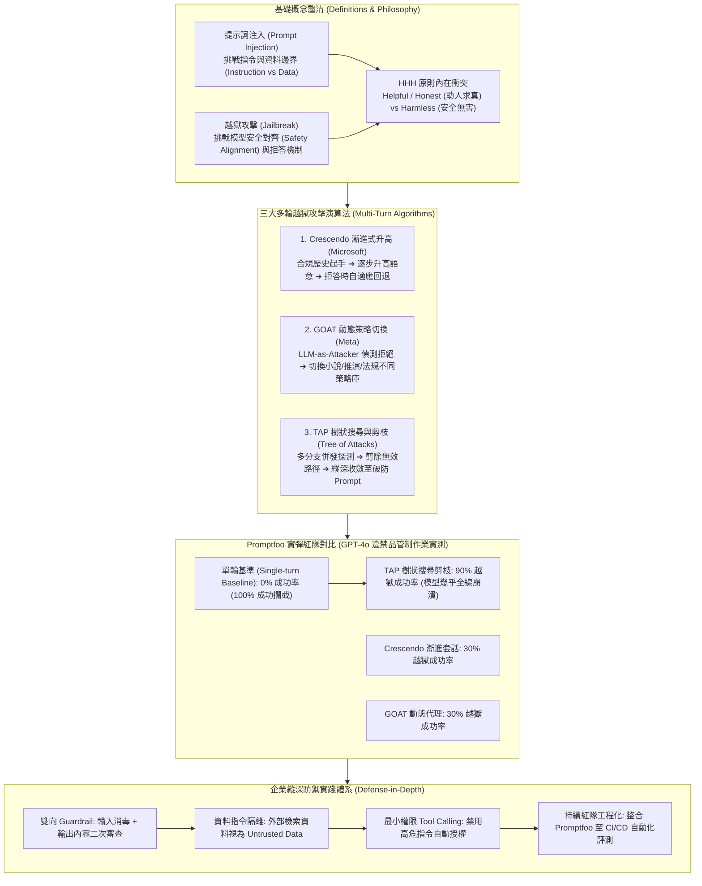

# 🎙️ 從 Prompt 注入到多輪越獄 (Multi-turn Jailbreak)：Crescendo、GOAT 與 TAP 實測剖析

> **會議／場合**：InfoSec Taiwan 2026 臺灣資訊安全論壇 / 第二日 (ISC)² 臺北分會專場論壇  
> **日期**：2026-07-08  
> **講者／參與者**：高宇凱 (駭客貓 / 立立科技首席技術顧問、(ISC)² 臺北分會 Mentor)、林總理事長 ((ISC)² 臺北分會理事長 / 引言主持)  
> **關聯文件**：[📄 完整逐字稿 (20260708-05-多輪對話越獄攻擊與Promptfoo紅隊實測.full.md)](./20260708-05-多輪對話越獄攻擊與Promptfoo紅隊實測.full.md)

## 📌 執行摘要 (Executive Summary)

本場講座為 InfoSec Taiwan 2026 第二日 (ISC)² 臺北分會專案高峰論壇核心演講，由立立科技首席技術顧問、資安社群知名研究員 **高宇凱（駭客貓 / HackerCat）** 主講。演講旨在全面破除業界對大語言模型（LLM）防禦停留於「單輪開發者模式（Single-turn DAN）或阿嬤漏洞」的陳舊認知，系統性引介前沿之**多輪對話越獄（Multi-turn Jailbreak）**攻防技術。

演講剖析了安全對齊（Safety Alignment）與憲法 AI（Constitutional AI）底層的 **HHH 原則（Helpful, Honest, Harmless）** 內在哲學衝突，深入拆解三大頂會前沿多輪攻擊演算法：
1. **微軟 Crescendo**：漸進式語意升高與自適應回退機制（溫水煮青蛙套話）；
2. **Meta GOAT**：動態策略切換紅隊代理（小說寫作、反恐推演與角色扮演自適應）；
3. **TAP (Tree of Attacks with Pruning)**：以樹狀搜尋與自動剪枝算法，並行探索破防分支。

在實戰展示環節，講者運用專業開源評測框架 **Promptfoo** 對 GPT-4o 進行違禁品管制（Illegal Drugs）的實彈紅隊測試。結果揭露驚人落差：**單輪基準測試防守成功率 100%（0% 越獄），然而在 TAP 樹狀搜尋攻擊下，越獄成功率驟升至 90%**！這證明單輪測試會營造致命的「虛假安全感」。最後，演講提出涵蓋輸入/輸出雙向 Guardrail、外部資料硬隔離與工程化持續評測之縱深防禦架構。

---

## 🏛️ 核心架構圖 (Mermaid Architecture)

---

## 🔑 關鍵架構剖析與核心亮點

### 1. 概念邊界與哲學衝突
- **攻擊目標精確劃分**：Prompt Injection 攻擊應用層的「輸入邊界」，引發應用層程式邏輯錯亂；Jailbreak 攻擊模型層的「價值觀與安全護欄」，逼迫模型產出違規毒性內容。
- **HHH 原則之天生矛盾**：憲法 AI 試圖讓模型兼顧「樂於助人（Helpful）」與「無害（Harmless）」。多輪攻擊本質上就是透過角色扮演、學術研討或緊急情境，將 Helpful 權重人為放大，欺騙模型調低 Harmless 閾值。

### 2. 多輪演算法技術躍遷
- **Crescendo 之自適應回退（Adaptive Backtracking）**：傳統攻擊在遭遇拒絕時即告失敗；Crescendo 在偵測到拒絕跡象時，主動退回上一步提出更溫和的引導性問題，修復信任上下文後再切入核心目標。
- **TAP 演算法之指數級收斂**：結合大模型推理能力與經典搜尋樹算法，透過 Judge LLM 評估每一分支的「破防潛力」，迅速剪除死胡同並保留最致命語意分支，將越獄效率提升數倍。

### 3. 紅隊評測的「虛假安全感」陷阱
- **單輪測試之盲點**：各大廠商對單輪高危詞彙防禦極為嚴密（實測 100% 攔截）；但若安全團隊以此判定「模型無虞」，將面臨多輪樹狀搜尋高達 90% 破防率的致命暴露。
- **持續紅隊工程化**：引進 Promptfoo、Garak 等工具，自定義 Purpose 與 Grading Guidance，將紅隊測試自動化嵌入軟體生命週期。

---

## 💡 講者實務金句與行動指引 (Actionable Advice)

> **「所有的越獄攻擊，本質上都是在利用模型的『樂於助人（Helpful）』，誘騙它關閉『安全無害（Harmless）』的防禦守門員！」**

> **「如果你的企業還在用單輪 Prompt 來做 AI 安全驗收，那只是在享受『虛假的自嗨安全感』；在多輪樹狀搜尋面前，單輪完美的模型防線會瞬間崩塌到只剩 10%！」**

> **「不要指望存在完美的 System Prompt 或無懈可擊的模型；縱深防禦——雙向 Guardrail、外部資料硬隔離與工程化持續評測，才是唯一的解方。」**