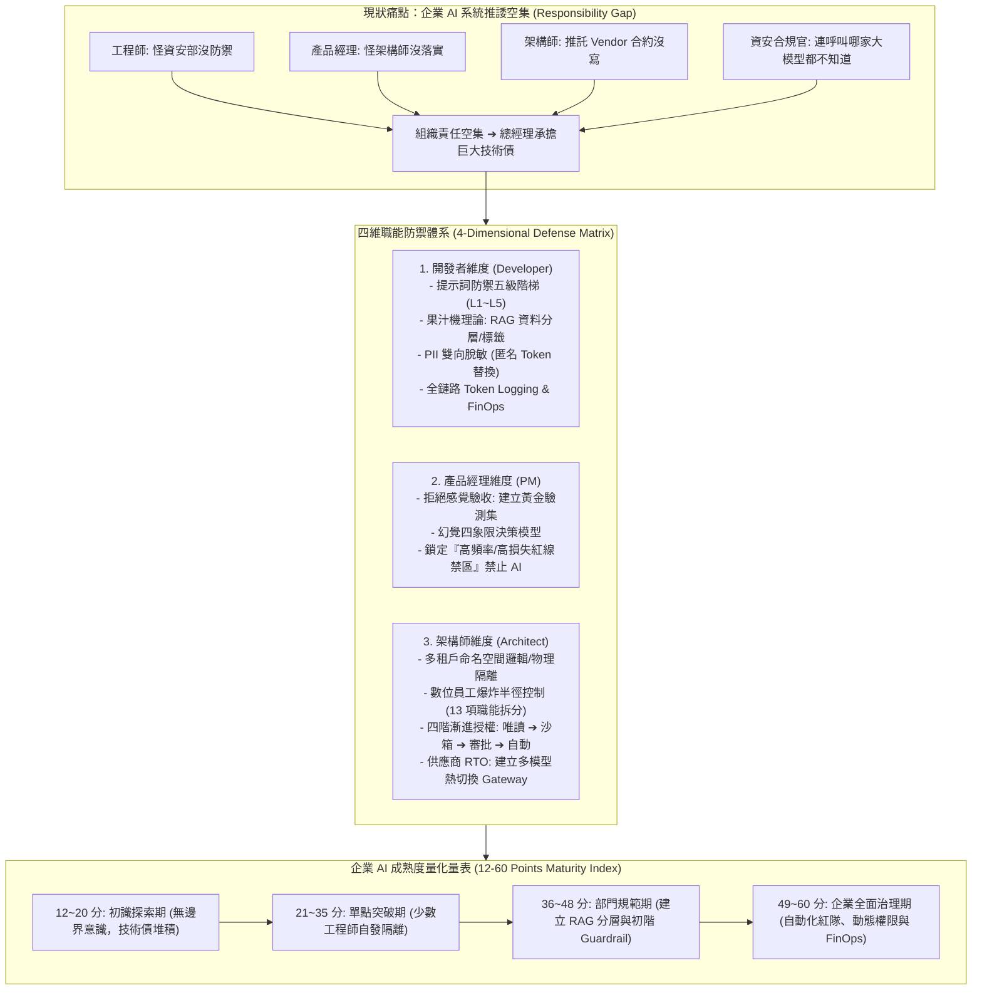

# 🎙️ 誰該守哪道線？企業 AI 系統上線的十二項能力缺口與技術債防禦體系

> **會議／場合**：InfoSec Taiwan 2026 臺灣資訊安全論壇 / 第二日社群高峰論壇 (閉幕壓軸)  
> **日期**：2026-07-08  
> **講者／參與者**：徐方毅 (FanJu / IBM 資安主管、GDG Taipei 核心幹部)、邱哲倫 (GDG Taipei 社長、Google Cloud AI GDE)、大會主持人  
> **關聯文件**：[📄 完整逐字稿 (20260708-06-誰該守哪道線之AI落地十二項能力缺口與技術債.full.md)](./20260708-06-誰該守哪道線之AI落地十二項能力缺口與技術債.full.md)

## 📌 執行摘要 (Executive Summary)

本場講座為 InfoSec Taiwan 2026 臺灣資訊安全高峰論壇第二日全體大會閉幕壓軸專題演講，由 IBM 資安主管、GDG Taipei 核心幹部 **徐方毅（FanJu）** 攜手 Google Cloud AI GDE **邱哲倫（Jerry）** 共同發表。演講直擊企業高層強推生成式 AI 上線時，各部門因職責邊界不清而引爆之深重「技術債（Technical Debt）」問題，生動刻劃「工程師怪資安部、PM 怪架構師、架構師推託 Vendor 合約沒寫、資安部渾然不知」之危險推諉空集現象。

為化解上述困局，演講提出完整之工程防禦架構與量化管理工具：
1. **開發者防禦維度**：確立提示詞防禦五級階梯，提出「果汁機過敏源理論（Blender Analogy）」闡明 RAG 資料分層與 Metadata Tagging 核心原則，落實 PII 雙向去識別化（Tokenization & Masking）與全鏈路 Token 日誌；
2. **產品經理 (PM) 防禦維度**：拒絕憑感覺驗收，導入包含邊界異常案例之黃金驗測集（Golden Dataset），提出「幻覺四象限決策模型」，堅守頻率高且損失嚴重的「紅線禁區（嚴禁 AI 介入）」；
3. **系統架構師防禦維度**：落實向量資料庫多租戶隔離，防範單一特權數位員工，透過四階段漸進授權（唯讀 ➔ 沙箱 ➔ 人類審批 ➔ 自動化）控制「爆炸半徑（Blast Radius）」，建立模型熱切換以降低供應商綁定導致之 RTO 災難；
4. **企業 AI 落地十二項能力成熟度量表**：設計 12 題（總分 12～60 分）涵蓋開發、產品與架構三面向之進階評分體系，提供組織自我體檢之實務路徑。

---

## 🏛️ 核心架構圖 (Mermaid Architecture)

---

## 🔑 關鍵架構剖析與核心亮點

### 1. 開發層：果汁機理論與 PII 雙向脫敏
- **果汁機過敏源理論（Blender Analogy）**：
  - *問題本質*：若將不同部門或敏感度的資料（如芹菜與胡蘿蔔）不加區隔地倒入向量資料庫攪拌，大模型在生成回覆時將無法將「過敏源（機密資料）」徹底剔除。
  - *解法*：在 Chunking 與 Embedding 階段實施精細的 Metadata Tagging 與存取控制清單（ACL），檢索時嚴格注入權限過濾條件。
- **PII 雙向脫敏機制**：
  - 本地端先透過輕量模型將身分證號、姓名等個資轉換為無意義隨機 Token（如 `8F7ZD`）；
  - 外部商業大模型只基於匿名化 Token 進行邏輯推理；
  - 輸出回傳至企業內網後，才在本地受控環境進行去遮罩還原，杜絕個資流向外部模型供應商。

### 2. 業務層：幻覺決策四象限模型
- **劃定紅線禁區**：以「出錯頻率」與「潛在損失嚴重度」建立四象限。
  - *全自動放行區（低頻率/低損失）*：放手讓 AI 自主運行；
  - *抽樣審查區（高頻率/低損失）*：定期抽樣複核；
  - *人機協同區（低頻率/高損失）*：嚴格落實 Human-in-the-loop；
  - *絕對紅線禁區（高頻率/高損失）*：如半導體精密機台故障排除、高風險資金放貸等，嚴禁 AI 自主下達指令，維持純人工審查。

### 3. 架構層：數位員工爆炸半徑與供應商 RTO
- **拆分特權 Agent**：禁止將具備跨部門特權的高管帳號一次性賦予單一 AI 秘書。若職責包含 13 項業務，應拆解為 13 個相互獨立、最小權限的小 Agent，透過唯讀、沙箱與人類二階段審批機制嚴控爆炸半徑。
- **架構韌性與 RTO**：切換大模型難度堪比資料庫機房大遷移。架構上必須透過標準化 API Gateway 抽象化底層模型呼叫，防範特定大廠因地緣政策下架或規則變更引發系統全面停擺。

---

## 💡 講者實務金句與行動指引 (Actionable Advice)

> **「RAG 系統就是一台果汁機！一旦你把胡蘿蔔跟芹菜混在一起攪碎，客人對芹菜過敏時，你根本不可能把芹菜挑出來——資料分層與標籤必須在進果汁機前做好！」**

> **「目前號稱可以『全自動化』的 AI 任務中，有三成屬於出錯代價無法承受的『紅線禁區』；專業 PM 的價值不在於盲目跟風，而在於有勇氣踩下煞車！」**

> **「不要讓一個數位員工繼承你所有的特權！控制爆炸半徑、拆分職能 Agent、落實唯讀與沙箱審批，才是 AI 系統安全落地的第一法則。」**