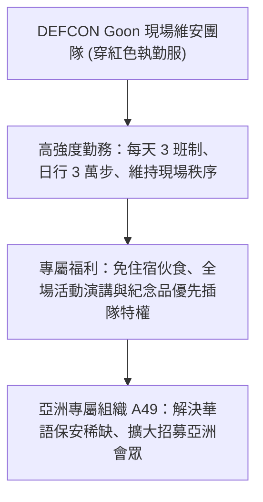

# ⚡ HITCON 2026 閃電秀：DEFCON Goon 現場維安工作人員招募 (Henry)

> **活動名稱**：HITCON 2026 Lightning Talks (閃電秀)  
> **演講講者**：Henry（亞洲 Goon 組織 A49 共同發起人）  
> **核心主題**：DEFCON Goon 現場維安實務、日行 3 萬步執勤考驗、會場特權與亞洲 A49 招募  
> **關聯文件**：[📄 完整原話逐字稿 (20260821-04-DEFCON-Goon現場維安工作人員招募.full.md)](./20260821-04-DEFCON-Goon現場維安工作人員招募.full.md)

---

## 🏛️ 核心架構與概念流轉圖

---

## 🔑 重點提要 (Key Takeaways)

1. **幕後核心職能**：DEFCON Goon 是維持 3 萬人駭客年會秩序的關鍵骨幹，需要極高體力與溝通技巧。
2. **亞洲專屬網絡**：成立 A49 專屬亞洲團隊，降低亞洲資安愛好者參與國際頂級年會志工的門檻。
