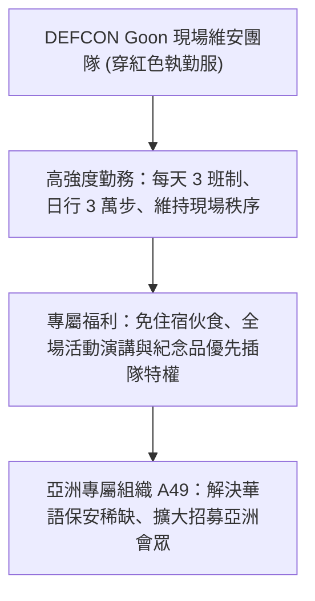

# 🎙️ 2026 閃電秀：DEFCON Goon 現場維安工作人員招募

> **活動名稱**：HITCON 2026 Lightning Talks (閃電秀)  
> **演講講者**：Henry（亞洲 Goon 組織 A49 共同發起人）  
> **核心主題**：DEFCON Goon 現場維安實務、日行 3 萬步執勤考驗、會場特權與亞洲 A49 招募  
> **關聯文件**：[📄 完整原話逐字稿 (20260821-04-DEFCON-Goon現場維安工作人員招募.full.md)](./20260821-04-DEFCON-Goon現場維安工作人員招募.full.md)

---

## 🏛️ 核心架構與概念流轉圖

---

## 🔑 重點提要 (Key Takeaways)

1. **幕後核心職能**：DEFCON Goon 是維持 3 萬人駭客年會秩序的關鍵骨幹，需要極高體力與溝通技巧。
2. **亞洲專屬網絡**：成立 A49 專屬亞洲團隊，降低亞洲資安愛好者參與國際頂級年會志工的門檻。
---

## 🛡️ DEFCON Goon 維安執勤架構、會場權限與亞洲 A49 招募實務

| 維度項目 | 現場實務內容與執勤挑戰 | 核心特權與社群價值 | 亞洲 Goon 組織（A49）招募與參與指引 |
| :--- | :--- | :--- | :--- |
| **Goon 角色定位與執勤強度** | 負責全球最大駭客年會 DEFCON 之現場動線控管、安全維護、緊急應變與演講廳秩序管理；每日於拉斯維加斯巨型會場步行高達 **7,000 至 30,000 步** | 不僅是安全糾察，更是維護大會自由交流氛圍與保護講者、會眾免受未授權物理入侵的第一道防線 | 講者 Henry 為亞洲 Goon 團隊 **A49** 共同發起人，現場於 HITCON 設立 **A49 攤位**提供第一手經驗諮詢 |
| **實體安全與會場突發應變** | 拉斯維加斯飯店曾發生會眾嘗試對房卡門鎖進行硬體逆向測試而遭飯店安全部門關切；Goon 需協助居中協調並落實大會行為準則（CoC） | 深度參與頂尖國際資安盛會幕後運作，學習數萬人規模高風險駭客聚會之群眾管理與危機處理SOP | 歡迎具備基礎英語溝通能力、抗壓性強且熱愛駭客社群文化的台灣資安夥伴加入國際志工行列 |
| **專屬福利與全球人脈網絡** | 執勤期間需配合排班表輪值各特色 Village、報到處與主議程廳 | 享有 **DEFCON 免費入場資格**、專屬 Goon 識別證（Badge）與服飾，並能直接結識全球頂尖白帽駭客、DEFCON 核心創辦團隊與跨國資安專家 | 有意願挑戰國際級資安年會幕後維安者，可直接至會場 A49 攤位與現任 Goon 成員面對面交流報名流程 |
