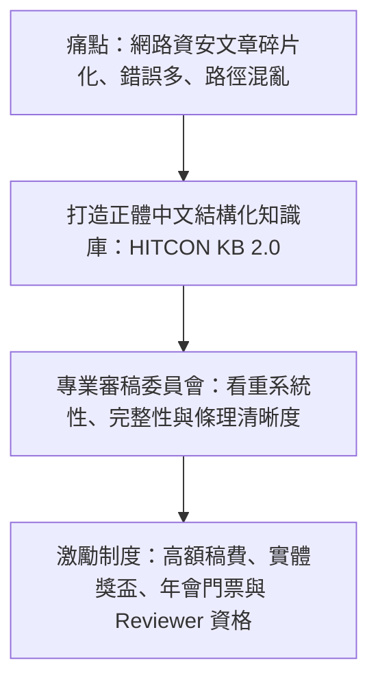

# 🎙️ 2026 閃電秀：讓 HITCON 成為你的知識庫——HITCON KB 2.0

> **活動名稱**：HITCON 2026 Lightning Talks (閃電秀)  
> **演講講者**：克雷 (Craig，HITCON KB 專案負責人)  
> **核心主題**：HITCON KB 2.0 正體中文資安知識庫、優渥稿費獎勵機制、審稿委員會嚴格把關  
> **關聯文件**：[📄 完整原話逐字稿 (20260821-05-HITCON-KB知識庫平台.full.md)](./20260821-05-HITCON-KB知識庫平台.full.md)

---

## 🏛️ 核心架構與概念流轉圖

---

## 🔑 重點提要 (Key Takeaways)

1. **品質導向非難度導向**：審稿不盲目追求技術艱深，高品質的基礎教學文章同樣能獲得最高評分與獎勵。
2. **開源知識累積**：透過社群協作累積系統化正體中文教材，降低後進學習者門檻。
---

## 📚 HITCON KB 2.0 知識庫運作機制、審稿規範與社群激勵模型

| 平台演進維度 | 舊版 HITCON Wiki / 傳統技術部落格痛點 | HITCON KB 2.0 升級架構與核心機制 | 對資安研究員與社群之實質效益 |
| :--- | :--- | :--- | :--- |
| **品牌定位與內容範疇** | 原名 HITCON Wiki，早期偏向百科條目形式，更新頻率受限且缺乏系統化專題深度文章 | 正式更名為 **HITCON KB（Knowledge Base）**，聚焦高品質正體中文資安技術專欄、漏洞研究 Writeup、紅藍隊攻防實戰與最新威脅分析 | 打造華語圈最具公信力的開源資安技術智庫，解決繁體中文高階資安教材與實戰文獻稀缺問題 |
| **專業審稿委員會（Review Board）** | 一般個人部落格缺乏同儕審查（Peer Review），易出現技術細節偏誤或未脫敏之合規風險 | 成立專屬 **HITCON KB 審稿委員會**，由資深資安專家針對投稿文章進行技術正確性驗證、結構潤飾與雙向建設性回饋 | 確保每篇上架文章兼具學術嚴謹度與工程可重現性，協助新手與中階研究員大幅提升技術寫作水平 |
| **實質稿費激勵與徵稿制度** | 傳統開源社群多仰賴無償熱血貢獻，難以長期維持高難度底層研究文章之穩定產出 | 導入極具競爭力的**實質稿費獎勵機制**，讓作者在分享知識的同時獲得合理的經濟回饋與官方署名榮譽 | 建立「研究產出 → 專業審稿 → 稿費獎勵 → 社群影響力」的正向飛輪，開放全體資安研究者透過官方管道踴躍投稿 |
