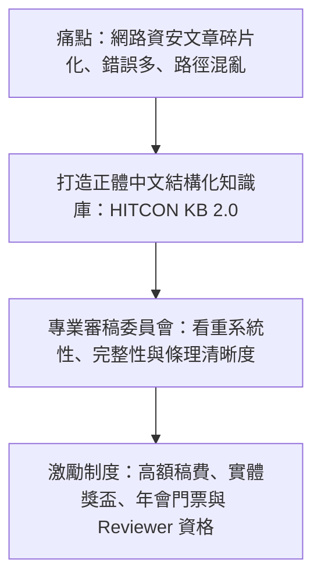

# ⚡ HITCON 2026 閃電秀：讓 HITCON 成為你的知識庫——HITCON KB 2.0 (克雷)

> **活動名稱**：HITCON 2026 Lightning Talks (閃電秀)  
> **演講講者**：克雷 (Craig，HITCON KB 專案負責人)  
> **核心主題**：HITCON KB 2.0 正體中文資安知識庫、優渥稿費獎勵機制、審稿委員會嚴格把關  
> **關聯文件**：[📄 完整原話逐字稿 (20260821-05-HITCON-KB知識庫平台.full.md)](./20260821-05-HITCON-KB知識庫平台.full.md)

---

## 🏛️ 核心架構與概念流轉圖

---

## 🔑 重點提要 (Key Takeaways)

1. **品質導向非難度導向**：審稿不盲目追求技術艱深，高品質的基礎教學文章同樣能獲得最高評分與獎勵。
2. **開源知識累積**：透過社群協作累積系統化正體中文教材，降低後進學習者門檻。
