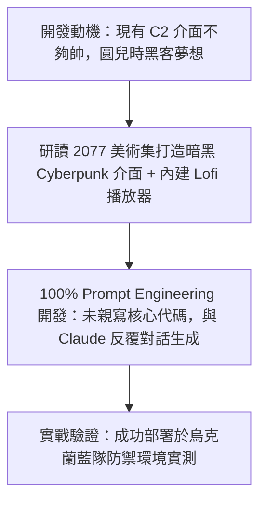

# 🎙️ 2026 閃電秀：極致 Cyberpunk 中二 C2 框架 Mina

> **活動名稱**：HITCON 2026 Lightning Talks (閃電秀)  
> **演講講者**：Ray（開源紅隊工具開發者）  
> **核心主題**：Cyberpunk 暗黑美學 UI、內建 Lofi 音樂、100% Prompt Engineering 生成、烏克蘭藍隊實測  
> **關聯文件**：[📄 完整原話逐字稿 (20260821-06-Cyberpunk-C2框架Mina.full.md)](./20260821-06-Cyberpunk-C2框架Mina.full.md)

---

## 🏛️ 核心架構與概念流轉圖

---

## 🔑 重點提要 (Key Takeaways)

1. **AI 輔助極速開發**：兩天內僅憑自然語言提示工程與 LLM 對話完成完整可用 C2 框架原型。
2. **使用者體驗革新**：將個人美學與實用紅隊工具結合，提升工具操作沉浸感。
---

## 👾 Mina C2 框架特色技術架構、Prompt 驅動生成與紅藍對抗驗證

| 技術與設計維度 | Mina C2 框架核心實作細節 | 與傳統紅隊 C2 工具（Cobalt Strike / Sliver）之差異 | 實戰驗證與防禦啟示 |
| :--- | :--- | :--- | :--- |
| **Cyberpunk 視覺美學與沉浸式體驗** | 採用高對比霓虹暗黑風格（Cyberpunk UI），內建 **Lo-fi 音樂播放器**與動態終端機特效，滿足紅隊算子對「中二駭客電影感」的極致追求 | 傳統 C2 介面多為陽春命令列或老舊 Java Swing 視窗，缺乏現代化前端互動體驗與操作愉悅感 | 證明資安攻防工具亦可兼具現代化 Web UI/UX 設計美學，降低長時間紅隊演練之視覺疲勞 |
| **100% Prompt Engineering 驅動開發** | 講者 Ray 透過大型語言模型（LLM）以 **100% 純 Prompt 工程**迭代生成前端介面、後端控制邏輯與通訊模組，未手寫傳統樣板代碼 | 大幅縮短自研 C2 框架從概念驗證（PoC）到可用原型的開發週期，展現 AI 輔助開發（Vibe Coding）於攻防工具鏈的爆發力 | 隨客製化 C2 開發門檻因 GenAI 而大幅降低，藍隊不能再僅依賴已知 C2 預設特徵碼（Signature），必須轉向行為偵測 |
| **跨國社群回饋與藍隊實測** | 專案開源發布至 GitHub 後獲得國際資安社群關注，甚至收到來自**烏克蘭藍隊研究人員**的實測詢問與交流回饋 | 一般玩具級專案僅停留在本地展示，Mina 則實際被前線防禦人員納入新型態開源 C2 樣本評估 | 提醒開發者與研究員：使用 AI 生成攻防工具時仍需嚴格審視通訊加密、權限控管與自身端點安全（OPSEC） |
