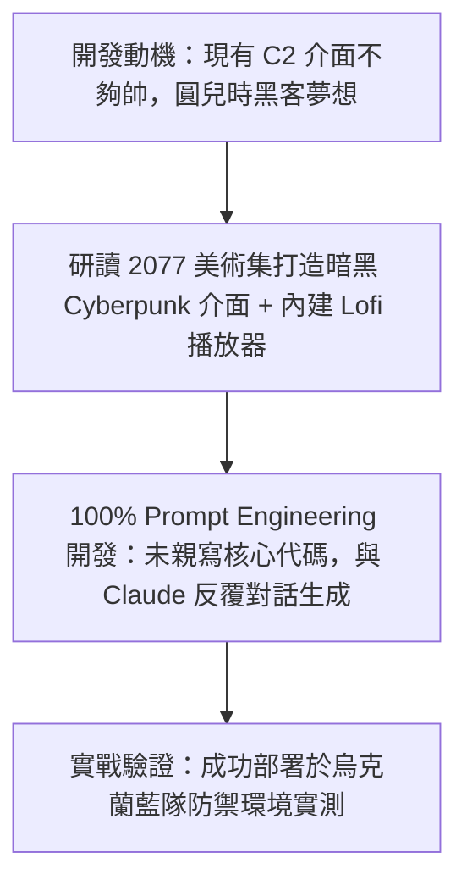

# ⚡ HITCON 2026 閃電秀：極致 Cyberpunk 中二 C2 框架 Mina (Ray)

> **活動名稱**：HITCON 2026 Lightning Talks (閃電秀)  
> **演講講者**：Ray（開源紅隊工具開發者）  
> **核心主題**：Cyberpunk 暗黑美學 UI、內建 Lofi 音樂、100% Prompt Engineering 生成、烏克蘭藍隊實測  
> **關聯文件**：[📄 完整原話逐字稿 (20260821-06-Cyberpunk-C2框架Mina.full.md)](./20260821-06-Cyberpunk-C2框架Mina.full.md)

---

## 🏛️ 核心架構與概念流轉圖

---

## 🔑 重點提要 (Key Takeaways)

1. **AI 輔助極速開發**：兩天內僅憑自然語言提示工程與 LLM 對話完成完整可用 C2 框架原型。
2. **使用者體驗革新**：將個人美學與實用紅隊工具結合，提升工具操作沉浸感。
