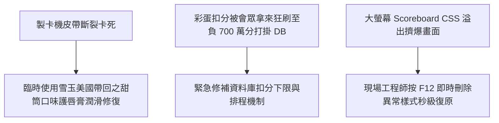

# 🎙️ 2026 閃電秀：HITCON 2026 活動組幕後除障血淚史

> **活動名稱**：HITCON 2026 Lightning Talks (閃電秀)  
> **演講講者**：HITCON 2026 現場活動組團隊  
> **核心主題**：護唇膏潤滑製卡機皮帶、彩蛋釣魚負 700 萬分打掛資料庫、F12 即時除障  
> **關聯文件**：[📄 完整原話逐字稿 (20260821-07-HITCON活動組幕後除障血淚史.full.md)](./20260821-07-HITCON活動組幕後除障血淚史.full.md)

---

## 🏛️ 核心架構與概念流轉圖

---

## 🔑 重點提要 (Key Takeaways)

1. **現場應變彈性**：大型資安年會充滿不可預期突發狀況，工程師發揮黑客精神就地取材解決硬體障礙。
2. **防禦會眾惡搞**：設計彩蛋互動時必須預想「自殘式刷分」的極端邊界條件，做好資料庫併發防護。
---

## 🛠️ HITCON 2026 活動現場突發障礙、根因分析與即時修復實務

| 現場突發事件 | 故障現象與技術根因分析 | 活動組極限應急除障手段 | 大型資安年會維運經驗沉澱 |
| :--- | :--- | :--- | :--- |
| **專屬識別證（Badge）製卡機卡死** | 開幕前夕大量印製會眾專屬識別卡時，熱昇華製卡機內部傳動皮帶因高負荷摩擦乾澀導致卡片頻繁卡死停擺 | 現場缺乏專用工業潤滑油，活動組靈機一動拿隨身**護唇膏（Lip Balm）**均勻塗抹於傳動皮帶進行物理潤滑，成功恢復高速印製 | 實體活動硬體設備需準備備援機台與耗材保養包；面對物理機械故障時，工程師的隨機應變能力至關重要 |
| **大會闖關遊戲「負 700 萬分」彩蛋釣魚事故** | 活動組於積分系統設計隱藏負分陷阱彩蛋，未料現場駭客會眾展現驚人自動化腳本能力，瘋狂觸發並累積高達**負 700 萬分**，導致排行榜與後端資料庫溢位崩潰 | 工程師於後台緊急攔截異常請求、修正積分邊界檢查邏輯（Boundary Check）並重置異常負分紀錄，防止資料庫連線池被塞爆 | 在滿場頂尖駭客的 HITCON 舉辦互動遊戲，任何前端輸入與商業邏輯都必須預設遭受高強度 Fuzzing 與極端值壓測 |
| **舞台與展示終端即時 F12 除錯** | 現場活動展示頁面在投影幕上突發前端渲染異常與狀態卡死，距離活動開始僅剩數十秒 | 活動組人員直接於現場開啟瀏覽器 **F12 開發者工具（DevTools）** 即時修改 DOM 狀態與熱修補（Hotfix）JavaScript 腳本化險為夷 | 現場展示系統應具備離線靜態備援模式（Fallback Mode）與快速回滾機制，確保高壓環境下服務不中斷 |
