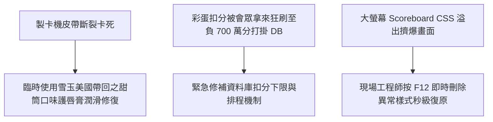

# ⚡ HITCON 2026 閃電秀：HITCON 2026 活動組幕後除障血淚史 (活動組)

> **活動名稱**：HITCON 2026 Lightning Talks (閃電秀)  
> **演講講者**：HITCON 2026 現場活動組團隊  
> **核心主題**：護唇膏潤滑製卡機皮帶、彩蛋釣魚負 700 萬分打掛資料庫、F12 即時除障  
> **關聯文件**：[📄 完整原話逐字稿 (20260821-07-HITCON活動組幕後除障血淚史.full.md)](./20260821-07-HITCON活動組幕後除障血淚史.full.md)

---

## 🏛️ 核心架構與概念流轉圖

---

## 🔑 重點提要 (Key Takeaways)

1. **現場應變彈性**：大型資安年會充滿不可預期突發狀況，工程師發揮黑客精神就地取材解決硬體障礙。
2. **防禦會眾惡搞**：設計彩蛋互動時必須預想「自殘式刷分」的極端邊界條件，做好資料庫併發防護。
