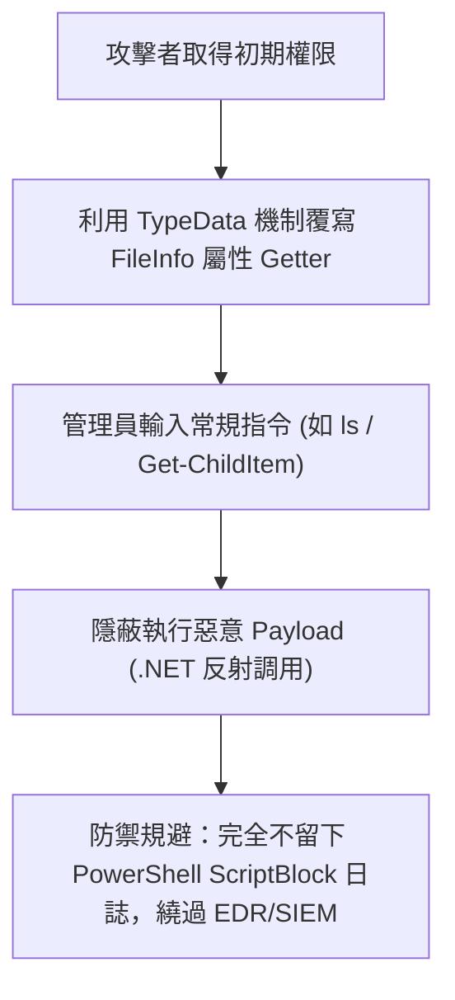

# 🎙️ 2026 閃電秀：PowerShell 隱蔽執行與 TypeData 屬性覆寫奇技淫巧

> **活動名稱**：HITCON 2026 Lightning Talks (閃電秀)  
> **演講講者**：阿斯卡 (Aska)  
> **核心主題**：PowerShell TypeData 屬性覆寫、無感知指令劫持、繞過 ScriptBlock 日誌監控  
> **關聯文件**：[📄 完整原話逐字稿 (20260821-08-PowerShell隱蔽執行與TypeData覆寫.full.md)](./20260821-08-PowerShell隱蔽執行與TypeData覆寫.full.md)

---

## 🏛️ 核心架構與概念流轉圖

---

## 🔑 重點提要 (Key Takeaways)

1. **極度隱蔽的持留機制**：覆寫 .NET 既有型別屬性，利用管理員日常操作自動觸發惡意行為。
2. **規避端點監控**：不經由常規腳本呼叫，大幅增加藍隊溯源與取證難度。
---

## ⚙️ PowerShell TypeData 屬性覆寫機制、防禦繞過與鑑識排查技術

| 隱蔽攻擊技術維度 | 底層 .NET / PowerShell 運作機制 | 惡意利用與持久化觸發方式 | 防禦繞過效果與藍隊鑑識挑戰 |
| :--- | :--- | :--- | :--- |
| **語言怪癖與 `$ExecutionContext` 濫用** | PowerShell 支援不區分大小寫、參數前綴自動縮寫、反引號（Backtick）跳脫，且可透過 `$ExecutionContext` 存取執行階段內部狀態與載入 C# / Inline Assembly | 攻擊者利用極短參數別名與動態上下文調用，構造高度混淆之無檔案（Fileless）攻擊載荷，規避靜態特徵碼掃描 | 傳統基於字串匹配的防毒與 WAF 規則極易被反引號插字與參數縮寫繞過 |
| **`System.IO.FileInfo` 屬性 Getter 劫持** | 透過 `Update-TypeData` 動態覆寫或擴充 .NET 物件型別（如 `System.IO.FileInfo`）之屬性 Getter 或 `CodeProperty` 成員 | 將惡意腳本注入檔案物件的顯示屬性中；當系統管理員在終端機執行日常 `ls`（`Get-ChildItem`）列舉目錄時，物件格式化輸出即自動觸發惡意 Getter 執行 | 觸發動作完全看似管理員正常維運指令，且在屬性求值階段執行，極難從命令列歷史紀錄察覺異常 |
| **`PSVariable` 變數偽造與 `Get-Member` 反制** | 覆寫 `System.Management.Automation.PSVariable` 的值讀取邏輯，同時連帶覆寫 `Get-Member` 的輸出型別定義 | 當藍隊分析師使用 `Get-Variable` 或 `Get-Member` 檢查可疑變數與物件結構時，終端機僅回傳偽造後的正常數值與乾淨成員列表 | 實現使用者空間（User-land）的 PowerShell Rootkit 效果，使現場互動式鑑識工具喪失可信度 |
| **零 ScriptBlock 日誌（Event ID 4104）規避** | 透過 TypeData 成員綁定與底層委派觸發之操作，不經過標準腳本區塊編譯管線 | 執行過程**完全不產生 PowerShell ScriptBlock Logging（Event ID 4104）**，使依賴該日誌的 EDR 與 SIEM 規則全面失明 | 藍隊需監控處理序記憶體中異常的 `Update-TypeData` 呼叫、檢查自訂 `.ps1xml` 型別定義檔，並結合 ETW（Event Tracing for Windows）底層事件進行關聯分析 |
