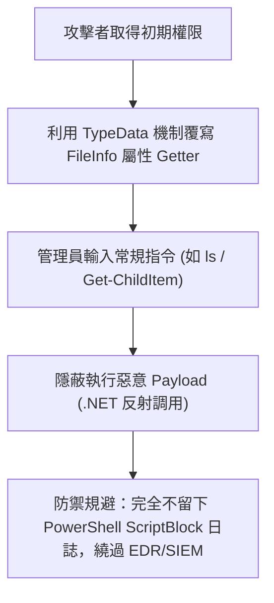

# ⚡ HITCON 2026 閃電秀：PowerShell 隱蔽執行與 TypeData 覆寫 (阿斯卡)

> **活動名稱**：HITCON 2026 Lightning Talks (閃電秀)  
> **演講講者**：阿斯卡 (Aska)  
> **核心主題**：PowerShell TypeData 屬性覆寫、無感知指令劫持、繞過 ScriptBlock 日誌監控  
> **關聯文件**：[📄 完整原話逐字稿 (20260821-08-PowerShell隱蔽執行與TypeData覆寫.full.md)](./20260821-08-PowerShell隱蔽執行與TypeData覆寫.full.md)

---

## 🏛️ 核心架構與概念流轉圖

---

## 🔑 重點提要 (Key Takeaways)

1. **極度隱蔽的持留機制**：覆寫 .NET 既有型別屬性，利用管理員日常操作自動觸發惡意行為。
2. **規避端點監控**：不經由常規腳本呼叫，大幅增加藍隊溯源與取證難度。
