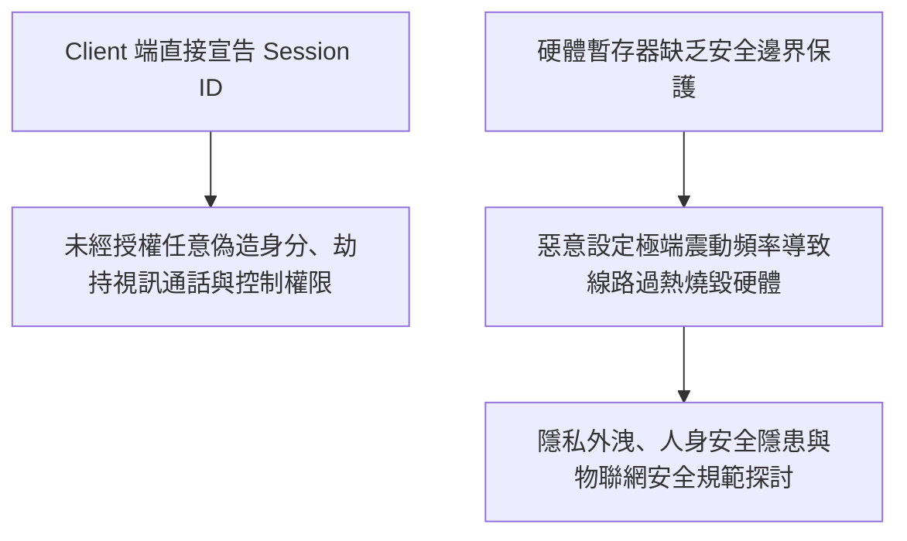

# 🎙️ 2026 閃電秀：來自超自然的震動——智慧成人連網玩具漏洞挖掘

> **活動名稱**：HITCON 2026 Lightning Talks (閃電秀)  
> **演講講者**：S & 艾子（硬體與物聯網安全研究員）  
> **核心主題**：IoT 藍牙連網玩具、Session ID 自主宣告身分偽造、遠端未授權控制與暫存器過熱燒毀  
> **關聯文件**：[📄 完整原話逐字稿 (20260821-09-智慧成人連網玩具漏洞挖掘.full.md)](./20260821-09-智慧成人連網玩具漏洞挖掘.full.md)

---

## 🏛️ 核心架構與概念流轉圖

---

## 🔑 重點提要 (Key Takeaways)

1. **身分驗證架構漏洞**：客戶端不應具備自主宣告 Session ID 權限，必須由後端加密生成並完成校驗。
2. **硬體安全防護邊界**：軟體指令不得突破物理硬體的極限，韌體端必須設置硬性保護熔斷機制。
---

## 🔍 物聯網 BLE 三層架構漏洞分析、Session 偽造與硬體風險評估

| 系統架構層級 | 核心通訊功能與資產偵察（Reconnaissance） | 挖掘之關鍵安全漏洞（6+ Bugs） | 潛在攻擊影響與負責任揭露（Responsible Disclosure） |
| :--- | :--- | :--- | :--- |
| **雲端伺服器與社交 API 層** | 提供跨國遠端控制（Remote Control）、雙向音視訊串流（Video/Audio Streaming）、公開個人檔案（Public Profile）與好友配對功能 | **Session ID 客戶端自主宣告與身分偽造漏洞**：配對與視訊請求之 Session ID 完全由 Client 端生成並上傳，Server 端未驗證發起者身分權限即直接轉發指令 | 攻擊者僅需從公開頁面爬取目標 User ID，即可偽造 Session 在未獲同意下強制對任意受害者發起視訊連線與遠端震動控制 |
| **手機 App 控制端** | 負責處理使用者登入、社群互動介面，並作為雲端指令轉發至本地藍牙裝置之中繼橋樑（Bridge） | 通訊協定封包缺乏嚴格的加密簽章與伺服器端挑戰應答（Challenge-Response）驗證，容易透過代理攔截（MitM）逆向還原 API 結構 | 導致使用者隱私狀態、配對關係與即時控制權暴露於未授權第三方之手 |
| **連網玩具硬體與 BLE 韌體層** | 透過低功耗藍牙（BLE GATT）接收手機 App 發送之震動頻率、強度與模式控制字元組 | **硬體暫存器缺乏邊界檢查（Missing Boundary Check）**：韌體未限制寫入馬達控制暫存器的數值上限與持續時間 | 攻擊者可透過藍牙發送超額控制指令，迫使內部馬達長期處於極限超載狀態，引發**硬體過熱甚至物理燒毀**之安全危害；團隊已遵循白帽原則整理報告提交廠商修補 |
