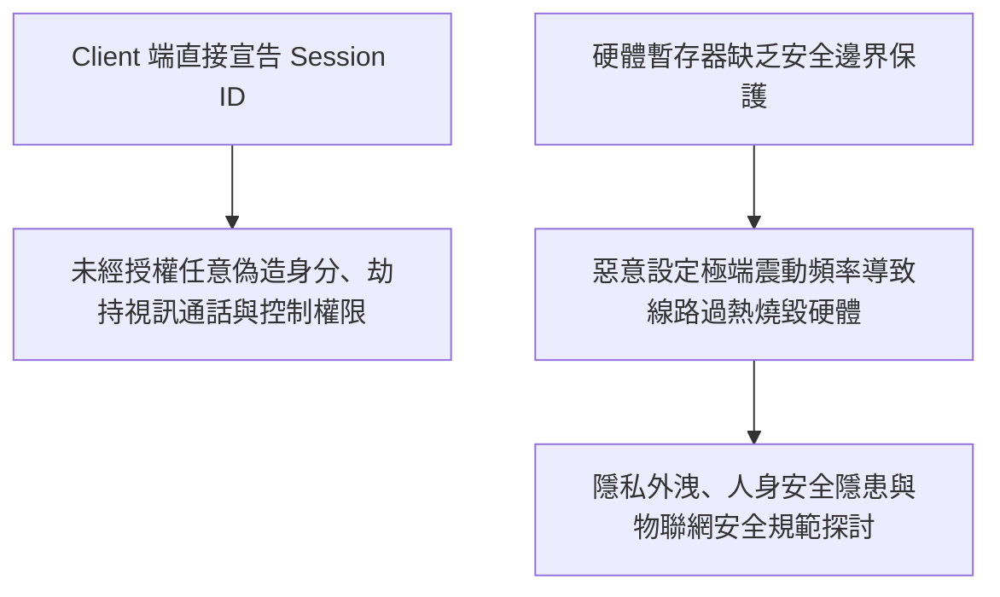

# ⚡ HITCON 2026 閃電秀：來自超自然的震動——智慧成人連網玩具漏洞挖掘 (S & 艾子)

> **活動名稱**：HITCON 2026 Lightning Talks (閃電秀)  
> **演講講者**：S & 艾子（硬體與物聯網安全研究員）  
> **核心主題**：IoT 藍牙連網玩具、Session ID 自主宣告身分偽造、遠端未授權控制與暫存器過熱燒毀  
> **關聯文件**：[📄 完整原話逐字稿 (20260821-09-智慧成人連網玩具漏洞挖掘.full.md)](./20260821-09-智慧成人連網玩具漏洞挖掘.full.md)

---

## 🏛️ 核心架構與概念流轉圖

---

## 🔑 重點提要 (Key Takeaways)

1. **身分驗證架構漏洞**：客戶端不應具備自主宣告 Session ID 權限，必須由後端加密生成並完成校驗。
2. **硬體安全防護邊界**：軟體指令不得突破物理硬體的極限，韌體端必須設置硬性保護熔斷機制。
