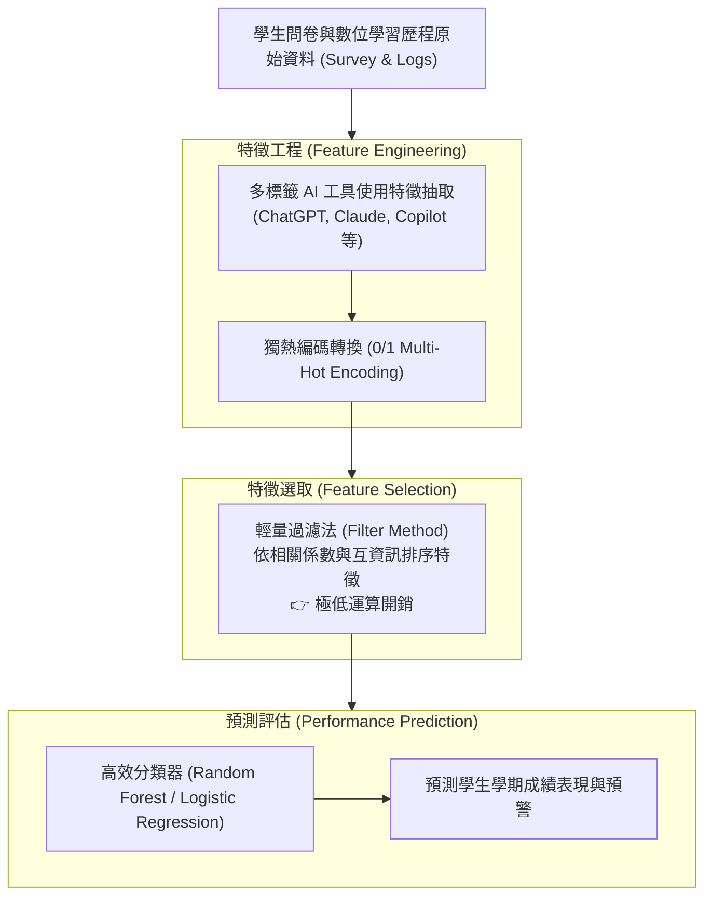

# 🎙️ 英語專題發表：人工智慧教育表現預測、特徵工程與低成本過濾法模型 (授課講師 / 學員 / Youchen)

> **專題發表主題**：AI 在教育學習表現預測之特徵工程（Feature Engineering）、多標籤獨熱編碼與輕量級過濾法（Filter Method）模型  
> **發表團隊**：Youchen 研究專案團隊（400th Day Request 專題小組）  
> **核心模組**：Educational Data Mining, Feature Selection, Filter Method, Multi-Label Encoding, Low-Cost ML  
> **學習目標**：掌握教育大數據中多模態學習工具使用特徵之編碼方式，運用低運算成本之過濾法特徵選取優化學習成效預測  
> **關聯文件**：[📄 完整原話逐字稿 (2026-03-18-AI教育表現特徵工程與過濾法預測-proofread.md)](./20260318-AI教育表現特徵工程與過濾法預測.full.md)

---

## 🏛️ 教育大數據特徵工程與過濾法預測管線

---

## 🎯 核心重點整理 (Key Takeaways)

### 1. 研究主題與教育範式轉移 (Paradigm Shift)
- **生成式 AI 工具融入學習**：探討現代大學生在學習歷程中使用各類 AI 輔助工具（如 ChatGPT）對學業表現之實際衝擊。
- **多標籤特徵表示**：學生可能同時使用多種 AI 工具，團隊透過多標籤編碼（0 與 1 二元矩陣）精確記錄其工具使用組合特徵。

### 2. 過濾法 (Filter Method) 之實務優勢
- **極低算力成本**：相較於包裹法（Wrapper Method）或嵌入法（Embedded Method）需要反覆訓練模型，過濾法僅需計算特徵與目標變數之統計相關性，運算成本極低，能推動 AI 教育預測工具的普及化。
---

## 📊 特徵工程過濾法指標、相關性分析與模型評估對照表

| 特徵工程與模型維度 | 核心技術方法與數學原理 | 於教育表現資料集之實驗發現 | 運算成本與模型泛化優勢 |
| :--- | :--- | :--- | :--- |
| **過濾法特徵選取（Filter Method）** | 獨立於下游分類器之外，直接計算各原始特徵與目標變數（學業成績高低）間之統計相關性（如 Pearson 相關係數、互資訊 Mutual Information、卡方檢定） | 能快速篩除與學習成效無關的冗餘人口統計雜訊，保留高資訊量之出席率、線上學習互動頻率與期中評量特徵 | 時間複雜度為 $O(N \cdot d)$，遠低於需要反覆訓練模型的包裝法（Wrapper Method，如 RFE），極適合教育機構低算力環境部署 |
| **多重共線性消除與特徵精簡** | 透過特徵間相關性矩陣（Correlation Matrix）檢測高度重疊之行為指標，僅保留最具代表性之正交特徵子集 | 將原始數十維特徵大幅壓縮後，不僅未減損分類準確率，反而消除了高維度稀疏空間帶來的過擬合（Overfitting）風險 | 顯著減少記憶體佔用與推論延遲，並使教師與教育管理者能直觀解釋各關鍵指標對學業預警的貢獻度 |
| **監督式分類器基準測試** | 對比邏輯斯迴歸（Logistic Regression）、支援向量機（SVM）、隨機森林（Random Forest）與梯度提升樹於精簡特徵集上之表現 | 搭配過濾法預處理後，輕量級線性與樹模型即可在 Accuracy、Precision、Recall 與 F1-score 上追平甚至超越複雜深度模型 | 為校園早期學習預警系統（Early Warning System）提供高可解釋性、低維護成本且可即時介入輔導的工程方案 |
