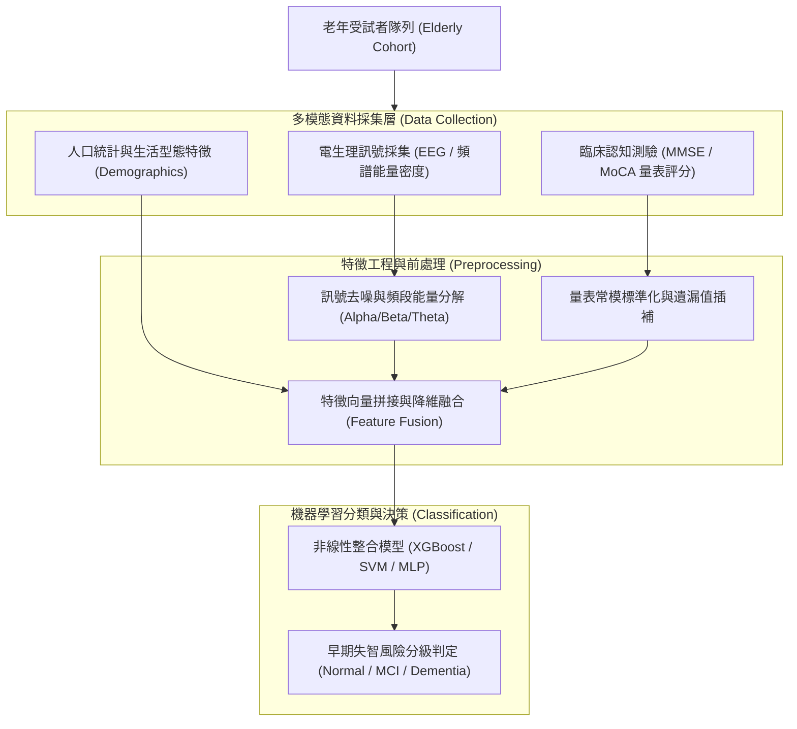

# 🎙️ 學術論文發表 Session A：智慧醫療——老年失智症多模態神經與認知特徵預測模型 (發表人 / 評審委員 / 主持人)

> **研討會名稱**：第十七屆國立中央大學資訊管理學系學術論文暨專題發表會 (NCU IM Conference 2026)  
> **發表場次**：Session A 智慧醫療專題  
> **核心模組**：Smart Healthcare, Dementia Prediction, Multimodal Features, Cognitive Assessment, Model Evaluation  
> **研究亮點**：整合多模態神經電生理訊號與臨床認知評估量表，構建高靈敏度之早期老年失智症輔助預測架構  
> **關聯文件**：[📄 完整原話逐字稿 (2026-03-27-NCU-IM-01-智慧醫療失智症預測-proofread.md)](./20260327-智慧醫療失智症預測.full.md)

---

## 🏛️ 多模態失智症早期篩檢特徵工程架構

---

## 🎯 核心重點整理 (Key Takeaways)

### 1. 研究動機與臨床挑戰
- **高齡化社會痛點**：失智症（Dementia）為神經退化性症候群，早期輕度認知障礙（MCI）若能提早偵測，可大幅延緩病程惡化。傳統醫院神經心理量表耗時長且仰賴資深醫師主觀判讀。
- **多模態特徵整合**：本研究結合客觀生理訊號（腦波 EEG 頻段特徵）與結構化認知量表，降低單一檢驗指標之偽陽性。

### 2. 實驗效能與評審委員講評
- **指標權衡**：在生醫診斷領域中，「靈敏度（Sensitivity / Recall）」高於特異度（Specificity），需確保不漏診潛在患者。
- **評審建議**：模型應進一步驗證不同年齡組群與跨院區資料之泛化能力，並朝向穿戴式輕量化設備推展。
---

## 🧠 老年失智症（aMCI）多模態神經與認知特徵預測架構對照表

| 研究與臨床評估維度 | 特徵來源與關鍵指標 | 機器學習建模挑戰與處理策略 | 臨床篩檢價值與實證效益 |
| :--- | :--- | :--- | :--- |
| **臨床認知量表與人口學特徵** | 涵蓋年齡、教育年數、MMSE（簡易心智量表）、MoCA（蒙特利爾認知評估）及記憶力、執行功能等次量表得分 | 單靠傳統量表對早期輕度認知障礙（aMCI）之敏感度不足，且受受試者教育程度影響大；需進行標準化（Z-score）與分層校正 | 提供第一線門診低成本、非侵入式的初步風險分級依據，縮小需進一步接受昂貴腦影檢查之高危人群範圍 |
| **多模態神經生理與生物標記** | 結合腦部結構性磁振造影（MRI 海馬迴萎縮體積）、功能性連結特徵或血液/腦脊髓液生物標記 | 多模態特徵維度高但臨床樣本數相對有限（Small-$n$-Large-$p$ 問題），且常伴隨部分檢查項目缺失值 | 透過特徵選擇演算法鎖定最具鑑別力之腦區與認知交叉指標，大幅提升早期失智症轉化風險之預測能力 |
| **不平衡分類與可解釋性評估** | 採用隨機森林、XGBoost 與 SVM 等模型，並以 AUC-ROC、Sensitivity（敏感度）與 Specificity（特異度）作為核心指標 | 臨床資料中健康對照組與確診組常存在類別不平衡；需結合 SMOTE 過採樣或成本敏感學習（Cost-Sensitive Learning）降低漏診率（False Negative） | 利用 SHAP 值與特徵重要度排序向臨床醫師解釋個別病患之高風險成因，強化醫療決策信任度與早期干預時效 |
