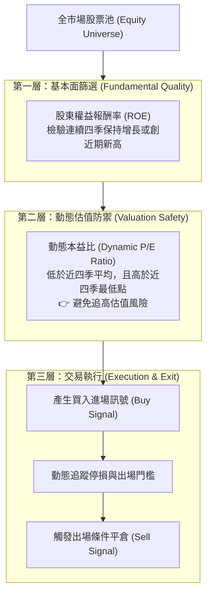

# 🎙️ 學術論文發表 Session H：智慧金融——量化投資多因子選股與動態本益比進出場策略 (發表人 / 評審委員 / 主持人)

> **研討會名稱**：第十七屆國立中央大學資訊管理學系學術論文暨專題發表會 (NCU IM Conference 2026)  
> **發表場次**：Session H 智慧金融專題  
> **核心模組**：FinTech, Quantitative Investing, Multi-Factor Model, ROE Dynamics, PE Thresholds, Backtesting  
> **研究亮點**：建構結合獲利能力動態趨勢（ROE）與市場估值門檻（動態本益比）之自動化選股與進出場交易決策系統  
> **關聯文件**：[📄 完整原話逐字稿 (2026-03-27-NCU-IM-02-智慧金融量化選股策略-proofread.md)](./20260327-智慧金融量化選股策略.full.md)

---

## 🏛️ 量化多因子選股與動態進出場決策邏輯

---

## 🎯 核心重點整理 (Key Takeaways)

### 1. 動態多因子模型架構
- **時間段動態對比 vs. 單一時間點**：傳統價值投資常僅比對單一季度的財務比率，本系統將指標擴展為「近四季滾動時間段（Rolling 4 Quarters）」，檢視公司體質之動態連續性。
- **市場估值防禦機制**：透過疊加動態本益比門檻，有效剔除受市場短期題材過度炒作之泡沫標的。

### 2. 系統架構與使用者體驗
- **黑盒子封裝與直覺化介面**：後端處理極為複雜的跨期財報清洗、因子權重計算與回測演算法，但前端提供直觀的視覺化圖表與簡潔進出場訊號，降低一般非量化投資人之使用門檻。
---

## 📈 多因子量化選股指標體系、動態進出場門檻與回測績效對照表

| 策略模組與評估維度 | 核心量化指標與篩選條件 | 動態決策機制與風險控管邏輯 | 多空市場回測驗證與實務效益 |
| :--- | :--- | :--- | :--- |
| **基本面多因子選股池（Stock Pooling）** | 結合**股東權益報酬率（ROE）**、近四季獲利穩定度、營收成長率與現金流量健康度進行多維度打分 | 排除單季一次性業外收益造成的假性高 ROE，要求近四季連續達標以確保企業具備長期護城河與穩定獲利能力 | 有效過濾財務體質脆弱之投機標的，在台股與美股歷史回測中建立具高勝率基底的核心投資組合 |
| **動態本益比（Dynamic P/E）進出場訊號** | 捨棄固定數值本益比（如固定 15 倍買入、20 倍賣出），改以個股歷史滾動區間之分位數與產業均值計算動態估值通道 | 當股價跌入歷史本益比低位區且基本面因子維持強勢時觸發分批建倉；當估值突破動態上軌或基本面轉弱時執行停利出場 | 克服傳統靜態估值在成長股與景氣循環股上的失靈問題，精準捕捉均值回歸（Mean Reversion）波段超額報酬（Alpha） |
| **最大回撤（MDD）控管與系統介面** | 納入移動停損、部位權重上限與大盤趨勢濾網，並衡量年化報酬率、夏普值（Sharpe Ratio）與最大回撤（Max Drawdown） | 在大盤空頭回檔期間自動縮減曝險部位，將投資組合波動率與最大回撤控制在投資人心理可承受範圍內 | 搭配視覺化回測儀表板呈現資金曲線與交易明細，兼顧機構法人嚴謹風控標準與一般投資人之操作易用性 |
