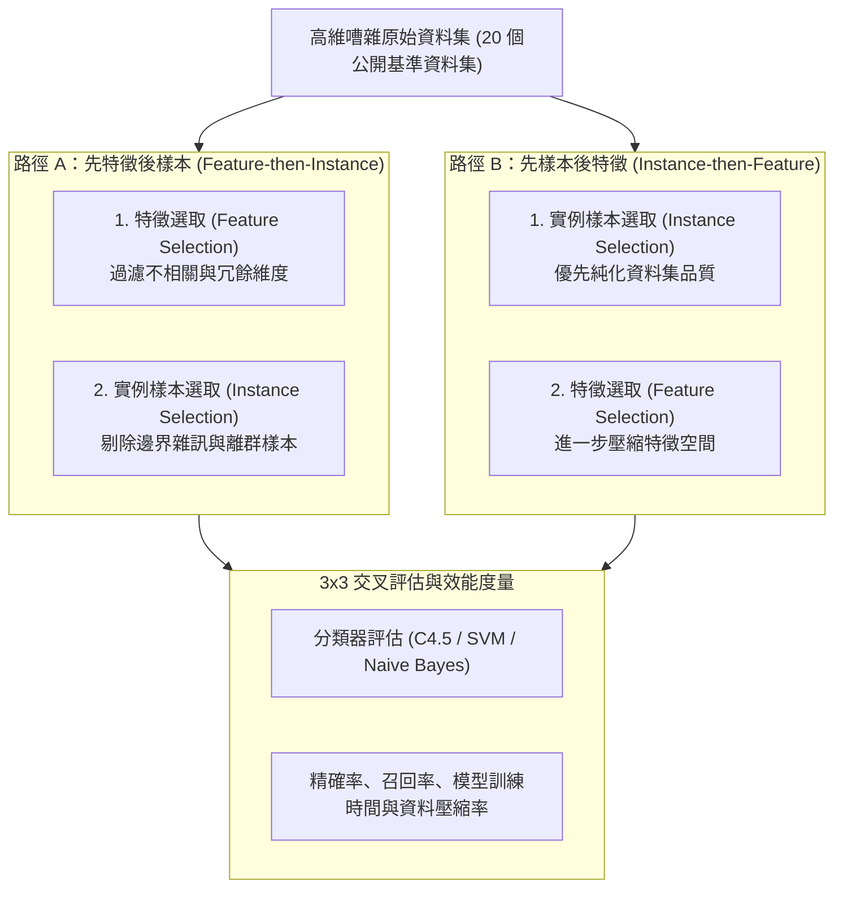

# 🎙️ 學術論文發表 Session I：機器學習——特徵精簡與實例樣本選取雙向管線效能優化 (發表人 / 評審委員 / 主持人)

> **研討會名稱**：第十七屆國立中央大學資訊管理學系學術論文暨專題發表會 (NCU IM Conference 2026)  
> **發表場次**：Session I 機器學習與資料探勘專題  
> **評審委員**：歐陽崇榮教授（南洋大學 / 專案特聘評審）  
> **核心模組**：Machine Learning, Feature Selection, Instance Selection, Pipeline Optimization, Benchmark Datasets  
> **研究亮點**：系統性探討特徵選取（橫向維度精簡）與實例樣本選取（縱向樣本過濾）之執行順序對模型分類效能與穩定度之影響  
> **關聯文件**：[📄 完整原話逐字稿 (2026-03-27-NCU-IM-03-機器學習特徵精簡管線-proofread.md)](./20260327-機器學習特徵精簡管線.full.md)

---

## 🏛️ 雙向資料前處理流水線 (Bi-Directional Pipeline) 實驗設計

---

## 🎯 核心重點整理 (Key Takeaways)

### 1. 特徵選取 (FS) 與實例選取 (IS) 之交互影響
- **橫向 vs. 縱向精簡**：特徵選取（FS）縮減屬性維度（Columns），降低模型複雜度；實例選取（IS）縮減訓練樣本數（Rows），移除雜訊資料與邊界模糊實例。
- **流水線執行先後順序**：
  - **路徑 A（FS $\to$ IS）**：在低維度空間中計算樣本距離與代表性，大幅降低 IS 演算法之運算時間，並提升代表性樣本選取之準確度。
  - **路徑 B（IS $\to$ FS）**：先淨化樣本分佈以確保特徵重要度評估不受極端離群值扭曲。

### 2. 嚴謹的實驗設計
- **20 個公開 Benchmark 資料集**：橫跨不同特徵維度、樣本規模與類別平衡度，避免演算法結論偏向特定領域資料集。
- **3 $\times$ 3 實驗設計**：各採用三種代表性 FS 演算法與三種 IS 演算法進行全組合驗證，確保實證結論之穩健性。
---

## 🔬 雙向特徵與實例選取管線（FS vs. IS）效能指標與運算成本對照表

| 預處理管線策略 | 執行順序與演算法組合（3×3 矩陣） | 資料壓縮率與運算時間成本分析 | 分類準確率與模型穩定性實證結論 |
| :--- | :--- | :--- | :--- |
| **路徑 A：先特徵選取、後實例選取（FS $\to$ IS）** | 第一階段先以 3 種特徵選取（Feature Selection）演算法剔除冗餘屬性，第二階段再於降維後的空間執行 3 種實例樣本選取（Instance Selection） | 先降維可避免高維度空間中的「維度災難（Curse of Dimensionality）」，使後續計算樣本間歐氏距離或近鄰關係的運算時間大幅縮減 | 在橫跨 20 個標準測試資料集的實證中，**FS $\to$ IS** 不僅顯著降低整體訓練耗時，且因距離度量更精確，所篩選出的代表性樣本能維持更優異的分類準確率 |
| **路徑 B：先實例選取、後特徵選取（IS $\to$ FS）** | 第一階段先在原始全特徵空間過濾雜訊樣本與邊界離群值，第二階段再針對淨化後的樣本子集評估特徵重要度 | 在高維度原始空間直接執行實例選取（如基於 KNN 的編輯演算法）需耗費龐大距離矩陣計算資源，時間複雜度顯著較高 | 雖能先行排除極端離群樣本對特徵統計量的扭曲，但在高維稀疏資料集上容易因距離失效而誤刪關鍵邊界支持向量 |
| **單一預處理基準（僅 FS 或僅 IS）** | 僅單獨縮減欄位維度（特徵數）或僅單獨縮減列數（樣本數） | 資料儲存壓縮率與模型訓練加速效果皆不及雙向複合管線顯著 | 歐陽崇榮教授等評審肯定雙向管線在壓縮率與準確率間取得的帕累托（Pareto）平衡，並建議進一步探討不同資料集規模與雜訊比下的自適應切換準則 |
