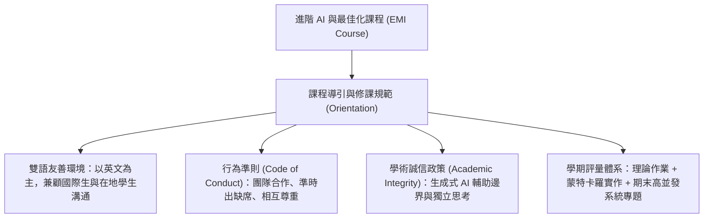

# 🎙️ 進階人工智慧與最佳化：EMI 全英語課程導論、課堂行為準則與評量規範 (授課講師 / 學員)

> **課程主題**：全英語授課（EMI）導論、課堂行為守則（Code of Conduct）與學術誠信規範  
> **授課教授**：授課講師（AI 與資訊工程領域講座教授）  
> **核心模組**：Course Orientation, Academic Integrity, Grading Policy, EMI Policy  
> **學習目標**：了解跨國學生 EMI 課堂規範、掌握學術誠信底線與學期 AI 最佳化專案要求  
> **關聯文件**：[📄 完整原話逐字稿 (2026-02-26-01-EMI英語課程導論與學術誠信-proofread.md)](./20260226-01-EMI英語課程導論與學術誠信.full.md)

---

## 🏛️ 核心架構與概念流轉圖

---

## 🔑 重點提要 (Key Takeaways)

1. **EMI 全英語教學目標**：透過全英文講述與國際生分組協作，建立學員在國際學術研討會與跨國科技產業的專業英文溝通力。
2. **AI 工具輔助準則**：鼓勵使用 AI 提升學習效率，但必須在繳交作業中誠實揭露使用的 Prompt 與模型版本，杜絕直接抄襲生成結果。
---

## 📜 EMI 課堂規範、學術誠信準則與學期評量體系對照表

| 課程治理與教學維度 | EMI 全英語授課規範與實施細節 | 學術誠信與生成式 AI 合規邊界 | 學期評分比重與能力培養目標 |
| :--- | :--- | :--- | :--- |
| **EMI 全英語互動與跨文化協作** | 配合外籍碩博士生修課政策，課堂講授、投影片製作、分組討論與期末專題發表全面採用英語進行 | 鼓勵非英語母語學生勇敢開口表達技術觀點；評分重點在於邏輯清晰度、實驗嚴謹度與問題解決能力，而非挑剔文法細節 | 培養研究生於國際頂級學術會議（如 NeurIPS、ICML、EMNLP）進行全英文口頭發表（Oral Presentation）與即席答辯之實戰力 |
| **課堂行為守則（Code of Conduct）與 AI 使用政策** | 嚴格禁止抄襲（Plagiarism）、代寫、未授權共享作業程式碼或捏造實驗數據 | 允許使用生成式 AI（如 ChatGPT、GitHub Copilot）輔助語法除錯、文獻檢索與英文潤飾，但**必須明確揭露 AI 工具使用範圍**，且核心演算法設計與實驗分析須由學生親自完成 | 促使學員理解 AI 時代研究者的核心不可替代性在於「問題定義、實驗假說檢證與批判性思維」 |
| **學期技術版圖與多元評量機制** | 課程涵蓋監督與非監督機器學習、Kaggle 資料科學管線、表徵學習（Word2Vec/Wav2Vec）、對抗性防禦與蒙特卡羅最佳化 | 結合每週實驗進度報告、期中研究提案（Proposal）、期末專題成果發表與**同儕互評（Peer Review）**進行綜合考核 | 透過每週高頻率實作與上台報告，確保各組從資料清洗、Baseline 建立到模型最佳化皆有紮實可重現的工程產出 |
