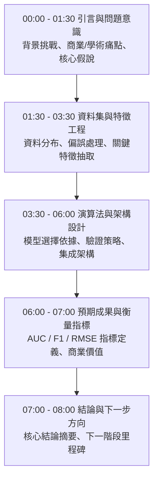

# 🎙️ 進階人工智慧與最佳化 Lesson 04-1：全英語專案提案規範與評分指標

> **課程主題**：專案提案全英語發表規範（EMI Presentation Guidelines）、8分鐘控時策略與同儕互評指標  
> **日期**：2026-03-19  
> **授課教授**：授課講師（AI 與機器學習領域講座教授）  
> **核心模組**：EMI Presentation, Time Discipline, Academic Structure, Audience-Centric Slides  
> **學習目標**：掌握國際頂級會議 8 分鐘簡報架構、訊息精煉技巧與眼神接觸颱風  
> **關聯文件**：[📄 完整原話逐字稿 (20260319-01-全英語專案提案規範與評分指標.full.md)](./20260319-01-全英語專案提案規範與評分指標.full.md)

---

## 🏛️ 8分鐘學術專題全英文發表結構與時間分配

---

## 🔑 重點提要 (Key Takeaways)

1. **嚴格遵守時間紀律（Time Discipline）**：超時在國際學術研討會為嚴重扣分項。學員必須經過反覆排練將論述精煉於 8 分鐘內。
2. **以受眾為中心（Audience-Centric）**：投影片切忌堆砌代碼或文字，應以架構圖與數據圖表為核心，面向觀眾進行眼神交流。
