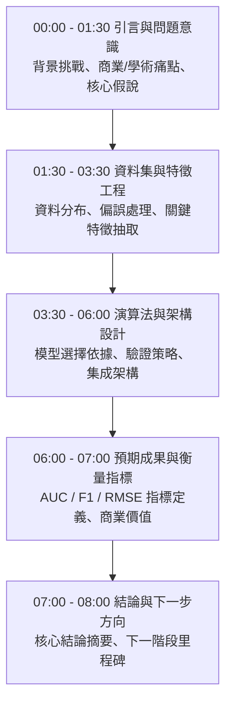

# 🎙️ 進階人工智慧與最佳化：全英語專案提案規範與評分指標

> **課程主題**：專案提案全英語發表規範（EMI Presentation Guidelines）、8分鐘控時策略與同儕互評指標  
> **日期**：2026-03-19  
> **授課教授**：授課講師（AI 與機器學習領域講座教授）  
> **核心模組**：EMI Presentation, Time Discipline, Academic Structure, Audience-Centric Slides  
> **學習目標**：掌握國際頂級會議 8 分鐘簡報架構、訊息精煉技巧與眼神接觸颱風  
> **關聯文件**：[📄 完整原話逐字稿 (20260319-01-全英語專案提案規範與評分指標.full.md)](./20260319-01-全英語專案提案規範與評分指標.full.md)

---

## 🏛️ 8分鐘學術專題全英文發表結構與時間分配

---

## 🔑 重點提要 (Key Takeaways)

1. **嚴格遵守時間紀律（Time Discipline）**：超時在國際學術研討會為嚴重扣分項。學員必須經過反覆排練將論述精煉於 8 分鐘內。
2. **以受眾為中心（Audience-Centric）**：投影片切忌堆砌代碼或文字，應以架構圖與數據圖表為核心，面向觀眾進行眼神交流。
---

## 🎯 專案提案發表規範、特徵與實例管線實驗指標對照表

| 評審維度與發表組別 | 核心研究問題與實驗方法設計 | 評估指標與關鍵實驗發現 | 授課教授（George）講評與修正指引 |
| :--- | :--- | :--- | :--- |
| **8 分鐘全英語提案評分準則** | 嚴格限時 **8 分鐘**完成口頭報告，結構須涵蓋研究動機（Motivation）、問題定義、文獻缺口、實驗管線設計與預期貢獻 | 評核指標包含：投影片視覺資訊密度（避免大段文字堆砌）、眼神交流與語速控管、實驗假說之可驗證性及時間精準度 | 強調學術簡報必須在黃金前 2 分鐘講清楚「為什麼這個問題重要」，並將繁瑣數據細節移至備用投影片供 Q&A 備詢 |
| **第一組：特徵選取（FS）與實例選取（IS）混合管線** | 探討預處理階段先執行特徵選取（FS-First）或先執行實例選取（IS-First）對下游分類器準確率與執行時間之影響 | 量測分類準確率（Accuracy）、資料集壓縮比例、CPU 運算耗時與記憶體峰值佔用；初步顯示 FS-First 在多數中大型資料集兼具速度與精準度優勢 | 建議擴大測試資料集的多樣性（涵蓋不同樣本數與特徵維度比），並加入統計顯著性檢定（如 Wilcoxon Signed-Rank Test）證明差異非隨機誤差 |
| **第二組：高維度基因微陣列與不平衡醫療資料分類** | 針對樣本數極少但基因特徵達數千維（High-Dimensional Microarray）且正負樣本極度失衡之醫療資料集進行降維與過採樣研究 | 比較 PCA、Lasso 特徵篩選搭配 SMOTE 過採樣於 SVM 與 Random Forest 上之 AUC、F1-score 與 Recall 表現 | 提醒必須嚴格防止資料洩漏（Data Leakage）：**特徵選取與 SMOTE 過採樣只能在交叉驗證的訓練摺（Training Fold）內執行**，絕不可在切分測試集前對全體資料預處理 |
