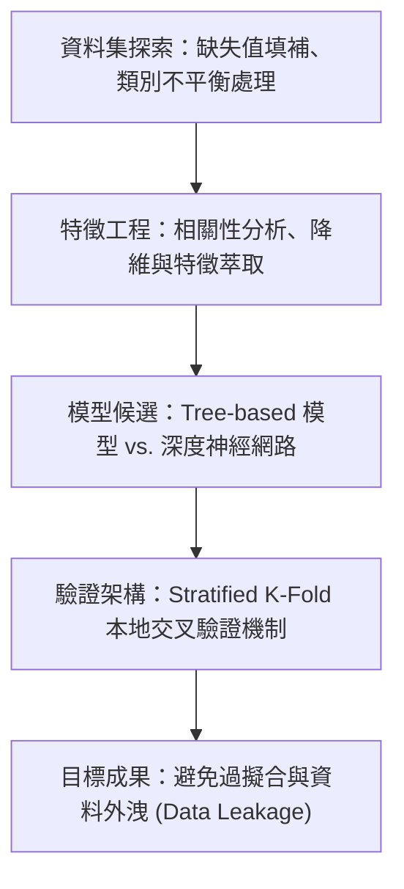

# 🎙️ 進階人工智慧與最佳化：各組研究提案實戰發表

> **課程主題**：各組專題提案全英語發表實戰（Student Project Proposals in English）  
> **日期**：2026-03-19  
> **發表團隊**：研一修課學員各組發表團隊  
> **核心模組**：Kaggle Dataset Exploration, Feature Pipeline, Hypothesis Formulation, Baseline Models  
> **學習目標**：依序展示選定資料集之探索洞見、預計採用之機器學習演算法與驗證策略  
> **關聯文件**：[📄 完整原話逐字稿 (20260319-02-各組研究提案實戰發表.full.md)](./20260319-02-各組研究提案實戰發表.full.md)

---

## 🏛️ 機器學習提案架構流轉圖

---

## 🔑 重點提要 (Key Takeaways)

1. **資料集洞察是模型基石**：各組展示了對特定領域資料集的清洗與分佈分析，確立假說邊界。
2. **建立可靠本地驗證**：強調在提交至 Leaderboard 之前，必須建構高信度的本地交叉驗證機制。
---

## 🧪 表格資料雜訊清理與極度類別不平衡合成採樣對照表

| 發表組別與研究主題 | 實驗設計與演算法機制 | 壓力測試設定與評估指標 | 授課教授講評與同儕問答焦點 |
| :--- | :--- | :--- | :--- |
| **第三組：深度神經網路與噪音清理（NCR）於表格資料之強健性研究** | 對比深度表格模型（如 TabNet、MLP）與傳統樹模型（XGBoost、Random Forest），並導入鄰域清理規則（Neighbourhood Cleaning Rule, NCR）預處理 | 人工注入 **10%、20%、30% 至 40%** 不同比例之特徵缺失值與標籤雜訊（Artificial Messiness），繪製各模型準確率退化曲線 | 教授指出：人工注入雜訊時應明確區分「特徵雜訊（Feature Noise）」與「標籤翻轉雜訊（Label Noise）」，且抽樣比例須符合真實世界資料分布，確保基準對比公平 |
| **第四組：極度類別不平衡（Extreme Class Imbalance）合成過採樣策略** | 針對不平衡比（Imbalance Ratio, IR）高達數十倍之多類別與二元資料集，比較 SMOTE、Borderline-SMOTE 與 ADASYN 等合成採樣演算法 | 捨棄具誤導性的整體 Accuracy，改採 **Macro-F1、G-Mean、PR-AUC（Precision-Recall AUC）** 及少數類別召回率（Minority Recall）評估 | 深入探討過採樣引發的**決策邊界偏移（Decision Boundary Shift）**：過度合成邊界樣本雖能提升少數類 Recall，但可能導致多數類誤報率（False Positive）上升，需依應用場景權衡誤報成本 |
| **學術簡報時間控管與圖表收斂準則** | 各組於 8 分鐘限時內展示問題背景、方法流程圖與初步實驗數據表 | 檢視投影片每頁資訊負載量、字體大小與多模型比較圖表之可讀性 | 提醒學員避免在單頁投影片塞入超過 20 列的巨大原始數值表格，應改用折線圖或長條圖呈現關鍵趨勢，將完整數據留存於書面報告附錄 |
