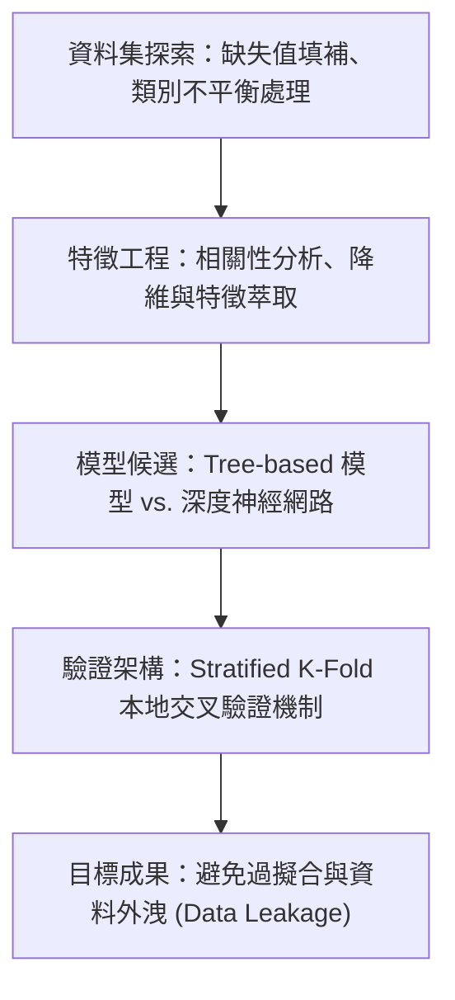

# 🎙️ 進階人工智慧與最佳化 Lesson 04-2：各組研究提案實戰發表

> **課程主題**：各組專題提案全英語發表實戰（Student Project Proposals in English）  
> **日期**：2026-03-19  
> **發表團隊**：研一修課學員各組發表團隊  
> **核心模組**：Kaggle Dataset Exploration, Feature Pipeline, Hypothesis Formulation, Baseline Models  
> **學習目標**：依序展示選定資料集之探索洞見、預計採用之機器學習演算法與驗證策略  
> **關聯文件**：[📄 完整原話逐字稿 (20260319-02-各組研究提案實戰發表.full.md)](./20260319-02-各組研究提案實戰發表.full.md)

---

## 🏛️ 機器學習提案架構流轉圖

---

## 🔑 重點提要 (Key Takeaways)

1. **資料集洞察是模型基石**：各組展示了對特定領域資料集的清洗與分佈分析，確立假說邊界。
2. **建立可靠本地驗證**：強調在提交至 Leaderboard 之前，必須建構高信度的本地交叉驗證機制。
