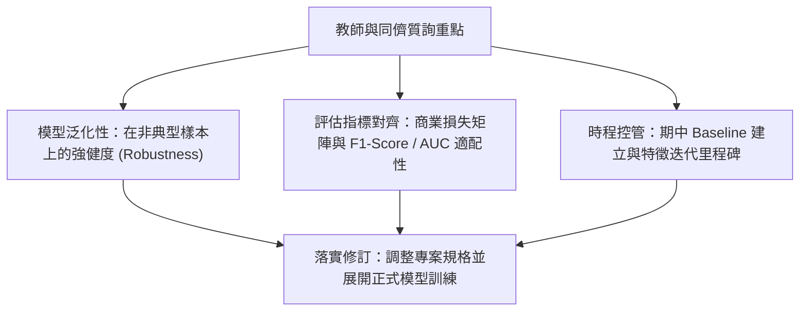

# 🎙️ 進階人工智慧與最佳化：教師講評與同儕深度問答

> **課程主題**：提案答辯（Proposal Q&A）、教師深度點評、模型泛化性與指標合理性剖析  
> **日期**：2026-03-19  
> **授課教授**：授課講師（AI 與機器學習領域講座教授）  
> **核心模組**：Generalization Ability, Metric Alignment, Peer Critique, Milestone Planning  
> **學習目標**：應對學術詰問、澄清模型局限性並落實期中專題修訂計畫  
> **關聯文件**：[📄 完整原話逐字稿 (20260319-03-教師講評與同儕深度問答.full.md)](./20260319-03-教師講評與同儕深度問答.full.md)

---

## 🏛️ 答辯覆盤與優化維度圖

---

## 🔑 重點提要 (Key Takeaways)

1. **指標必須對齊實務目標**：單純追求 Accuracy 往往掩蓋類別不平衡問題，必須依據錯誤代價定義評估指標。
2. **正面應對質詢局限**：學術答辯核心在於坦承當前假設之局限性並提出可驗證之改進路徑。
---

## 🔍 缺失值插補演算法（MICE vs. GAIN）與下游分類效能驗證對照表

| 研究維度與插補方法 | 演算法原理與缺失機制模擬 | 插補誤差指標 vs. 下游任務效能 | 實證洞見與教授總結建議 |
| :--- | :--- | :--- | :--- |
| **缺失資料機制模擬（MCAR / MAR）** | 於完整基準資料集上人工模擬完全隨機缺失（MCAR）與隨機缺失（MAR），控制缺失比例由低至高變化 | 分別針對連續數值特徵計算均方根誤差（**RMSE**），針對類別型特徵計算錯誤分類比例（**PFC**, Proportion of Falsely Classified） | 實驗設計必須同時涵蓋純數值、純類別與混合型（Mixed-type）表格資料，才能全面檢視各插補演算法的適用邊界 |
| **統計與機器學習插補（Mean / Mode / KNN / MICE）** | 對比單純平均數/眾數填補、K-近鄰插補（KNN Imputation）以及鏈式方程多重插補（**MICE**, Multivariate Imputation by Chained Equations） | 平均數填補運算最快但會嚴重扭曲變數變異數；MICE 透過迭代迴歸建模特徵間條件分布，在中等缺失率下具備極佳的統計穩健性 | MICE 在中小型表格資料集上表現穩定且計算成本可控，是實務資料科學管線中最值得優先採用的強基準（Strong Baseline） |
| **生成對抗插補網路（GAIN）與下游分類悖論** | 導入基於 GAN 架構之 **GAIN（Generative Adversarial Imputation Nets）**，利用生成器填補缺失值並由判別器區分真實與插補元素 | 實證發現一個關鍵悖論：**較低的插補重建誤差（低 RMSE）未必保證下游分類器獲得最高的分類準確率（Accuracy / F1）** | 教授高度肯定此項核心發現：生成模型可能產生平滑但模糊化類別邊界的插補值；因此評估預處理方法時，必須將「下游任務最終預測表現」與「計算耗時成本」一併納入綜合決策 |
