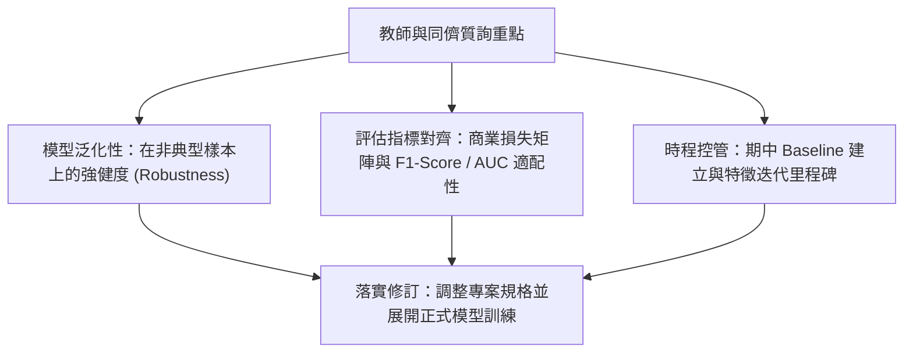

# 🎙️ 進階人工智慧與最佳化 Lesson 04-3：教師講評與同儕深度問答

> **課程主題**：提案答辯（Proposal Q&A）、教師深度點評、模型泛化性與指標合理性剖析  
> **日期**：2026-03-19  
> **授課教授**：授課講師（AI 與機器學習領域講座教授）  
> **核心模組**：Generalization Ability, Metric Alignment, Peer Critique, Milestone Planning  
> **學習目標**：應對學術詰問、澄清模型局限性並落實期中專題修訂計畫  
> **關聯文件**：[📄 完整原話逐字稿 (20260319-03-教師講評與同儕深度問答.full.md)](./20260319-03-教師講評與同儕深度問答.full.md)

---

## 🏛️ 答辯覆盤與優化維度圖

---

## 🔑 重點提要 (Key Takeaways)

1. **指標必須對齊實務目標**：單純追求 Accuracy 往往掩蓋類別不平衡問題，必須依據錯誤代價定義評估指標。
2. **正面應對質詢局限**：學術答辯核心在於坦承當前假設之局限性並提出可驗證之改進路徑。
