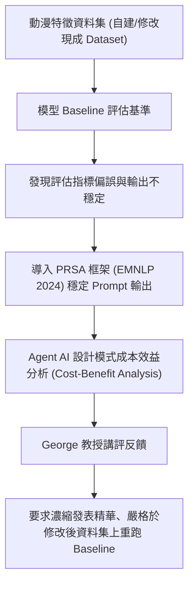

# 🎙️ 進階人工智慧與最佳化：學員專案發表（動漫人氣預測、評估指標偏誤緩解與Agent AI設計） (授課講師 (George) / 發表學員)

> **課程主題**：動漫人氣預測模型、評估指標偏誤緩解（Bias Mitigation）、Prompt 穩定性與 Agent AI 成本效益分析  
> **授課教授**：授課講師（George）  
> **發表團隊**：課堂專題研究團隊（Angie, Michelle, Benjamin Lee 等）  
> **核心模組**：Anime Popularity Modeling, Metric Bias Mitigation, PRSA Framework (EMNLP 2024), Agent AI Design Patterns  
> **關聯文件**：[📄 完整原話逐字稿 (20260430-動漫預測模型與偏誤緩解發表.full.md)](./20260430-動漫預測模型與偏誤緩解發表.full.md)

---

## 🏛️ 核心架構與概念流轉圖

---

## 🔑 重點提要 (Key Takeaways)

1. **評估指標偏誤之緩解**：針對動漫受眾主觀評分之偏差，透過調整預測特徵加權與基準校正，減輕極端值對模型的干擾。
2. **大語言模型輸出穩定性**：引入 EMNLP 2024 PRSA 框架，解決多變 Prompt 引發之 LLM 輸出漂移問題，提高實驗可重複性。
3. **課堂指導與講評**：George 提醒發表同學報告時應聚焦核心技術亮點、有效控制時間，並強調修改現成資料集後必須同步於修改集上重測 Baseline 方具說服力。
---

## 🎬 多模態動漫人氣預測架構、偏誤緩解機制與 Agent AI 評估對照表

| 專題模組與研究團隊 | 核心方法設計與資料預處理管線 | 評估指標與關鍵技術挑戰 | 授課教授（George）講評與改進方向 |
| :--- | :--- | :--- | :--- |
| **動漫人氣與評分預測：多模態特徵融合** | 整合動漫作品之**表格中繼資料（Metadata：集數、時長、類型）**、**文字簡介嵌入（Text Embedding）**與**封面視覺特徵（Image Embedding + 對比學習 Contrastive Learning）**，同時預測人氣（Watchlist 收藏數）與平均評分（Mean Score） | 原始人氣數據呈現極端右偏分佈，直接計算原始 MAE 高達上萬（`MAE ≈ 10,000`），需透過對數轉換（**Log-MAE**）與分位數指標評估 | 教授提醒投影片應大幅濃縮，將 25 頁以上的繁雜流程收斂至核心架構與關鍵實驗圖表，避免每次報告皆嚴重超時 |
| **時間累積偏誤緩解（Popularity Bias Mitigation）** | 針對老作品因上映時間長而自然累積較高收藏數之「時間累積偏誤」，採用 **Winsorization 分位數極端值縮尾處理**，並建立同季度（Quarter PCT）排名正規化與「以過去預測未來」之時間切分策略 | 驗證排除 2000 年以前舊資料前後之模型表現差異，確認四模態特徵融合（Metadata + Text + Image + Related Anime Retrieval）顯著優於單一模態 | 強調**修改或重新定義現有公開資料集後，必須在修改後的同一份資料集上重新執行所有 Baseline 模型**，才能確保實驗比較的科學公平性 |
| **電商與 IT 之 Agent AI 設計模式成本效益分析** | 第二組（Angie, Michelle, Benjamin Lee）探討多代理（Agent AI）設計模式之成本效益，並針對不同 Prompt 導致 LLM 輸出不穩定、破壞實驗可重現性之痛點提出解法 | 導入 **EMNLP 2024 發表的 PRSA 框架（Zhou et al.）**，系統化剖析並降低提示詞變異對大型語言模型輸出一致性的干擾 | 肯定團隊針對前次審查意見（Prompt 敏感度與可重現性問題）提出具體頂會文獻解法，建立嚴謹的評估基準 |
