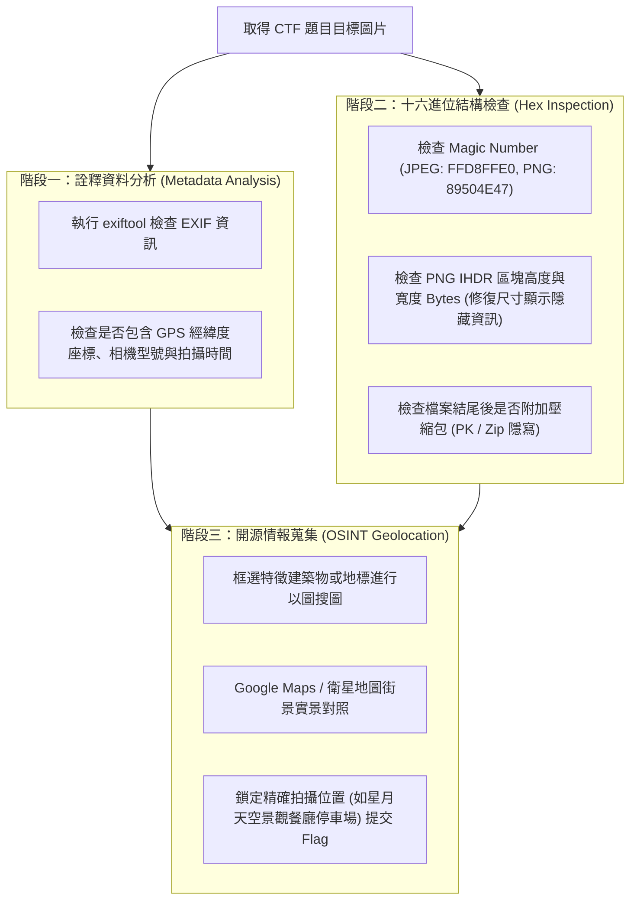

# 🎙️ 資安實戰：CTF 圖片隱寫術分析、十六進位結構竄改與 OSINT 地理定位解題實務 (授課講師 / 學員)

> **課程主題**：CTF 搶旗賽資安實務、數位隱寫術（Steganography）、HEX 檔案結構分析、EXIF 詮釋資料與 OSINT 開源情報地理定位  
> **授課教授**：授課講師（資安戰隊指導教練）  
> **核心模組**：CTF Misc, Steganography, EXIF Metadata, Hex Editing, OSINT Geolocation, Google Lens  
> **學習目標**：掌握數位圖片隱寫偵測與還原技術（修改尺寸、附加封包），熟練運用開源情報（OSINT）比對地理座標解出競賽 Flag  
> **關聯文件**：[📄 完整原話逐字稿 (2026-04-08-01-圖片隱寫術分析與OSINT地理定位-proofread.md)](./20260408-OSINT與網路威脅情報分享.full.md)

---

## 🏛️ CTF Misc 圖片隱寫與開源情報分析工作流程

---

## 🎯 核心重點整理 (Key Takeaways)

### 1. 圖片檔案結構與隱寫術常見手法
- **EXIF 詮釋資料抽取**：相機或智慧型手機拍照時會自動將裝置型號、光圈快門與 GPS 經緯度直接嵌入圖片檔案標頭。隱寫題目中常隱藏 Flag 或提示訊息。
- **IHDR 尺寸位元組竄改 (PNG Chunk Tampering)**：
  - PNG 檔案在 `IHDR` Chunk 中定義了圖片寬度（4 Bytes）與高度（4 Bytes）。
  - 出題者常將高度修改為較小值，使圖片顯示時隱藏下方帶有 Flag 的區域。解題時透過十六進位編輯器（如 010 Editor、HxD）將高度 Bytes 還原或改大，即可重新顯示被遮蔽的內容。
- **檔案尾端夾帶 (File Carving / Append)**：在 JPEG 檔案結尾標記 `FF D9` 之後附加壓縮檔（`50 4B 03 04`），可使用 `binwalk` 或 `foremost` 自動抽離被隱藏之資料檔案。

### 2. OSINT (Open Source Intelligence) 地理定位實戰技術
- **圖像局部反搜**：當全圖搜尋無法精確比對時，使用裁切工具鎖定「非自然景觀之獨特人造建物、招牌或欄杆裝飾」，利用 Google Lens 等逆向圖庫比對出目標景點（案例：南投星月天空景觀餐廳）。
- **衛星地圖視角校正與精確定位**：比對照片拍攝視角、陰影方位與停車場地坪標線，判定拍攝者實際站立位置，以符合 CTF 題目對特定經緯度或地標名稱之檢驗要求。
---

## 🔍 CTF 隱寫術分析維度、工具鏈與 OSINT 地理偵察對照表

| 解題階段與技術類別 | 核心隱藏機制與脆弱點原理 | 實戰分析工具與關鍵指令操作 | 解題突破點與防禦鑑識啟示 |
| :--- | :--- | :--- | :--- |
| **檔案標頭與 EXIF 詮釋資料檢測** | 圖片檔屬性（Metadata）常殘留拍攝設備型號、軟體版本、建立時間、作者註解，甚至直接包含 **GPS 經緯度座標**；或因 Magic Number 被竄改導致無法開啟 | 使用 `exiftool`、`strings`、`file` 與 `010 Editor` / `HxD` 檢查檔案首尾十六進位結構（如 PNG 標頭 `89 50 4E 47`、JPEG 標頭 `FF D8 FF E0`） | 拿到 Misc 題目圖片切勿只用肉眼觀看，第一步必先跑 `exiftool` 與 `binwalk`，檢查是否藏有隱藏字串或附加壓縮檔 |
| **PNG IHDR 結構竄改與尾端附加檔案** | 出題者故意將 PNG `IHDR` 區塊中的**圖片高度（Height）位元組改小**，使看圖軟體僅渲染上半部而截斷下半部隱藏的 Flag；或在 `IEND` 結尾標記後附加 ZIP/RAR 檔案 | 透過十六進位編輯器修改 `IHDR` 高度數值並重新計算 CRC32 校驗碼，或使用 `binwalk -e`、`foremost` 自動分離夾帶於圖片尾端的隱藏檔案 | 理解檔案格式底層規格（Chunk 結構與 CRC 校驗機制）是破解結構型隱寫術的核心基本功 |
| **OSINT 開源情報與地理視覺定位（GEOINT）** | 當題目僅提供一張無 EXIF 的街景、校園或建築物照片時，需仰賴畫面中之招牌文字、道路標線、植被、建築外牆幾何特徵與光影方向進行推理 | 結合 **Google Lens / Yandex 以圖搜圖**、Google Maps 街景（Street View）歷史圖資比對與 OpenStreetMap 地標檢索，交叉鎖定拍攝者站立之精確座標 | 展現開源情報收集（OSINT）將零散公開線索轉化為精準實體位置之威力，同時提醒個人與企業分享照片前務必清除敏感背景與 EXIF 資訊 |
