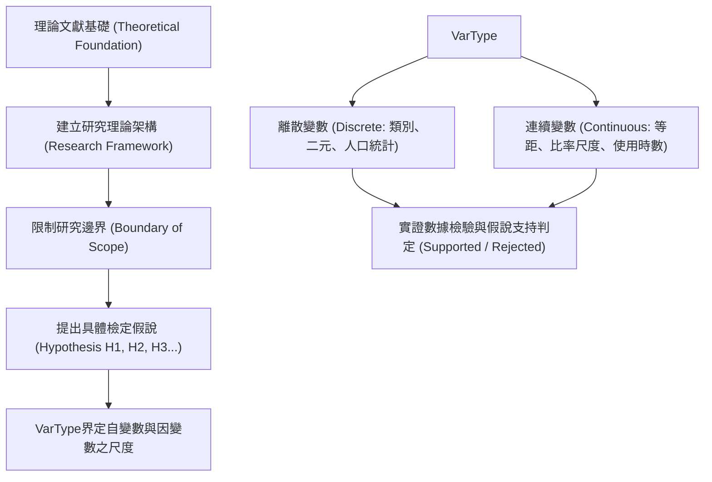

# 🎙️ 資訊管理研究方法論：概念界定、離散與連續變數、假說建立與理論架構檢證 (授課講師 / 學員)

> **課程主題**：學術概念思考邊界、變數尺度分類（離散 vs. 連續）、研究假說擬定與理論框架  
> **授課教授**：授課講師（資管所資深講座教授）  
> **核心模組**：Research Concepts, Discrete vs. Continuous Variables, Hypothesis Formulation  
> **學習目標**：掌握嚴謹概念界定、區分名目/順序/等距/等比尺度，建立可被實證檢驗之具體假說  
> **關聯文件**：[📄 完整原話逐字稿 (2026-03-04-02-假說建立與理論框架實證-proofread.md)](./20260304-02-假說建立與理論框架實證.full.md)

---

## 🏛️ 核心架構與概念流轉圖

---

## 🔑 重點提要 (Key Takeaways)

1. **概念是思考與溝通的基石**：學術研究最忌「頭腦簡單」，所謂深刻思考即在於大腦中具備足夠豐富、邊界精準的專用概念，能向同行精確傳遞邏輯。
2. **變數尺度的統計意義**：離散變數（如性別、部門、是否採用某技術）與連續變數（如系統反應時間、月交易量）適用完全不同的統計檢定模型（卡方檢定 vs. 回歸分析/結構方程模型）。
3. **假說（Hypothesis）的邊界效應**：提出明確的假說能防止研究發散，為論文明確劃定「要包含什麼、不包含什麼」的嚴密範疇。
---

## 📊 變數類型分類、假說陳述格式與理論框架構建對照表

| 研究設計要素 | 分類定義與統計尺度特性 | 於理論框架（Theoretical Framework）中之角色 | 假說檢證與實證研究撰寫規範 |
| :--- | :--- | :--- | :--- |
| **離散變數（Discrete）vs. 連續變數（Continuous）** | **離散變數**屬於類別或計數尺度（名目 Nominal、次序 Ordinal，如性別、產業別、違規次數）；**連續變數**則可在區間內取任意實數值（等距 Interval、等比 Ratio，如回應時間、營收金額） | 變數的測量尺度直接決定後續可採用的統計檢定與機器學習模型（如類別依變數適用 Logistic 迴歸或分類器，連續依變數適用 OLS 迴歸或結構方程模型 SEM） | 設計問卷與收集日誌數據時，應盡可能保留原始連續數值，避免過早將連續變數粗暴切分為高低二元類別而損失統計檢定力（Statistical Power） |
| **自變數（IV）、依變數（DV）、中介（Mediator）與干擾變數（Moderator）** | **自變數**為推測之原因；**依變數**為觀察之結果；**中介變數**解釋「為何（How/Why）」產生影響之內在傳遞機制；**干擾變數**則界定影響強度在「何種條件下（When）」被強化或削弱 | 完整理論框架不僅展示 $X \to Y$ 的直接效果，更需透過中介與干擾變數刻畫背後的因果路徑與邊界條件（Boundary Conditions） | 繪製研究模型圖時，方框代表可觀測變數、橢圓代表潛在構念（Latent Construct），箭頭方向須具備堅實的文獻理論推導支撐 |
| **假說建立（Hypothesis Formulation）與可證偽性** | 假說是對兩個以上變數間關係之**可檢驗陳述（Testable Statement）**，分為具正負方向性的「方向性假說」與僅宣稱存在差異的「非方向性假說」 | 每一條假說（$H_1, H_2, \dots$）都必須對應文獻探討中的理論邏輯推演，作為連接抽象理論層次與實證數據層次的橋樑 | 假說必須具備卡爾·波普爾（Karl Popper）所強調之**可證偽性（Falsifiability）**，措辭應精確指明變數方向（如「系統延遲越高，使用者持續使用意願越低」），避免模稜兩可的同義反覆 |
