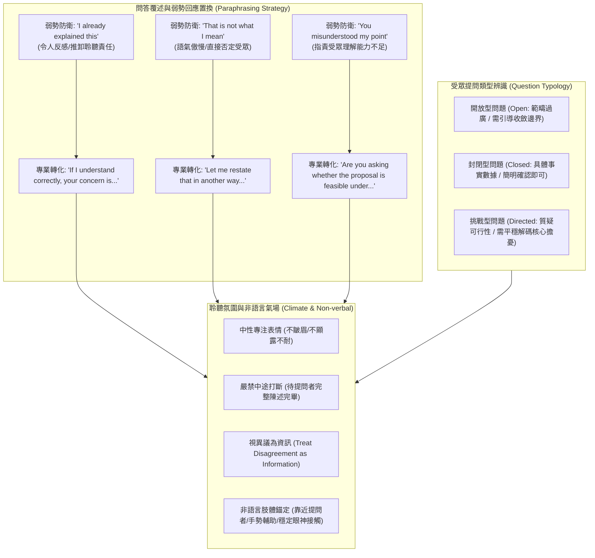

# 📋 管理溝通 Week 05：Q&A 問答覆述策略、正向聆聽氛圍與肢體非語言訊息 — 執行摘要

> **活動場次**：碩二秋季學期 管理溝通（全英語 EMI 課程）
> **錄音日期**：2026-10-15
> **發言講者**：授課講師 / Jerry / Wesley
> **對應完整逐字稿**：[`20261015-01-管理溝通-Week05-問答覆述技巧與正向聆聽氛圍.full.md`](./20261015-01-管理溝通-Week05-問答覆述技巧與正向聆聽氛圍.full.md)

---

## 🏗️ 核心架構概念圖

---

## 🎯 核心技術概念與管理溝通指引

### 1. 問答環節（Q&A Session）弱勢回應置換原則
- **防衛心理陷阱**：在被質疑或面對未被聽懂的尷尬情境時，講者容易下意識說出 *"I already explained this"* 或 *"You misunderstood my point"*。此類言詞本質上是將溝通失敗的責任轉嫁給聽眾，引發強烈的情緒對立。
- **專業覆述公式（Paraphrasing Formula）**：
  - *確認擔憂*：*"If I understand correctly, your concern is [restate concern]..."*
  - *重塑焦點*：*"Let me clarify that point from another perspective..."*
  - *實務效果*：藉由主動重述或覆述問題，講者不僅贏得沉澱思考的時間，更向全場展現成熟自信的傾聽風度。

### 2. 提問類型辨識與即時應對策略
- **開放型問題（Open Questions）**：範疇廣泛（如 *"How will this affect staff?"*），講者切忌漫無邊際發散，應主動邀請提問者聚焦特定維度（如工作流程、培訓成本）。
- **封閉型問題（Closed Questions）**：針對特定數字、預算或時間節點，應直截了當回覆具體事實，避免冗長鋪陳。
- **挑戰型問題（Directed / Skeptical Questions）**：帶有強烈懷疑或尖銳預設立場（如 *"Isn't this too risky?"*），講者應保持情緒平穩，將攻擊性語氣解碼為「對風險評估的合理關注」，就事論事回應。

### 3. 營造正向聆聽氛圍（Positive Listening Climate）
- **絕對不打斷**：無論提問者的問題是否已在預期之內，必須等待對方完整說完最後一個字方能開口。
- **異議即資訊（Disagreement as Information）**：高階經理人必須將質詢與反對意見視為「檢驗專案漏洞的免費壓力測試」，而非針對個人的攻擊。

### 4. 非語言訊息（Non-verbal Cues）的專業氣場錨定
- **肢體語言功能**：Jerry 與 Wesley 於課堂討論中指出，肢體動作能實質傳遞講者的專業信念。講者在回答問題時，可微微走向提問者、輔以開展的手勢並維持堅定的眼神接觸，有效強化專業說服力。

---

## 💬 授課講師質詢引導與全英語研討對抗矩陣

| 質詢向度 | 授課講師核心提問與指引論點 | 課堂答辯與方法學解析 | 實務簡報與高階溝通啟示 |
| :--- | :--- | :--- | :--- |
| **防衛性言詞之破壞力** | 當講者脫口而出 *"I already explained this"* 時，受眾心理會產生何種負面反應？ | 此言詞傳達出講者的傲慢與防衛心態，隱含「是你沒認真聽」的責怪，立即摧毀現場建立的信任感與合作氛圍。 | 專業溝通應採用 *"If I understand correctly..."* 進行同理覆述，將焦點拉回實質問題解決。 |
| **開放型問題邊界失控** | 面對範疇極廣的開放式提問，講者若試圖面面俱到全面回答，會造成什麼災難？ | 講者容易偏離核心主題，且冗長空泛的回答通常無法滿足提問者，甚至引發更多枝節性質疑。 | 講者應先禮貌性收斂邊界（*"Which specific aspect would you like me to focus on?"*），精準聚焦回應。 |
| **非語言訊息的核心價值** | 為什麼講者單純站在講台後、語調平淡地唸出答案，無法展現專業影響力？ | Jerry 指出肢體手勢是傳遞觀點的重要載體；靜止不動會向受眾傳遞緊張、冷漠或不自信的負面訊號。 | 透過走動接近受眾、開放性手勢與堅定目光接觸，能顯著提升講者的可信度與氣場（Presence）。 |
| **面對尖銳異議時的情緒控制** | 當提問者提出帶有質疑甚至敵意的挑戰型問題時，講者應如何穩定局面？ | 講師強調必須「視異議為資訊而非攻擊」。維持中性面部表情，不打斷對話，承認對方對風險的擔憂並以數據回應。 | 經理人的格局體現在承接質疑時的優雅從容，情緒失控是商務溝通中最致命的失分項。 |

---

## 🛠️ 實踐決策與簡報溝通建議
1. **建立禁忌詞清單**：嚴格在團隊演練中剔除 *"I already explained this"*、*"You misunderstood me"* 等防衛性口頭禪。
2. **訓練 3 秒覆述習慣**：在回答任何重要提問前，先花 3 秒鐘用自己的話精準覆述問題核心，確保認知一致。
3. **刻意練習非語言錨定**：簡報演練時加強手勢展開與走動節奏，戒除雙手插口袋或緊握講台的僵硬肢體習慣。
