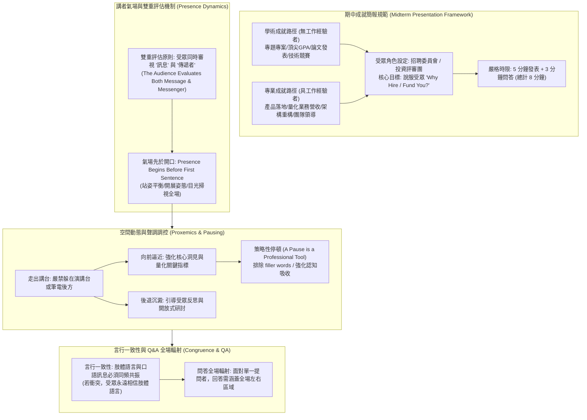

# 📋 管理溝通 Week 05：簡報氣場台風塑造、期中成就發表規範與空間聲調調控 — 執行摘要

> **活動場次**：碩二秋季學期 管理溝通（全英語 EMI 課程）
> **錄音日期**：2026-10-15
> **發言講者**：授課講師 / 學員 / Victor / Wesley
> **對應完整逐字稿**：[`20261015-02-管理溝通-Week05-簡報台風氣場塑造與期中專業成就發表.full.md`](./20261015-02-管理溝通-Week05-簡報台風氣場塑造與期中專業成就發表.full.md)

---

## 🏗️ 核心架構概念圖

---

## 🎯 核心技術概念與管理溝通指引

### 1. 期中簡報（Midterm Presentation）定位與發表範式
- **簡報任務設定**：受眾全體扮演面試委員會或投資審查委員。講者必須在極短時間內回答核心問題：「為什麼我們應該錄取你？為什麼你的專案值得投資？」
- **成就分類框架**：
  - *學術成就組（Academic Track）*：針對應屆畢業生與研一新生，著重在核心課程專題、開源貢獻、量化學術產出（如論文專案）及個人強項之精確包裝。
  - *專業成就組（Professional Track）*：針對具備產業界經歷的在職專班與資深同學，著重於業務營收成長指標、系統架構演進與跨部門協作成果。
- **嚴格時限與死線規範**：每人發表 5 分鐘、問答 3 分鐘（合計 8 分鐘）。投影片須於週二午夜 24:00 前提早上傳，確保審查委員具備充裕時間預審材料並設計深度質詢。

### 2. 講者氣場塑造法則（Executive Presence）
- **雙重評估假說（Message & Messenger）**：受眾在聽取簡報時，大腦同時在兩個頻道運作：分析投影片上的文字數據（訊息），以及審查講者展現出的自信、專業與穩定度（傳遞者）。
- **氣場先於開口（Presence Begins Before the First Sentence）**：從講者起立走向台前的第一秒起，簡報就已開始。雙腳對齊肩膀、重心平衡、自然掃視全場並保持三秒自信微笑，能在發出第一個字前確立權威感。

### 3. 空間運動學（Proxemics）與策略性停頓（Strategic Pausing）
- **拒絕講台防禦掩體**：講台（Podium）與筆記型電腦本質上是講者的心理掩體，會切斷與受眾的情感連結。講者必須走出講台，成為舞台的核心主角。
- **目的性空間位移**：
  - *前進兩步*：宣布重大決策、轉折點或突破性量化數據，提升現場緊迫感與專注力。
  - *後退一步*：拋出反思問題或過渡章節時，給予受眾思維留白的空間。
- **策略性停頓的威力**：沉默不是忘詞，而是高階經理人的專業工具。1 至 2 秒的停頓能凸顯前後語句的份量，並徹底消滅 *"uh"*, *"um"* 等低專業度的贅字。

### 4. 言行一致性（Congruence）與 Q&A 全場輻射機制
- **非語言主導定律**：當講者的口語宣稱（如「這項提案完全可行」）與肢體語言（畏縮肩膀、語音微弱、眼神飄移）衝突時，受眾 100% 相信肢體語言。
- **問答全員對話原則**：在回答特定評審提問時，眼神應從提問者起點輻射至全場左右各區域，因為專業問答的本質是向「全體審查委員會」進行說服。

---

## 💬 授課講師質詢引導與全英語研討對抗矩陣

| 質詢向度 | 授課講師核心提問與指引論點 | 課堂答辯與方法學解析 | 實務簡報與高階溝通啟示 |
| :--- | :--- | :--- | :--- |
| **自我介紹 vs 成就發表差異** | 期中成就發表與 Week 02 的個人自我介紹，在溝通目標上有何本質區別？ | 自我介紹是破冰性質的背景陳述；期中成就發表則是高強度的「商業說服（Pitch）」，要求提出具備量化指標的實證結果，證明自身不可替代的商業或學術價值。 | 經理人報告必須由「我是誰（Who I am）」轉向「我能帶來什麼價值（What value I deliver）」。 |
| **無工作經驗之成就框架** | 缺乏多年產業界經歷的年輕研究生，應如何架構令人信服的個人成就？ | 講師強調「成就無需是全台第一」。關鍵在於價值框架（Framing）：將紮實的學術專案、優秀 GPA、嚴謹的代碼貢獻與分析寫作能力進行體系化包裝。 | 自信來自對自身強項的精準提煉，而非盲目與資深業界主管比拚年資。 |
| **講台躲藏心理與舞台佔有** | 為什麼許多初學者習慣躲在演講台後方或緊盯筆電螢幕？如何破局？ | 演講台提供物理安全感，但會阻隔非語言傳遞。講師要求講者走出掩體，透過前進強調重點、後退引導反思的位移掌控全場注意力。 | 真正的台風（Presence）來自全然暴露在受眾視線下的從容與自信。 |
| **語氣與言行矛盾的信任危機** | 當講者宣稱「方案風險極低」卻伴隨顫抖聲調與眼神閃爍時，委員會如何判定？ | 受眾本能判定該講者缺乏真實把握或隱瞞關鍵風險。當言語與肢體衝突時，非語言訊號永遠勝出。 | 聲音投影（Voice Projection）與目光直視是傳遞可信度的基石，不可有分毫猶豫。 |

---

## 🛠️ 實踐決策與簡報發表建議
1. **期中成就精選兩至三項**：聚焦最能展現個人方法論深度與解決複雜問題能力的成果，佐以量化數據佐證。
2. **週二午夜前完成投影片封裝**：預留 48 小時進行全真模擬排練，嚴格自我計時在 4 分 45 秒至 5 分鐘內收尾。
3. **實施夥伴模擬質詢**：與組內同學互相設計高難度追問，排練「覆述問題 $\to$ 全場目光輻射 $\to$ 結構化解答」的三步問答流程。
