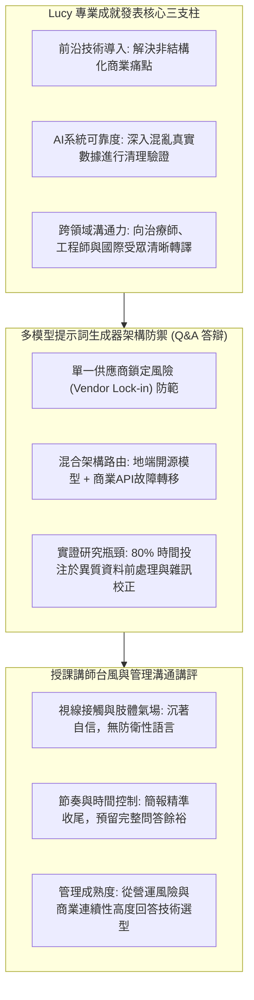

# 📋 管理溝通 Week 06：專業成就簡報發表與多模型 AI 架構問答 — 執行摘要

> **活動場次**：管理溝通 (Week 06)
> **錄音日期**：2026-10-22
> **發言講者**：授課講師 / Lucy / Vidi / Julie
> **對應完整逐字稿**：[`20261022-01-管理溝通-Week06-專業成就簡報發表與多模型AI架構問答.full.md`](./20261022-01-管理溝通-Week06-專業成就簡報發表與多模型AI架構問答.full.md)

---

## 🏗️ 核心架構概念圖

---

## 🎯 核心技術概念與管理溝通分析

### 1. 個人專業成就發表之結構化呈現
- **三核心支柱定位**：聚焦前沿科技應用、系統可靠度實證、以及跨領域多元利益關係人（臨床治療師 vs 軟體工程師）的語意轉譯，展現全方位軟實力。
- **時間與簡報節奏掌控**：演講者以簡潔投影片輔助，精準控制在時限內完成，為 Q&A 問答環節預留充分的時間裕度。

### 2. 多模型 AI 提示詞生成器之架構決策防衛
- **反脆弱性架構**：面臨同學質疑「為何不單獨使用單一最強模型（如 GPT-4）」，演講者從企業維運高度提出「防範模型底層暗更（Silent Updates）、避免供應商價格綁定、支援本地敏感隱私推論」等多重理由。
- **故障轉移與成本優化**：透過商業雲端與地端開源模型之混合路由（Hybrid Routing），達成高可用性與低延遲之雙重目標。

### 3. 實證資料工程之現實困境
- **數據泥沼法則**：回應資料整合挑戰時，直言超過 60%～80% 工時消耗在多源異質臨床資料的清洗與對齊，印證管理資料科學中「數據品質決定模型天花板」之硬道理。

---

## 💬 現場問答與 Q&A 覆述矩陣 (QA Critique Coverage Matrix)

| 發問者 | 核心質詢問題 | 演講者技術與管理答辯 | 授課講師講評與技巧認證 |
| :--- | :--- | :--- | :--- |
| **Vidi** | 提示詞生成器為何採用三個不同 AI 模型，而非直接串接單一最強大模型？ | 單一模型存在嚴重供應商鎖定（Vendor Lock-in）與未預期暗更風險；多模型混合路由可確保企業營運連續性與成本控制。 | 高度讚賞演講者具備「管理成熟度（Managerial Maturity）」，能從商業風險高度捍衛技術架構。 |
| **Julie** | 在跨領域實證研究與模型驗證過程中，所遭遇最具挑戰性的瓶頸為何？ | 臨床觀察筆記與日誌資料之跨來源異質性；耗費近三分之二工時於資料探勘、清洗與離群值校正。 | 肯定演講者實事求是，指出資料工程（Data Engineering）乃真實商業應用之致勝關鍵。 |
