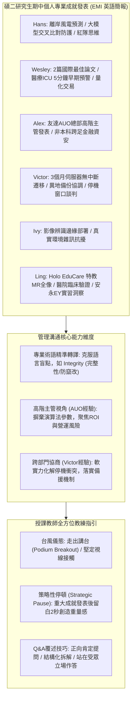

# 📋 管理溝通 Week 06：英語成就發表台風評析與平台完整性答辯 — 執行摘要

> **活動場次**：管理溝通 (Week 06)
> **錄音日期**：2026-10-22
> **發言講者**：授課講師 / Hans / Wesley / Alex / Victor / Ivy / Ling
> **對應完整逐字稿**：[`20261022-02-管理溝通-Week06-英語成就發表台風評析與平台完整性答辯.full.md`](./20261022-02-管理溝通-Week06-英語成就發表台風評析與平台完整性答辯.full.md)

---

## 🏗️ 核心架構概念圖

---

## 🎯 核心技術概念與管理溝通深度剖析

### 1. 碩士期中專業成就之結構化演繹
- **實質產出量化呈現**：Wesley 以「2 篇國際研討會最佳論文、3 項國家級競賽首獎」開場，迅速建立高階說服力；Victor 則以「零非預期停機時間、100% 資料完整性」量化三個月伺服器遷移工程。
- **高階主管溝通心態（Executive Framing）**：Alex 分享受友達光電（AUO）邀請至企業總部演講經驗，點出企業決策層「不在乎神經網路超參數調校，而在乎投資報酬率（ROI）、上線時程與營運風險」之關鍵轉變。

### 2. 跨領域實務與系統完整性（System Integrity）
- **資安紅隊思維**：Hans 探討大語言模型跨來源交叉校對架構，強調對抗性紅隊思維需跳脫傳統被動最佳化損失函數，轉為主動預判未預期邊界攻擊。
- **特教與醫療臨床落地**：Ling 介紹「Holo EduCare」特教混合實境系統，以及與醫學中心合作 196 例真實臨床決策輔助界面，體現以人為本（Human-centric）之科技倫理。

### 3. 國際商務溝通障礙排除與教練指引
- **「Integrity（完整性）」術語辨析**：面對課堂問答中學生因無法即時中文轉譯「Integrity」而卡詞的情境，講師深刻指導：國際會議中切忌慌亂，應立即以「確保資料與系統未受未授權竄改、維持準確可靠」之白話功能定義代換。
- **策略性停頓與空間動線**：走出講台（Break out from the podium），宣告重大成就後刻意留白停頓 2 秒，強化受眾記憶烙印。

---

## 💬 現場提問與即席講評矩陣 (QA Critique Coverage Matrix)

| 發表學員 | 核心發表成就與專案 | 現場提問焦點 / 答辯 | 授課教師核心教練評語 |
| :--- | :--- | :--- | :--- |
| **Hans** | 離岸風力發電預測、Kaggle 機器學習競賽、大語言模型跨來源交叉防護架構。 | 三大專案中何者技術挑戰最大？ ➔ 答辯：LLM 提示詞紅隊攻防最難，因需站在攻擊者思維預判邊界突破。 | 肯定其架構嚴謹，建議技術向外行受眾解說時，多用生活化比喻降低認知負荷。 |
| **Wesley & Alex** | 2 篇國際最佳論文、醫療 ICU 5 分鐘早期預警系統、友達 AUO 總部演講、金融量化。 | 非資工/金融背景如何跨足高頻量化？ ➔ 答辯：將研究重心置於微結構委託簿數據與強化學習實證。 | 盛讚以量化成果開場建立權威感，並表彰其從友達總部演講淬鍊出之高階受眾意識。 |
| **Victor** | 企業 3 個月跨部門舊機換新機遷移、離線異地災難備援管線建立。 | 如何向客戶證明平台與資料之 Integrity？ ➔ 答辯：透過逐項校驗碼與 15 分鐘回滾機制確保零資料遺失。 | 機會教育「Integrity」之資安意涵（未受竄改/完整性），讚許其展現卓越跨部門談判軟實力。 |
| **Ivy & Ling** | 影像辨識邊緣部署、Holo EduCare 特教 MR 全像系統、醫院 196 例決策介面、安永實習。 | 在安永（EY）實習的最大收穫為何？ ➔ 答辯：學會將複雜資安與 AI 趨勢濃縮為商業顧問團隊適讀之簡報。 | 讚許兩位將技術深植於社會公益與臨床價值，勉勵大家維持「自信眼神與策略性停頓」。 |
