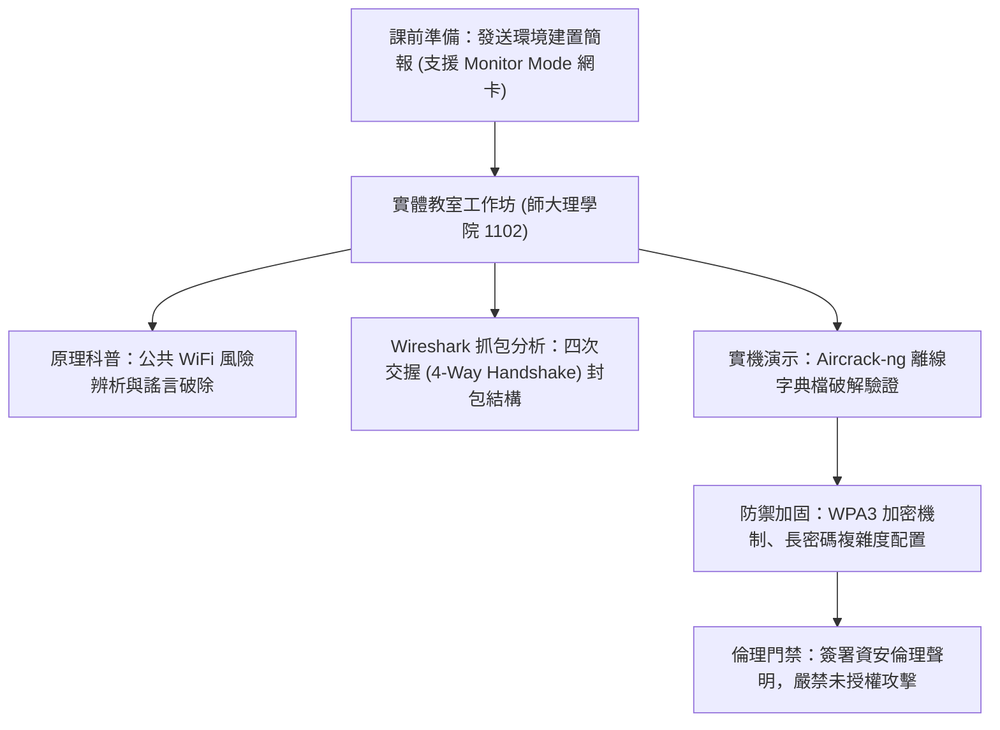

# 🛡️ AIS3 社團成果提案：WiFi Crack 與無線空口滲透工作坊 (師大 GDG / 清大)

> **活動名稱**：教育部 AIS3 資安社團幹部研習營（社團企劃成果發表）  
> **提案團隊**：師大 GDG 學生開發者社群、清華大學資安同儕  
> **核心主題**：WiFi 安全科普、Kali Linux 監聽模式、Wireshark 封包監聽與合規倫理聲明  
> **關聯文件**：[📄 完整原話逐字稿 (20260912-01-WiFi無線空口滲透工作坊提案.full.md)](./20260912-01-WiFi無線空口滲透工作坊提案.full.md)

---

## 🏛️ 核心架構與概念流轉圖

---

## 🔑 重點提要 (Key Takeaways)

1. **環境前置作業關鍵**：WiFi 實作工作坊最大痛點在於學員網卡硬體是否支援 Monitor Mode 與封包注入。主辦方提前發布測試簡報並安排提早半小時現場除障。
2. **資安倫理與法律聲明**：技術教學必須嚴格宣告僅限離線隔離環境與主辦方熱點測試，切實遵守法律紅線。
