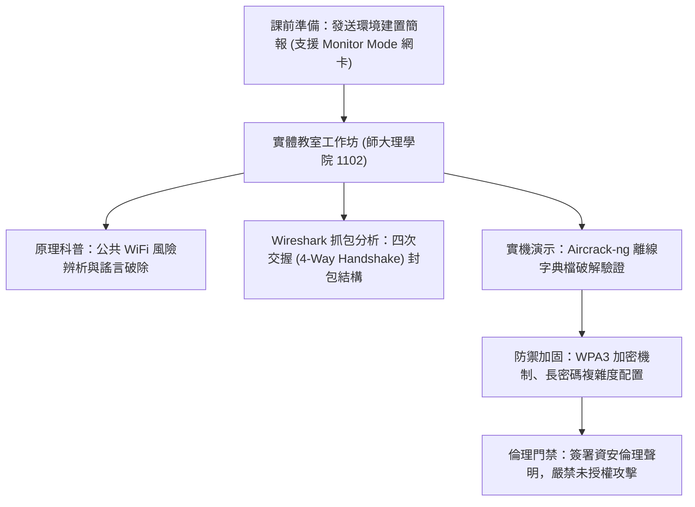

# 🛡️ AIS3 社團成果提案：WiFi Crack 與無線空口滲透工作坊 (師大 GDG / 清大)

> **活動名稱**：教育部 AIS3 資安社團幹部研習營（社團企劃成果發表）  
> **提案團隊**：師大 GDG 學生開發者社群、清華大學資安同儕  
> **核心主題**：WiFi 安全科普、Kali Linux 監聽模式、Wireshark 封包監聽與合規倫理聲明  
> **關聯文件**：[📄 完整原話逐字稿 (20260912-01-WiFi無線空口滲透工作坊提案.full.md)](./20260912-01-WiFi無線空口滲透工作坊提案.full.md)

---

## 🏛️ 核心架構與概念流轉圖

---

## 🔑 重點提要 (Key Takeaways)

1. **環境前置作業關鍵**：WiFi 實作工作坊最大痛點在於學員網卡硬體是否支援 Monitor Mode 與封包注入。主辦方提前發布測試簡報並安排提早半小時現場除障。
2. **資安倫理與法律聲明**：技術教學必須嚴格宣告僅限離線隔離環境與主辦方熱點測試，切實遵守法律紅線。

---

## 📊 工作坊執行流程、硬體環境門檻與資安倫理防線設計

| 階段模組 | 執行時程與場地配置 | 核心技術操作與教學設計 | 風險控管與新手友善配套措施 |
| :--- | :--- | :--- | :--- |
| **課前環境整備與報到除障** | 活動前三天寄發環境建置簡報；當日於師大理學院 1102 教室提早 30 分鐘開放報到 | 預先安裝 Kali Linux 虛擬機並驗證外接無線網卡是否支援 **Monitor Mode（監聽模式）**與封包注入 | 安排現場助教駐點協助驅動程式除錯，避免學員因虛擬機 USB 穿透失敗而無法跟上實作 |
| **無線空口封包擷取與離線破解** | 破除「連上免費公共 WiFi 就會立刻被盜刷」之誇大迷思，回歸協定底層原理 | 使用 Wireshark 觀察 802.11 四次交握（4-Way Handshake）封包結構，並以 Aircrack-ng 針對主辦方自建測試熱點執行字典檔離線碰撞 | 嚴格限制僅能攻擊主辦方指定之隔離測試 AP，全體學員於課前簽署**資安倫理與合法授權聲明書** |
| **企業與個人無線網路防禦加固** | 比較 WEP / WPA2 / WPA3 歷代加密協定之安全強度差異 | 演練如何透過高熵值長密碼與開啟 WPA3 SAE（Simultaneous Authentication of Equals）抵禦離線字典破解 | 課後發放回饋表單統計完訓率，並引導有志深入研究之學員銜接後續進階網路安全社課 |

